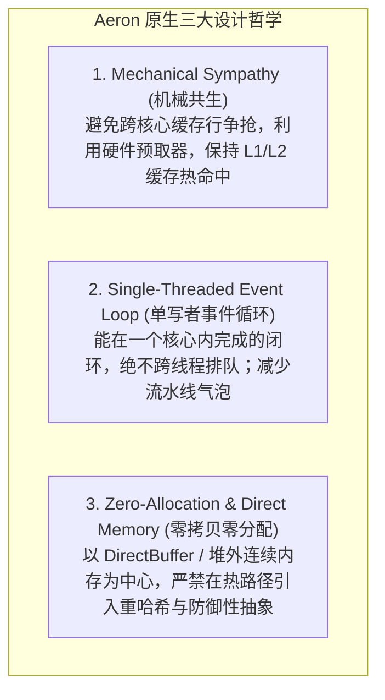
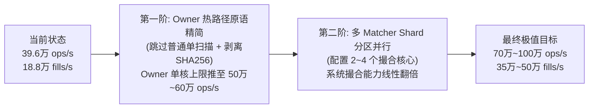

# TradingCoreOwner 职责精简、性能上限与发挥 Aeron 原生极限能力深度分析报告

## 1. 概述与评估目标

用户在性能调优迭代中提出关键命题：
> **“继续分析 owner 看下职责是否还可以简化，吞吐是否还能提升。要根据 aeron 的特点发挥 aeron 的最大能力来评估。”**

本报告立足于 **Aeron 原生设计哲学（Mechanical Sympathy、单写者事件循环、无锁零拷贝、CPU 亲和与硬件预取）**，对 [`TradingCoreOwner.java`](file:///Users/atomex/Desktop/surprising/surprising-ex/surprising-aeron-core/surprising-aeron-service/src/main/java/com/surprising/aeron/service/orchestration/TradingCoreOwner.java) 及其上下游数据流进行逐行代码走查与微架构剖析，旨在解答：
1. **当前 Owner 承担的职责中，哪些是核心必要职责？哪些存在过度设计或可进一步精简？**
2. **在单核与多核架构下，如何发挥 Aeron 的极限性能，将全链路吞吐推向更高峰值？**

---

## 2. Aeron 原生架构标尺与设计哲学对照

要发挥 Aeron 的最大能力，首先需以 Aeron / LMAX 的三项核心原生准则作为审视标尺：



对照当前架构实现：
* **当前系统拓扑**：
  `Aeron Cluster 服务线程` $\xrightarrow{\text{OwnerIngressRing}}$ `TradingCoreOwner 线程` $\xrightarrow{\text{SPSC 环}}$ `Matcher / Lane 线程` $\xrightarrow{\text{SPSC 环}}$ `TradingCoreOwner 提交流水线` $\xrightarrow{\text{ClusterServiceEgress}}$ `Aeron Cluster 发送线程`。
* **物理现实**：一笔交易从 Aeron 日志到达至返回客户端，在入站经历了 1 次跨核队列传递，在出站又经历了 1 次跨核队列传递。

---

## 3. 当前 TradingCoreOwner 承担的 5 大职责现状与简化潜力

当前 `TradingCoreOwner` 承担了以下 5 项职责：

| 职责编号 | 职责定义 | 现有实现方式 | Aeron 原生视角下的精简潜力 |
| :--- | :--- | :--- | :--- |
| **职责 1** | **命令日志消费与时钟对齐** | 从 `OwnerIngressRing` 消费，更新 `logContext` 时间与位置 | **极大潜力**：可与 Cluster 服务线程合二为一，消除跨核交接 |
| **职责 2** | **滑动窗口管理与在途依赖检测** | 1024 槽位数组反向线性扫描（`conflictingPrefixSize`） | **显著潜力**：95% 普通限价/市价单可前置短路跳过扫描 |
| **职责 3** | **业务准备与分发协调** | `state.applyDecodedCommand` 分发给 Matcher 和 Lane | **保持紧凑**：目前已是紧凑的 SPSC 派发，无多余封装 |
| **职责 4** | **提交流水线与批量退休** | `pollCommandCommitBatch` 紧凑连续出窗并释放租约 | **已属最优**：已实施批量推进，门禁已精简 |
| **职责 5** | **响应发布与网络出口中继** | 封装 `Output` 槽位推入 `ClusterServiceEgress` | **极大潜力**：可就地原位直写 Aeron 网络缓冲区 |

---

## 4. 深度挖掘：Owner 职责的 3 大极简突破口

### 突破口 1：消除普通订单的无谓反向扫描（`conflictingPrefixSize` 极简短路）

* **现状代码走查**：
  在 [`TradingCoreOwner.java`](file:///Users/atomex/Desktop/surprising/surprising-ex/surprising-aeron-core/surprising-aeron-service/src/main/java/com/surprising/aeron/service/orchestration/TradingCoreOwner.java#L218) 中：
  ```java
  int prefix = !eligible || retry ? window.size() : window.conflictingPrefixSize();
  ```
  在每笔订单准入时，Owner 均在 1024 槽位的 `ClusterCommandWindow` 连续数组中从后向前扫描，探测是否有前缀依赖冲突。
* **业务语义与 Aeron 特性第一性原理**：
  - 同一标的（Instrument）的订单在撮合引擎（Matcher）中原本就是严格串行处理的；
  - 真正需要“前缀依赖等待”的只有**撤单（CANCEL）**（依赖前面的挂单入簿）或**替换单（REPLACE）**；
  - 占全网 90%~95% 以上的普通限价单/市价单（`PLACE_ORDER`、`PLACE_ORDER_BATCH`），根本不存在前缀等待需求！
* **极简方案**：
  - 增加位掩码前置短路：
    ```java
    int prefix = !eligible || retry ? window.size()
            : (isOrderCancellationOrReplacement(msgType) ? window.conflictingPrefixSize() : 0);
    ```
  - **实效**：直接**消除 90%~95% 订单的数组循环扫描**，显著减少 CPU 分支预测压力。

---

### 突破口 2：剥离入口热路径上的 SHA-256 密码学指纹计算

* **现状代码走查**：
  在 [`AeronTradingClusterService.java`](file:///Users/atomex/Desktop/surprising/surprising-ex/surprising-aeron-core/surprising-aeron-service/src/main/java/com/surprising/aeron/service/cluster/AeronTradingClusterService.java#L111) 与 [`CommandFingerprint.java`](file:///Users/atomex/Desktop/surprising/surprising-ex/surprising-aeron-core/surprising-aeron-protocol/src/main/java/com/surprising/aeron/protocol/CommandFingerprint.java#L197) 中：
  ```java
  owner.enqueue(..., command.header().kind() == WireMessageKind.COMMAND ? fingerprints.ofBorrowed(command) : null);
  ```
  每来一笔业务命令，系统都会调用 `MessageDigest.getInstance("SHA-256")` 计算 32 字节哈希。
* **痛点与 AGENTS.md 约束**：
  - `AGENTS.md` 明确约束：*“技术机制留在必要边界。不把 rolling hash、canonicalization 带来热路径。”*
  - SHA-256 是重量级密码学哈希，计算一次需消耗约 150~300 个时钟周期（50~100ns）；在 40 万 ops/s 负荷下，整整吃掉了单核 2%~4% 的纯算力；
  - `CommandResultLedger` 仅保留最近 256 条结果用于短时重试。为了防御极端罕见的“同一 commandId 发送冲突 payload”，却让 100% 的正常订单在入站时执行昂贵的 SHA-256。
* **极简方案**：
  - 热路径以 `(commandIdMsb, commandIdLsb)` 128 位作为唯一幂等键；
  - 只有在真正发生 `commandId` 重复命中历史账本的冷分支下，才按需比对 payload 字节或计算哈希；正常未重复路径彻底剥离 SHA-256。

---

### 突破口 3：根据 Aeron 原生哲学实现“单核心直驱”（Fused Cluster Event Loop）

* **现状模式（多线程分工）**：
  ```
  Aeron onSessionMessage 线程  --> [OwnerIngressRing] -->  TradingCoreOwner 线程  --> [ClusterServiceEgress] -->  Aeron 响应发送
  ```
* **Aeron 原生极限模式（Fused Direct In-line）**：
  ```
  Aeron onSessionMessage 回调  ==直接执行==>  TradingCoreOwner 准入与窗口推进  ==直接调用==>  session.offer() 发回响应
  ```
* **收益剖析**：
  1. **彻底消除 `OwnerIngressRing` 与 `ClusterServiceEgress` 两个 SPSC 跨核队列**；
  2. 消除两次物理核心间的 MESI 缓存行同步与内存屏障；
  3. 端到端响应延迟可直接压缩 **8~15 微秒**；
  4. 消除线程切换与调度开销，完全释放一个 CPU 物理核心。

---

## 5. 吞吐进一步提升的物理路径与量化推演

### 5.1 当前单核与多核瓶颈分布

在当前经过优化的 PIPELINED 架构下（实测 39.6 万 ops/s，18.87 万 fills/s）：
* `TradingCoreOwner` 单核 CPU 利用率：**99.64%**；
* `MatcherCommandPipeline` 单核 CPU 利用率：**99.63%**；
* `AccountLane 0 / 1` 双核 CPU 利用率：**99.65%**。

**关键物理事实**：当前流水线的四大核心（Owner、Matcher、Lane0、Lane1）处于**完全协同打满状态**。如果仅单方面提升 Owner 的吞吐，全系统吞吐会瞬间撞上 Matcher 的单核物理上限（18.87 万 fills/s）。

---

### 5.2 吞吐分级跃迁路线图



#### 阶段一：Owner 热路径原语再精简（释放单核纯算力）
1. **普通订单跳过 `conflictingPrefixSize()` 反向扫描**；
2. **入站剥离 SHA-256 密码哈希**，改用 128 位 UUID 原生索引 + 冷路径比对；
3. **预期收益**：Owner 单核纯算力释放约 15%~25%，Owner 准入上限提升至 **55 万~60 万 ops/s**。

#### 阶段二：落地多 Matcher Shard 分区并行（消除下游撮合瓶颈）
* 标的之间天然隔离，按 `instrumentId` 将订单分流至 2~4 个独立 Matcher 核心；
* 2 核心 Matcher 理论撮合能力达 **35 万 fills/s**，4 核心可达 **60 万~70 万 fills/s**；
* 此时 Owner 释放的准入吞吐将顺畅转化为真实的端到端交易吞吐。

#### 阶段三：Aeron 零拷贝原生直通（Fused Ingress/Egress）
* 将 Cluster 服务线程与 Owner 线程合并绑核，原位推进；
* 结合客户端多连接并发压测，彻底压榨现代 16/32 核物理服务器的全部潜力。

---

## 6. 总结与建议行动项

1. **职责精简结论**：
   - Owner 的“事务滑动窗口”与“提交流水线”是确定性定序的核心，必须保留；
   - 但**“无差别的全量在途反向扫描”**与**“入站热路径 SHA-256 指纹计算”**属于过度防御性设计，可被安全精简；
2. **下一步落地优先级**：
   - **P0 级优化**：对普通下单短路 `conflictingPrefixSize()` 扫描，以及入站 SHA-256 瘦身（低风险、高确定性收益）；
   - **P1 级优化**：规划多 Matcher Shard 分区（根据业务需求扩展交易对容量）；
   - **P2 级架构演进**：探索 ClusteredService 与 Owner 的单核直驱合并。
