# Surprising EX

Surprising EX is a Java exchange backend with an Aeron Cluster trading core. Each product line has its own ordered command stream, instruments, account state, matching books, and recovery data. Gateway, Price, Realtime, Derivatives Lifecycle, and Maker provide the surrounding application services.

This guide describes the current source layout. Arrows in class flowcharts show processing stages and ownership handoffs; they do not imply that every edge is a direct Java method call. Business variants share the common admission, matching, settlement, and commit stages shown below.

## Product lines

| Product | Core scope |
| --- | --- |
| Spot | Asset reservation, matching, and asset settlement |
| Linear perpetual | Quote-asset margin, positions, funding, and liquidation |
| Inverse perpetual | Base-asset margin, inverse accounting, funding, and liquidation |
| Linear delivery | Quote-asset margin and expiry settlement |
| Inverse delivery | Inverse accounting and expiry settlement |
| Options | Premiums, positions, exercise, and expiry settlement |

`LINEAR_PERPETUAL` is the product used by the local single-node launcher. Do not reuse a product's data directory or source identity for another product.

## System architecture

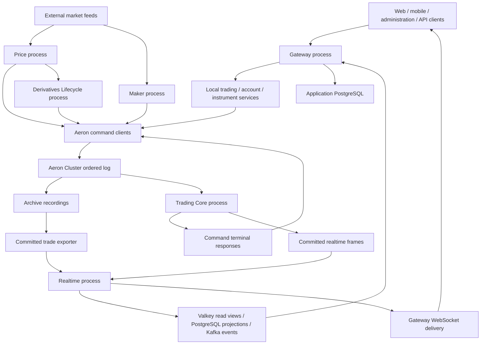

Gateway is the unified application for authentication, trading, accounts, and instrument administration. These are Java package boundaries inside Gateway, not four separate production processes. Trading authority remains in Core. PostgreSQL and Valkey projections are query and workflow stores; they must not become competing sources of balances, frozen funds, positions, or matching truth.

Aeron Archive records the cluster log. Archive participation does not by itself establish a per-response filesystem `fsync` guarantee. Lossy realtime delivery and reliable committed-log export are separate paths.

## Maven modules and processes

| Directory | Type | Responsibility |
| --- | --- | --- |
| [surprising-parent](surprising-parent) | Parent POM | Dependency versions, build plugins, and shared constraints |
| [surprising-instrument-api](surprising-instrument-api/README.md) | Library | Product identity, instrument contracts, snapshots, and shared contract mathematics |
| [surprising-trading-api](surprising-trading-api/README.md) | Library | Trading, account, transfer, and settlement contracts, rules, and shared calculations |
| [surprising-aeron-core](surprising-aeron-core/README.md) | Module group | Protocol, client, service, tools, and benchmarks |
| [surprising-gateway](surprising-gateway/README.md) | Application | Security, REST/WebSocket, local business services, and product containers |
| [surprising-price](surprising-price/README.md) | Module group | External index prices, mark prices, FX, and option reference quotes |
| [surprising-realtime](surprising-realtime/README.md) | Module group | Realtime routing, read views, committed export, candles, and history |
| [surprising-derivatives-lifecycle](surprising-derivatives-lifecycle/README.md) | Module group | Funding, risk scans, liquidation, insurance, and ADL orchestration |
| [surprising-maker](surprising-maker/README.md) | Application | Reference-market quoting and controlled load generation |

The parent POM and the root reactor are build structures, not runtime services. The six-process single-product backend consists of Core, Gateway, Price, Realtime, Derivatives Lifecycle, and Maker. Wallet is external and is not started by default.

## State and thread ownership

| Owner | State and work | Completion boundary |
| --- | --- | --- |
| Cluster service thread / [TradingCoreOwner](surprising-aeron-core/surprising-aeron-service/src/main/java/com/surprising/aeron/service/core/TradingCoreOwner.java) | Command scheduling, dependency barriers, ordered retirement, Treasury, result identities, and committed metadata | Original cluster-log order |
| Matcher shard | Native order book and matching facts | Matching result and settlement publication |
| Account Lane | User balances, holds, reservations, orders, positions, and account risk | Account result and commit acknowledgement |
| Realtime transport | Publications, subscriptions, and copied frames | Transport ownership only; no trading-state mutation |
| Application processes | Configuration, orchestration, durable projections, and user-facing queries | Application-specific transactions and checkpoints |

`OrderBookRouter` runs Matcher shard threads. `SettlementLaneWorker` runs Account Lane threads. Treasury work remains on Owner; there is no separate authoritative ledger thread.

```mermaid
flowchart LR
    Ingress[OwnerIngressRing] --> Owner[TradingCoreOwner]
    Owner --> Window[OrderCommandQueue.IngressWindow]
    Window --> Admission[OrderCheckService]
    Admission --> Matcher[OrderBookRouter]
    Matcher --> Settlement[SettlementLaneWorker]
    Settlement --> Commit[OrderCommitService]
    Commit --> Treasury[SystemFunds on Owner]
    Treasury --> Publish[OrderCommitService.Publication]
    Publish --> Response[ResponseSlotPool / committed realtime output]
```

`OrderCommandQueue.IngressWindow` is a bounded FIFO of admitted, unretired commands. It retains input leases and routing metadata and tracks dependencies on the same user or referenced order. It is not an order book. The client in-flight limit is a different bound on outstanding requests. The current Core window accepts powers of two from 64 to 4096; 256 is the documented local qualification baseline, not a proven physical capacity limit.

## Source navigation

Core classes below are under [the Aeron service source tree](surprising-aeron-core/surprising-aeron-service/src/main/java/com/surprising/aeron). Application trading/account/instrument classes are under [the Gateway source tree](surprising-gateway/src/main/java/com/surprising).

| Concern | Main packages / classes |
| --- | --- |
| Node lifecycle | `bootstrap.SurprisingCoreApplication`, `config`, `bootstrap.AeronCoreLifecycle` |
| Replicated-log callback | `controller.AeronTradingClusterService` |
| Scheduling and dispatch | `service.core.TradingCoreOwner`, [TradingCore](surprising-aeron-core/surprising-aeron-service/src/main/java/com/surprising/aeron/service/core/TradingCore.java), `support.ingress.OwnerIngressRing` |
| Order dispatch | `service.order.OrderCheckService`, [OrderCommand](surprising-aeron-core/surprising-aeron-service/src/main/java/com/surprising/aeron/service/order/OrderCommand.java), [OrderCommandQueue](surprising-aeron-core/surprising-aeron-service/src/main/java/com/surprising/aeron/service/order/OrderCommandQueue.java), [OrderMatchingFlow](surprising-aeron-core/surprising-aeron-service/src/main/java/com/surprising/aeron/service/order/OrderMatchingFlow.java), [OrderBatchProcessor](surprising-aeron-core/surprising-aeron-service/src/main/java/com/surprising/aeron/service/order/OrderBatchProcessor.java) |
| Account admission | `service.order.OrderCheckService`, `service.account.AccountPartition` |
| Matching | `service.matcher.OrderBookEngine`, `service.matcher.OrderBookRouter` |
| Settlement | `bootstrap.account.SettlementLaneWorker`, `service.settlement.TradeSettlement`, [SpotTradeSettlementService](surprising-aeron-core/surprising-aeron-service/src/main/java/com/surprising/aeron/service/settlement/SpotTradeSettlementService.java), [DerivativeTradeSettlementService](surprising-aeron-core/surprising-aeron-service/src/main/java/com/surprising/aeron/service/settlement/DerivativeTradeSettlementService.java) |
| Ordered publication | `service.order.OrderCommitService`, [OrderCommitService.Publication](surprising-aeron-core/surprising-aeron-service/src/main/java/com/surprising/aeron/service/order/OrderCommitService.java) |
| Identity and retention | `service.result.CommandResultLog`, [FundsCommandIndex](surprising-aeron-core/surprising-aeron-service/src/main/java/com/surprising/aeron/service/result/FundsCommandIndex.java), `service.retention.CompletedOrderArchive` |
| Risk and lifecycle | `service.risk`, `service.liquidation`, `service.funding`, `service.insurance`, `service.adl`, [ContractExpirySettlementService](surprising-aeron-core/surprising-aeron-service/src/main/java/com/surprising/aeron/service/settlement/ContractExpirySettlementService.java) |
| Snapshot and recovery | `service.snapshot.CoreSnapshotLifecycle`, [SectionedCoreSnapshotRecovery](surprising-aeron-core/surprising-aeron-service/src/main/java/com/surprising/aeron/service/snapshot/SectionedCoreSnapshotRecovery.java) |

## Trading flows by business operation

### 1. Order entry and transport

```mermaid
flowchart LR
    HTTP[OrderInternalController / request handlers] --> OS[OrderService]
    OS --> Rules[Normalize request / resolve BBO / validate product and order rules]
    Rules --> ID[StableOrderIdentity + TradingCommandCodec]
    ID --> OAG[OrderAeronGateway]
    OAG --> Pool[AeronClientPool]
    Pool --> Session[SurprisingAeronClient]
    Session --> Cluster[Aeron Cluster log]
    Cluster --> Callback[AeronTradingClusterService]
    Callback --> Ring[OwnerIngressRing]
    Ring --> Owner[TradingCoreOwner]
    Owner --> Runtime[TradingCore.applyDecodedCommand]
```

Gateway performs request validation and encoding. Core makes the authoritative reservation, margin, position, and execution decisions. A transport timeout or an unknown command outcome is not evidence of business rejection or permission to submit a new funds identity.

### 2. Place order: admission, matching, and settlement

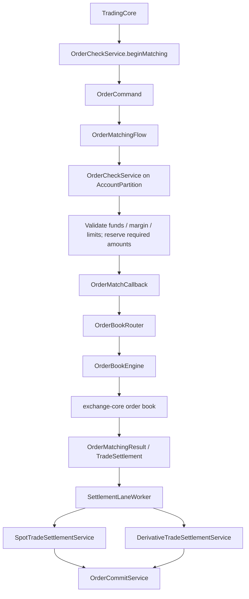

Matcher owns book mutations. Account Lanes own the resulting user accounting. A match alone is not the command's final response: the required account and Owner commit stages must complete.

### 3. Cancel, replace, and amend

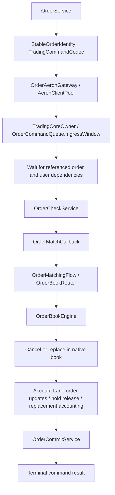

Replace/amend carries both the original and replacement identities. Decode the returned command result for the outcome of each order; do not infer atomic success from transport acceptance. Cancellation dependencies are based on actual order identities, not an assumed relationship between Matcher and account shards.

### 4. Batch placement, cancellation, and amendment

```mermaid
flowchart LR
    OS[OrderService: validate batch] --> Codec[TradingOrderBatchCodec]
    Codec --> Gateway[OrderAeronGateway]
    Gateway --> Owner[TradingCoreOwner / TradingCore]
    Owner --> Batch[OrderBatchProcessor]
    Batch --> Slots[Admission and matching work for batch items]
    Slots --> Matching[OrderMatchingFlow / OrderBookRouter]
    Matching --> Lanes[Account Lane settlement]
    Lanes --> Commit[OrderCommitService]
    Commit --> Response[CoreOrderBatchResult / per-item outcomes]
```

Gateway validates the batch before submission. Core retains per-item outcomes and the original command identity. A batch message, an order item, and a matched trade are different counting units. Borrowed batch response slices must be copied before their `ResponseSlotPool` lease ends if they need to outlive that lease.

### 5. Ordered commit, funds audit, and response

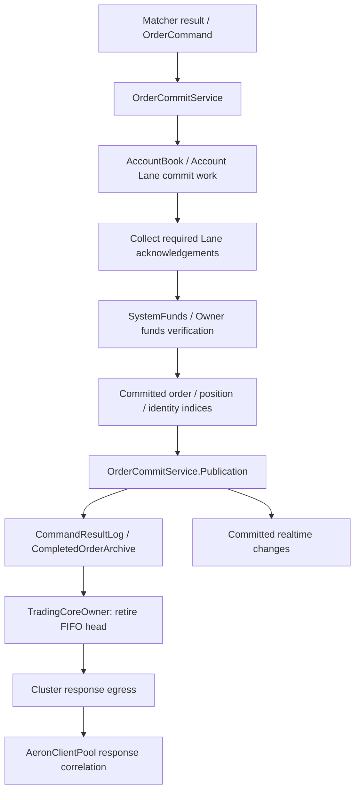

Results become terminal only after the required business work and ordered commit. `OrderCommand` slots, decoded inputs, and `ResponseSlotPool` buffers retain explicit lifetimes. Business rejection and runtime failure are different paths; funds-validation failures propagate instead of becoming successful responses.

### 6. Trigger and algorithmic orders

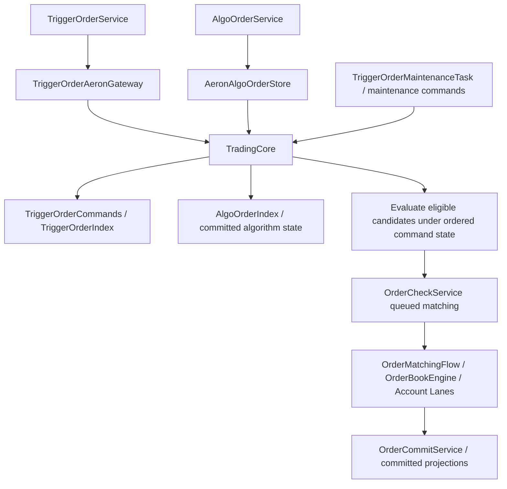

The scheduling and index stages select work; generated orders still use the real matching and accounting path. Client order identity checks read the owning Account Lane's authoritative state. Read models do not independently trigger execution.

### 7. Prices, funding, and derivative lifecycle

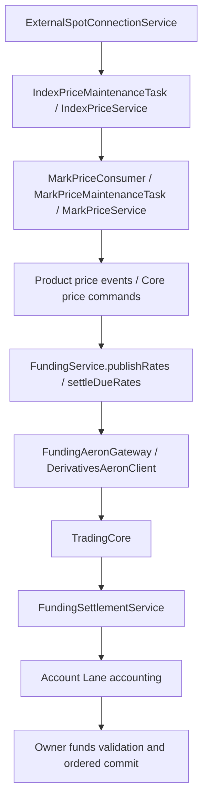

Funding freezes the applicable inputs and advances settlement using a stable settlement identity and cursor. Previous-period progress is checked before starting or continuing a period. Funding components load only for perpetual products. Index, mark, order-limit, and actual execution prices have distinct meanings and must not be substituted for each other.

### 8. Risk, liquidation, insurance, ADL, and expiry

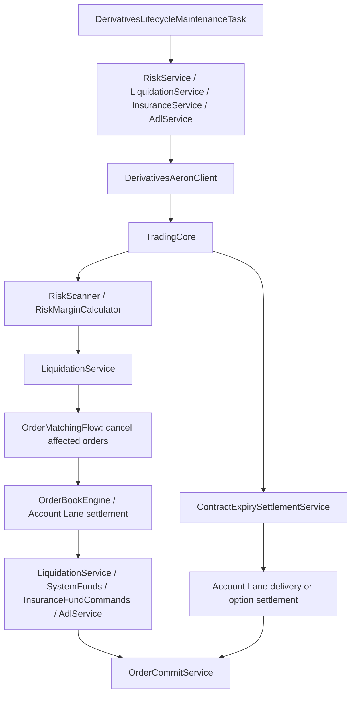

These are related command families, not one unconditional sequence. Insurance and ADL depend on the actual deficit and resolution state; expiry/exercise uses the relevant product's settlement rules. Control commands may keep a financial scope open across asynchronous account work. They must not commit while required insurance reservations or accounting work remain incomplete.

### 9. Funds commands and cross-product transfers

```mermaid
flowchart LR
    Transfer[ProductTransferService] --> Product[ProductTransferInternalController / product account services]
    Product --> Client[Aeron account command client]
    Client --> Core[TradingCoreOwner / TradingCore]
    Core --> Identity[FundsCommandIndex / fingerprint and source checks]
    Identity --> Account[Owning Account Lane + Treasury accounting]
    Account --> Commit[Ordered terminal result]
    Commit --> Reconcile[ProductTransferReconciliationTask]
```

Products are separate state machines. The application coordinator persists transfer workflow progress; it does not make two product clusters one transaction. Preserve command identities and reconcile unknown outcomes. [FundsCommandIndex](surprising-aeron-core/surprising-aeron-service/src/main/java/com/surprising/aeron/service/result/FundsCommandIndex.java) is durable through Core snapshots/log recovery; its capacity exhaustion is a system failure, not permission to forget old identities.

### 10. Queries, WebSocket delivery, and reliable export

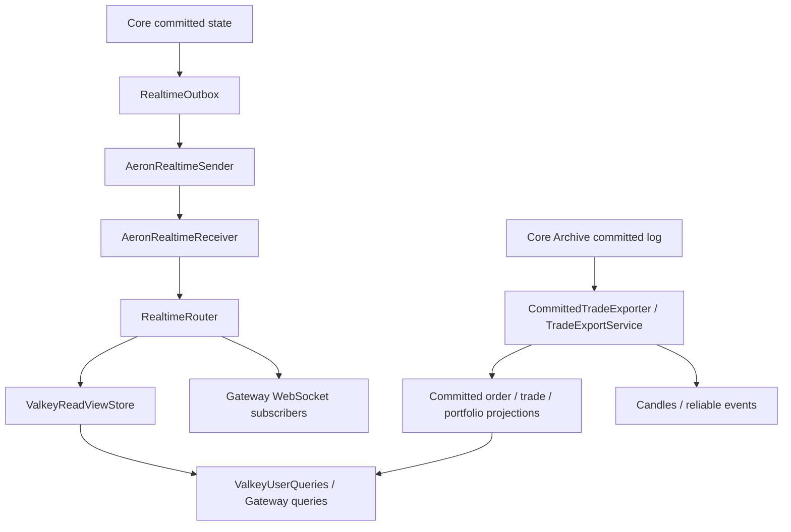

Realtime output can lose complete callbacks under bounded-capacity pressure. Receivers validate complete commit/snapshot boundaries and recover continuity before serving current state. Reliable export uses its own committed-log checkpoint. Ordinary order/account queries use Realtime read views and committed history where supported; an unavailable view does not silently fall back to Core or a stale database balance.

### 11. Startup, snapshots, and recovery

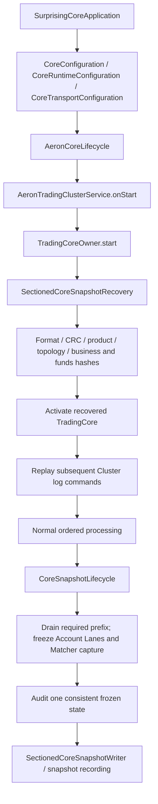

Recovery restores Core authority from its snapshot and following cluster log, not from application projections. Account state, books, Treasury, result identities, source progress, and topology must refer to the same frozen boundary. Unsupported snapshot formats are rejected. Do not delete Archive or snapshot data as a substitute for recovery.

### 12. Account controls, instrument configuration, and fee policy

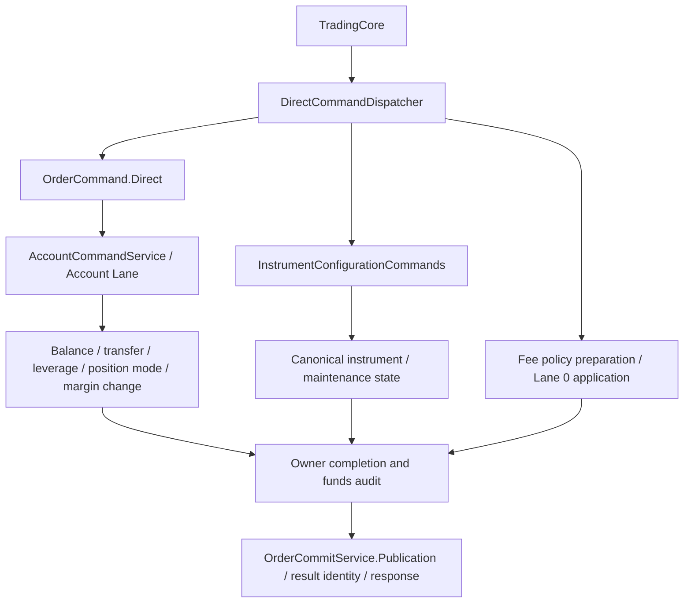

Dispatch success only means a branch was selected. [OrderCommand.Direct](surprising-aeron-core/surprising-aeron-service/src/main/java/com/surprising/aeron/service/order/OrderCommand.java) can retain asynchronous work until the owning Lane and financial scope finish. TRANSFER_IN validates both the recipient and target product before applying funds. Fee-policy publication does not rewrite rates already frozen on existing orders.

| Command family | Dispatch and business classes |
| --- | --- |
| Balance / transfer out / transfer in / complete transfer | [DirectCommandDispatcher](surprising-aeron-core/surprising-aeron-service/src/main/java/com/surprising/aeron/service/core/command/DirectCommandDispatcher.java) → [OrderCommand.Direct](surprising-aeron-core/surprising-aeron-service/src/main/java/com/surprising/aeron/service/order/OrderCommand.java) → [AccountCommandService](surprising-aeron-core/surprising-aeron-service/src/main/java/com/surprising/aeron/service/account/AccountCommandService.java) |
| Position mode / leverage / position margin | [DirectCommandDispatcher](surprising-aeron-core/surprising-aeron-service/src/main/java/com/surprising/aeron/service/core/command/DirectCommandDispatcher.java) → [OrderCommand.Direct](surprising-aeron-core/surprising-aeron-service/src/main/java/com/surprising/aeron/service/order/OrderCommand.java) → [AccountCommandService](surprising-aeron-core/surprising-aeron-service/src/main/java/com/surprising/aeron/service/account/AccountCommandService.java) |
| Instrument registration / maintenance | [DirectCommandDispatcher](surprising-aeron-core/surprising-aeron-service/src/main/java/com/surprising/aeron/service/core/command/DirectCommandDispatcher.java) → [InstrumentConfigurationCommands](surprising-aeron-core/surprising-aeron-service/src/main/java/com/surprising/aeron/service/instrument/command/InstrumentConfigurationCommands.java) |
| Fee policy | [DirectCommandDispatcher](surprising-aeron-core/surprising-aeron-service/src/main/java/com/surprising/aeron/service/core/command/DirectCommandDispatcher.java) → Lane 0 application → [OrderCommitService.Publication](surprising-aeron-core/surprising-aeron-service/src/main/java/com/surprising/aeron/service/order/OrderCommitService.java) |
| Mark price | [DirectCommandDispatcher](surprising-aeron-core/surprising-aeron-service/src/main/java/com/surprising/aeron/service/core/command/DirectCommandDispatcher.java) → [RiskMarginCalculator](surprising-aeron-core/surprising-aeron-service/src/main/java/com/surprising/aeron/service/risk/RiskMarginCalculator.java) → trigger scan initialization |
| Risk continuation | [DirectCommandDispatcher](surprising-aeron-core/surprising-aeron-service/src/main/java/com/surprising/aeron/service/core/command/DirectCommandDispatcher.java) → [RiskScanner](surprising-aeron-core/surprising-aeron-service/src/main/java/com/surprising/aeron/service/risk/RiskScanner.java) + remaining trigger budget |
| Funding | [DirectCommandDispatcher](surprising-aeron-core/surprising-aeron-service/src/main/java/com/surprising/aeron/service/core/command/DirectCommandDispatcher.java) → [FundingSettlementService](surprising-aeron-core/surprising-aeron-service/src/main/java/com/surprising/aeron/service/funding/FundingSettlementService.java) |
| Insurance adjustment | [DirectCommandDispatcher](surprising-aeron-core/surprising-aeron-service/src/main/java/com/surprising/aeron/service/core/command/DirectCommandDispatcher.java) → [InsuranceFundCommands](surprising-aeron-core/surprising-aeron-service/src/main/java/com/surprising/aeron/service/insurance/command/InsuranceFundCommands.java) |
| Liquidation resolution / ADL | [DirectCommandDispatcher](surprising-aeron-core/surprising-aeron-service/src/main/java/com/surprising/aeron/service/core/command/DirectCommandDispatcher.java) → [LiquidationService](surprising-aeron-core/surprising-aeron-service/src/main/java/com/surprising/aeron/service/liquidation/LiquidationService.java) / [AdlService](surprising-aeron-core/surprising-aeron-service/src/main/java/com/surprising/aeron/service/adl/AdlService.java) |
| Algorithm, cancel-all deadline, OCO, trigger claim/retry/expiry/execution | [DirectCommandDispatcher](surprising-aeron-core/surprising-aeron-service/src/main/java/com/surprising/aeron/service/core/command/DirectCommandDispatcher.java) → [TriggerOrderCommands](surprising-aeron-core/surprising-aeron-service/src/main/java/com/surprising/aeron/service/trigger/command/TriggerOrderCommands.java) |

### 13. Rejection, unknown outcome, and runtime fault

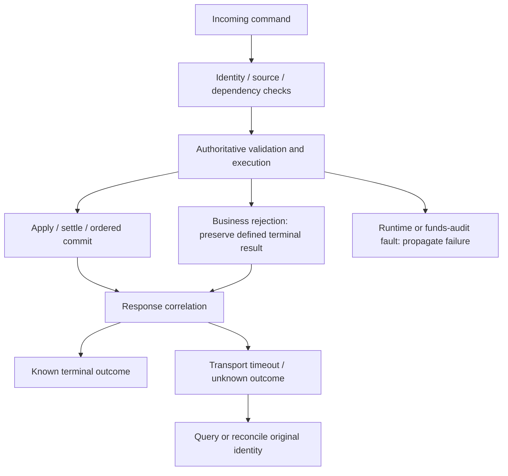

Unknown delivery is distinct from rejection. Never invent a new funds identity to hide an unresolved command. Rollback and lease retirement follow their actual business ownership boundaries; a failure must not be converted into a fabricated committed result.

## Build and local operation

Use HotSpot JDK 27. Version management is in [surprising-parent/pom.xml](surprising-parent/pom.xml): Spring Boot 4.1.2, Spring Cloud 2025.1.4, Aeron 1.54.0, Agrona 2.7.0, and the project fork of `exchange.core2:exchange-core:0.5.19-emporia`.

Install the matching dependency from the adjacent `exchange-core-lilaizhencn` checkout before the first build:

```bash
mvn -f ../exchange-core-lilaizhencn/pom.xml install
mvn -pl surprising-aeron-core/surprising-aeron-service -am package -DskipTests
```

Local integrated environment:

```bash
./scripts/local-perpetual.sh up
./scripts/local-perpetual.sh status
./scripts/local-perpetual.sh down
```

See [local perpetual deployment](deployment/local-perpetual/README.md) and [single-node test deployment](deployment/test-single-node/README.md) for prerequisites and data-directory rules. Existing databases require migrations, not repeated initialization. Production credentials belong outside version control. Public content uses the dedicated R2 bucket and external credential file described in [the legal/content deployment guide](deployment/legal/README.md).

## Verification and performance evidence

Run tests for the changed business and ownership boundaries. Protocol changes require producer/consumer checks; financial changes require funds, holds, positions, terminal-state, and recovery checks. A successful compile or benchmark launcher exit alone does not prove business correctness.

```bash
mvn -pl surprising-aeron-core/surprising-aeron-service -am test
mvn -pl surprising-gateway -am test
```

Performance procedures are defined in [AGENTS-performance.md](AGENTS-performance.md). The formal local topology is one real Aeron member, one Matcher, and global in-flight 256, with network, Archive, and Core retained. Report profiling separately from primary throughput. An in-flight limit reached under closed-loop load is not proof of Core saturation.

Historical observations and their limitations are in [PERFORMANCE_VALIDATION.md](PERFORMANCE_VALIDATION.md). These are evidence for their recorded versions and environments, not current capacity guarantees. Module READMEs are maintained as current source guides; historical change narratives remain in validation documents and Git history.
