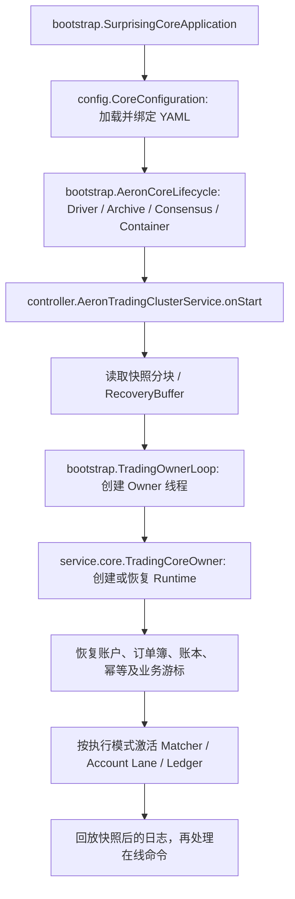
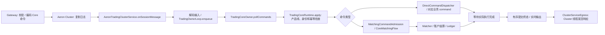

# Aeron Service 启动与命令流转图

当前源码按 `controller`、`config`、`bootstrap`、`service.<业务>`、`model`、`support` 分层。
完整配置、线程说明、下单步骤、撤单、触发单、风控、强平和恢复图统一维护在
[aeron-service README](../surprising-aeron-core/surprising-aeron-service/README.md)。
本文串起启动、标的注册、用户状态建立和直接账户命令，源码链接使用当前目录。

## 启动与状态建立

启动入口见 [SurprisingCoreApplication](../surprising-aeron-core/surprising-aeron-service/src/main/java/com/surprising/aeron/bootstrap/SurprisingCoreApplication.java)，
配置见 [CoreConfiguration](../surprising-aeron-core/surprising-aeron-service/src/main/java/com/surprising/aeron/config/CoreConfiguration.java)
和 [application.yml](../surprising-aeron-core/surprising-aeron-service/src/main/resources/application.yml)。
首次启动不自动从数据库补载余额、订单或持仓；重启通过快照与日志恢复已有状态。
六条产品线各有独立节点状态，注册标的和账户命令都必须属于当前产品线。

## 命令公共路径

[Controller](../surprising-aeron-core/surprising-aeron-service/src/main/java/com/surprising/aeron/controller/AeronTradingClusterService.java)
管理 Cluster 会话与协议回调，[TradingOwnerLoop](../surprising-aeron-core/surprising-aeron-service/src/main/java/com/surprising/aeron/bootstrap/TradingOwnerLoop.java)
管理线程和输入交接，[TradingCoreOwner](../surprising-aeron-core/surprising-aeron-service/src/main/java/com/surprising/aeron/service/core/TradingCoreOwner.java)
推进业务完成条件。[TradingCoreRuntime](../surprising-aeron-core/surprising-aeron-service/src/main/java/com/surprising/aeron/service/core/TradingCoreRuntime.java)
连接各业务入口；账户和订单簿继续由各自线程持有。
入队、撮合计算结束或内部 `MATCHING_PENDING` 都不能单独作为客户端交易终态。

## 注册标的与建立用户运行态

标的配置经 `REGISTER_INSTRUMENT` 进入
[InstrumentConfigurationCommands](../surprising-aeron-core/surprising-aeron-service/src/main/java/com/surprising/aeron/service/instrument/command/InstrumentConfigurationCommands.java)，
再由 [RuntimeInstrumentStateTransitions](../surprising-aeron-core/surprising-aeron-service/src/main/java/com/surprising/aeron/service/instrument/RuntimeInstrumentStateTransitions.java)
检查产品线、注册身份和配置更新约束。Gateway 的配置同步入口为
[InstrumentCoreSyncService](../surprising-gateway/src/main/java/com/surprising/trading/order/service/InstrumentCoreSyncService.java)。

Core 没有独立的 `CREATE_USER` 命令。首次合法账户命令可按自身规则物化用户运行态；
例如余额调整在所属 Account Lane 中创建或更新 `UserRuntime` 与 `BalanceRuntime`。
认证数据库的注册和 Core 中的用户运行态是不同职责，恢复已有用户也不等于重新注册。

## 余额、划转与杠杆

| 动作 | 按顺序阅读的源码 | 结束条件 |
| --- | --- | --- |
| 余额调整 | [BalanceTransferCommands.executeAdjustBalance](../surprising-aeron-core/surprising-aeron-service/src/main/java/com/surprising/aeron/service/account/command/BalanceTransferCommands.java) → `DirectCommandSlot.deferBalanceAdjustment` → `RuntimeAccountStateTransitions` | 所属账户完成变更，并满足资金索引、提交与响应条件 |
| 跨产品划转 | 同类的 `executeTransferOut` / `executeTransferIn` / `executeCompleteTransfer` → `TransferRuntime` | 各复制命令保留自己的幂等身份与源/目标产品线检查；转出、转入和确认分别推进 |
| 杠杆调整 | [LeverageCommands.executeUpdateLeverage](../surprising-aeron-core/surprising-aeron-service/src/main/java/com/surprising/aeron/service/position/command/LeverageCommands.java) → `DirectCommandSlot.deferLeverageChange` → `DerivativeAccountCommandProcessor` | 所属账户完成保证金、持仓及杠杆规则检查与更新，再交给提交路径 |

生产异步路径通过已有控制槽和账户邮箱交接；冷执行路径仍调用既有状态转换。
业务拒绝按原结果返回；线程故障、不能确认的撮合分歧和恢复校验失败沿原有故障边界传播。

快照从 `AeronTradingClusterService.onTakeSnapshot` 经 Owner 动作边界进入
[CoreSnapshotLifecycle](../surprising-aeron-core/surprising-aeron-service/src/main/java/com/surprising/aeron/service/snapshot/CoreSnapshotLifecycle.java)。
先完成快照前缀，再捕获同一日志边界的账户、Matcher、账本及业务进度；恢复一起校验和还原。
