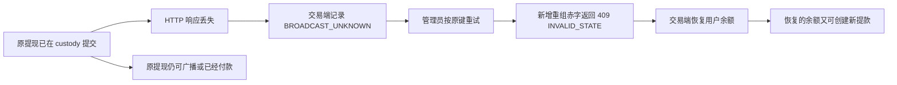

# 钱包 / custody 资金链路审计（2026-10-29）

## 结论

**当前充提链路不能视为完整闭环，不能承诺故障时绝不会重复出款。** 本轮确认并复现了手续费未执行、网络配置未在提交端强制校验、未知状态重试误退款、幂等哈希随估值变化等问题；已独立修复用户历史隔离和充值回调金额精度两项问题。其余问题没有冒充已修复。

| 用户关心的问题 | 核实结果 |
| --- | --- |
| 钱包功能是否完整 | 尚不完整。已有充提入口、签名认证、幂等、审批、事件、结算、Gas 账务和部分恢复，但下面的跨系统故障路径没有闭合。 |
| 后台提现手续费是否生效 | **没有进入实际扣款或净到账计算。** 配置能保存和展示，但提现只扣 `amountUnits`，custody 接收的还是原始 `amount`。 |
| 是否与链上手续费分开 | custody 的 Gas 账户/用量/NETWORK_FEE 流水与交易端手续费配置是不同模型；但是交易端平台费尚未执行，Web 还将该配置标成 “Configured network fee”，不能说已经正确完成两种费用的端到端计费和展示。 |
| 故障是否可能重复提币 | 同一幂等键和同一链上交易具有现成的防重保障；**未知结果被错误退款后，原提款仍可能执行，恢复的交易余额又可以创建新提款，因此仍有资金损失和再次出款风险。** |

审查基线为交易后端 `1d2e514ba` 的钱包相关源码与 custody `7d376c8`。工作区同时存在 KYC 和客户端界面任务；本轮保留其改动，只修改下述两个 Gateway 边界及相应测试。独立源码副本、初始/修复后哈希见 [source-hashes.json](source-hashes.json)。

## 仍未修复的阻断项

### A01 / P0：未知结果的后续拒绝，被当作原提款未发生并退款

交易端 [CustodyWithdrawalService](../../../surprising-gateway/src/main/java/com/surprising/gateway/provider/service/CustodyWithdrawalService.java) 的 `continueSubmission` 捕获 `CustodyWalletRejectedException` 后直接进入退款，没有区分首次请求与曾经未知的重试。`CustodyWalletClient` 把 400/422，以及带 INVALID_STATE 的 409 当成可退款拒绝。

custody 的 [CustodyWithdrawalService](../../../../surprising-wallet/wallet-api/src/main/java/com/surprising/wallet/service/CustodyWithdrawalService.java) 在幂等回放之前检查重组赤字等可变条件。因此“第二次请求被拒绝”不证明“第一次请求没有提交”。



复现分为两个边界，均未向真实链发送资金：

- Gateway 探针模拟 custody 接单后丢失响应，再让重试返回带 INVALID_STATE 的 409；观察到正数退款 `adjustBalance` 和 REFUNDED 状态写入，模拟的已接受付款仍为一笔。
- PostgreSQL 探针先真正提交 custody 订单、冻结余额、事件和幂等响应，将原订单置于 SENT，真实插入重组赤字；同键请求在幂等回放前抛出状态异常，真实异常映射器返回 409 / INVALID_STATE，原订单和冻结仍存在。

关闭租户网络返回的是 403，本身不会被 Gateway 当作可退款拒绝；早期“关闭网络会退款”的推断已撤回。最终证据使用上面的重组赤字真实分支。401/403/普通 409/429 均作为未知结果保留，相关分类回归也已覆盖。

这证明错误退款决策及其必要前提成立；不是声称本轮真的执行了两次链上付款。修复必须引入可信的原意图终态/持久拒绝证据，并正确处理并发、进程崩溃和缓存过期。单纯依赖后来一次 HTTP 4xx 或“查询暂时没找到”不能授权退款。

### A02 / P1：后台提现手续费未实际收取

[AssetConfigurationService](../../../surprising-gateway/src/main/java/com/surprising/asset/service/AssetConfigurationService.java) 保存 `asset_networks.withdrawal_fee`，并检查手续费小于最低提现额。但 `CustodyWithdrawalService.submit` 只调用 `amountUnits`，没有读取网络手续费；持久化意图也没有独立的平台费、净到账、配置版本快照。

探针设置 2.5 USDT 手续费并申请 25 USDT，实际仍扣 25 USDT、向 custody 发送 25 USDT；网络配置仓储完全没有被读取。无论采取内扣还是额外加收口径，该配置都没有生效。

扣费口径尚待用户确认。本轮没有擅自改变提现金额、收款地址到账金额或平台收益账务。后续需要同时补齐服务端计费、幂等快照、退款、收入流水，以及 Web/App 的净到账和总扣款展示。

### A03 / P1：网络提现开关和最低额仅在展示/客户端层限制

[WalletFundingService](../../../surprising-gateway/src/main/java/com/surprising/gateway/provider/service/WalletFundingService.java) 的目录过滤会隐藏不支持的网络；但是提交链路没有强制读取对应 `asset_networks` 的 `withdrawal_enabled`、`min_withdrawal`。custody 自身的网络开关与交易后台的这个配置并不相同。

探针配置网络关闭、最低额 100，并直接提交 25，依然调用 custody 并得到 SUBMITTED。应在业务服务执行权威校验，同时让已存在的提现意图先按原身份恢复，避免新增可变校验继续破坏故障重试。

### A04 / P1：同一请求的幂等哈希包含实时估值

交易端 `canonical` 包含 `usdtValue`，每次 `submit` 都先重新估值。探针对同一地址、数量、用户和键的 1 ETH 请求依次返回 2500 / 2501 USDT 估值，得到不同请求哈希；实际 StateService 会拒绝该重试。

控制器还在进入本地幂等查询之前重新选择“当前有足额余额”的 custody 源地址。原提款冻结资金、地址版本变动或估值暂时不可用，都可能阻止恢复已有意图。身份必须来自稳定业务参数，风控估值和源地址在首次创建时确定，恢复时使用持久化快照。

### A05 / P2：提现历史查询协议不完整

Gateway 给 custody `/withdrawals` 传 `search=user:42`，但 custody 的提现查询搜索订单号、externalReference、目标地址和交易哈希，不搜索 subject。数据库探针确认：该用户真实订单存在，空搜索能返回它，`user:42` 搜索却返回空。

Gateway 本地意图会补回部分记录，因此界面未必全空，但 custody 的交易哈希和链上详情可能缺失。已加的用户精确过滤只堵住数据泄漏；要完整分页和查询，仍需 custody 提供独立、精确的 subject 过滤，而不是把全文搜索作为账户边界。

### A06 / P2：未知状态和长期重试的恢复仍不完整

- Gateway 的定时对账只选择 FAILED_PENDING；BROADCAST_UNKNOWN、遗留 DEBITED 和 SUBMITTED 在回调缺失时没有同等自动闭环。
- custody 幂等响应缓存七天后过期。永久 `(tenant_id,idempotency_key)` 唯一约束仍能挡住第二笔订单，但过期后不能正常重放响应，数据库探针得到唯一约束异常；新插入的订单和冻结会随事务回滚。
- 普通 EVM `send` 在广播返回后才写入 `evm_tx` 的签名原文和哈希。响应丢失的窗口可能留下无哈希未知单；不能将它作为可以换 nonce 重新发送的证据。普通 EVM 失败回执当前直接抛错，也没有完整的本金释放和已发生 Gas 结算闭环。

普通 EVM 的两处缺口有静态代码证据，但本轮没有对该分支执行真实节点崩溃或失败回执测试；不能把 EVM batch/UTXO 的恢复测试推广成所有链都已验证。

## 本轮已修复

### R01：交易用户历史越权

custody 充值目录按模糊匹配查询 subject，因此 `user:42` 也会命中 `user:420`。原 Gateway 直接转发整个结果。Gateway 探针复现了其他用户记录被返回；数据库探针同时验证了底层前缀匹配。

[CustodyWalletClient](../../../surprising-gateway/src/main/java/com/surprising/gateway/provider/client/CustodyWalletClient.java) 现在对充提历史都强制比对完整 subject，拒绝缺少归属的记录；空响应按服务不可用处理。新增回归覆盖正确用户、前缀相似用户和缺少 subject 的记录。分页不足/提现搜索缺陷仍按 A05 保留，没有声明完整历史协议已修好。

### R02：充值回调十进制精度

custody 可发送数值型 BigDecimal，而 Gateway 原先将 JSON 解成普通 Map，十进制先经过 double。探针中的 `100000000000.000001 USDT` 被转成 `100000000000`，随后少入账一个最小单位。

[CustodyWalletWebhookService](../../../surprising-gateway/src/main/java/com/surprising/gateway/provider/service/CustodyWalletWebhookService.java) 现在在回调解码时启用 USE_BIG_DECIMAL_FOR_FLOATS，保留原十进制数后再转换整数单位。没有改变原文验签、事件幂等键和资金流水引用。修复范围是充值/提现回调解析，未声称所有 Map 型 HTTP 响应都已经改成精确金额契约。已处理历史事件不会自动重放；若上线前已有受影响事件，需要按流水对账，不能通过更换幂等键补发。本轮没有读取生产历史。

两项正式回归在修复前各失败一次，修复后及原有相关用例全部通过，见 [repair-tests.json](repair-tests.json)。

## 平台手续费与链费

| 项目 | 平台提现手续费 | 链上交易手续费 |
| --- | --- | --- |
| 来源 | 交易后台 asset_networks.withdrawal_fee | 链回执或明确标记的配置预留 |
| 资产 | 提现币种 | 通常为链原生币；与提现 token 可以不同 |
| 当前执行 | 仅保存/展示，尚未进入真实计费 | custody Gas 账户、用量预留/结算、NETWORK_FEE 流水 |
| 当前限制 | 缺费用/净到账/收入快照 | 部分分支会用 CONFIGURED_RESERVE，不能当成实际链费 |

EVM 实际手续费来自 gas 使用量、有效 gas price 及该链需要的附加费用；固定的平台费不能替代该账务。[Ethereum Gas 官方说明](https://ethereum.org/developers/docs/gas/)。链上交易的 nonce/输入防重也不能替代应用意图幂等或错误退款防护。[Ethereum 交易说明](https://ethereum.org/developers/docs/transactions/)、[Bitcoin Core 原始交易广播说明](https://bitcoincore.org/en/doc/26.0.0/rpc/rawtransactions/sendrawtransaction/)。

## 已验证的保障与测试

- Gateway 原有五类测试：41 项通过，覆盖签名、拒绝分类、提现状态、回调和目录。
- custody 原有十四类测试：106 项通过、0 失败/错误/跳过。覆盖租户隔离、充值投影、提现创建、事务回滚、重复/竞争结算、Gas 账务、UTXO 签名流水线与队列、序号预留和 EVM unknown attempt 恢复。
- 新增六个 Gateway 审计探针复现旧缺陷，均有明确的“观察到不安全行为”断言；它们通过不表示功能安全。
- 新增四个 custody PostgreSQL 探针验证旧请求被真实重组赤字检查拒绝、七天缓存过期、模糊 subject 匹配和提现历史缺失。
- 两项正式回归先红后绿；修复后相关 Gateway 用例为 43 项通过；其余四项不安全行为探针再次复现，未被误标为已修复。审计探针源码见 [Gateway 探针](WalletAuditProbeTest.java.txt)、[custody 增量探针](custody-probes.patch)，执行摘要分别见 [baseline-tests.json](baseline-tests.json) 和 [repair-tests.json](repair-tests.json)。

首次构建使用 HotSpot Corretto JDK 27 / Maven 3.9.16，在两个独立源码副本运行；数据库仅使用本机 PostgreSQL 18.4 + PGMQ 1.11.1 的独占测试库 `surprising_wallet_test_audit_20261029`。未启动钱包服务进程、真实签名服务、Core 或做市，未执行真实链上付款。

```sh
# 交易后端：修复后相关回归
mvn -pl surprising-gateway -am \
  -Dtest=CustodyWalletClientTest,CustodyWalletWebhookServiceTest,CustodyWithdrawalServiceTest,CustodyWalletControllerTest,WalletFundingServiceTest \
  -Dsurefire.failIfNoSpecifiedTests=false test

# custody：在独立源码副本，连接明确的本机测试库
SW_TEST_CUSTODY_DB_URL=jdbc:postgresql://127.0.0.1:5432/surprising_wallet_test_audit_20261029 \
SW_TEST_CUSTODY_DB_USERNAME=atomex SW_TEST_CUSTODY_DB_PASSWORD='' \
mvn -pl wallet-api -am \
  -Dtest=CustodyWithdrawalCreationIntegrationTest,WithdrawalSettlementIntegrationTest,CustodyWithdrawalProjectionIntegrationTest,CustodyGasAccountingIntegrationTest,CustodyDepositProjectionIntegrationTest,CustodySecurityIntegrationTest,CustodyTenantIsolationIntegrationTest,UtxoSigningSubmissionIntegrationTest,UtxoSigningPipelineIntegrationTest,EvmNonceReservationIntegrationTest,EvmUnknownAttemptRecoveryIntegrationTest,AccountSequenceReservationIntegrationTest,TransactionQueueSafetyTest,AccountChainWorkflowServiceTest \
  -Dsurefire.failIfNoSpecifiedTests=false test
```

四项 custody 审计探针仅应用于独立副本；对基线使用 `git apply --unidiff-zero custody-probes.patch`。仅改测试时使用 `-Dmaven.main.skip=true -Dprotobuf.skip=true` 复用已完成干净编译的未修改 main 类，避免重复生成/编译；修复 main 后的正式 Gateway 回归执行完整 compile，没有跳过 main。

## 未测范围与影响判断

没有读取生产数据库或验证实际部署环境变量；没有执行生产提现、全链真节点故障注入、真实二次签名硬件、全部产品线交易赚取资产后提现的端到端测试或原生 UI 流程。本轮不修改 Web/App 的字段、页面或计费；前端手续费文案是静态审查发现，尚未修复。

custody 仓库只有独立副本测试，原仓库无代码改动。Gateway 两项修复保持接口字段、既有状态机和数据库结构；不涉及模块边界或链上工作流架构调整，因此无需修改 wallet 的架构 SVG、系统流程 SVG 和 init-sql。遗留 A01–A06 需要后续实现与对应跨端、故障验证，不能用本报告代替上线验收。
