# Aeron 交易核心：启动、架构与业务源码导航

本目录聚合五个 Maven 模块。Core 按产品线独立运行：现货、U 本位/币本位永续、U 本位/币本位交割、期权各有自己的 Cluster、账户和订单簿。HTTP、数据库接入、价格生产和生命周期调度位于外部服务；Core 接收复制日志中的命令，完成交易裁决、撮合、账户变更与恢复。

聚合 POM 用于 Maven/IDE 分组，子模块仍直接继承 `surprising-parent`，artifactId 和产物路径保持原有定义。

阅读顺序：启动与配置 → 线程与状态归属 → 下单 → 其他业务流程 → 快照与恢复 → 包结构。图中的编号是该业务的阅读步骤，不代表新增的线程、队列或提交阶段。

直接进入执行服务可读 [service README](surprising-aeron-service/README.md)：按相同编号汇总启动、下单、撤单、触发、风控与强平的类导航，并说明包归属和线程完成条件。

## 模块与系统架构

| 模块 | 职责与关键类 |
| --- | --- |
| [protocol](surprising-aeron-protocol/src/main/java/com/surprising/aeron/protocol) | `CoreMessage`、`CoreMessageHeader`、`TradingCommandCodec`、`CoreResponse`，以及快照/实时帧协议 |
| [client](surprising-aeron-client/src/main/java/com/surprising/aeron/client) | `SurprisingAeronClient`、`AeronClientPool`：发送命令、关联响应和共享连接；`AeronLifecycleCoordinator`：对生命周期冲突做有界重试 |
| [service](surprising-aeron-service/README.md) | `SurprisingCoreApplication`：非 Web 节点入口；`AeronTradingClusterService`：Cluster 回调；`TradingCoreOwner`：交易推进 |
| [tools](surprising-aeron-tools) | 集群探针、诊断、离线回放工具 |
| [benchmarks](surprising-aeron-benchmarks) | JMH、真实 Cluster 交易链路及运行验证工具 |

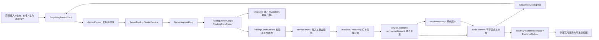

[`ProductTradingRulesRegistry`](surprising-aeron-service/src/main/java/com/surprising/aeron/service/product/ProductTradingRulesRegistry.java) 为六条产品线分别保留规则实例：现货使用 `SpotTradingRules`，永续使用固定合约类型的 `PerpetualTradingRules`，交割使用固定合约类型的 `DeliveryTradingRules`，期权使用 `OptionTradingRules`。线性与反向金额仍由合约类型选择原公式，规则实例拒绝其他产品的合约；账户、订单簿和风险状态按产品隔离。

## 启动与配置

### 加载顺序

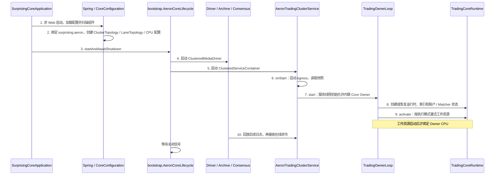

| 步骤 | 源码与职责 |
| --- | --- |
| 1 | [`SurprisingCoreApplication.main`](surprising-aeron-service/src/main/java/com/surprising/aeron/bootstrap/SurprisingCoreApplication.java)：`WebApplicationType.NONE`，创建 Spring 上下文 |
| 2 | [`CoreConfiguration`](surprising-aeron-service/src/main/java/com/surprising/aeron/config/CoreConfiguration.java)：绑定配置、校验必填产品线，创建 `ClusterTopology`、`LaneTopology` 和 `TradingCpuAffinity` |
| 3–5 | [`AeronCoreLifecycle.startAndAwaitShutdown`](surprising-aeron-service/src/main/java/com/surprising/aeron/bootstrap/AeronCoreLifecycle.java)：配置并启动 Driver/Archive/Consensus，再启动 Service Container；资源由 try-with-resources 逆序关闭 |
| 6 | [`AeronTradingClusterService.onStart`](surprising-aeron-service/src/main/java/com/surprising/aeron/controller/AeronTradingClusterService.java)：重置解码槽、启动响应出口、读取快照后启动 Owner |
| 7–8 | [`TradingOwnerLoop.start`](surprising-aeron-service/src/main/java/com/surprising/aeron/bootstrap/TradingOwnerLoop.java)：在 Owner 线程执行 `TradingCoreOwner.start`、恢复和激活；回调线程不直接修改账户 |
| 8–9 | [`TradingCoreRuntime`](surprising-aeron-service/src/main/java/com/surprising/aeron/service/core/TradingCoreRuntime.java)：恢复状态、幂等结果、来源序号、索引和路由，随后 `activate`；Matcher/Account Lane 激活后启动 System Ledger |

首次启动不会从业务数据库自动加载币对、余额和标记价。这些业务事实经 `REGISTER_INSTRUMENT`、余额/划转、`APPLY_MARK_PRICE` 等命令进入复制日志；重启从快照和日志恢复。

### 配置入口

正式节点在启动时统一绑定并校验：`CoreConfiguration` 管拓扑，`CoreRuntimeConfiguration` 管执行与存储预算，
`CoreTransportConfiguration` 管 Driver/Archive/Service，`RealtimeConfiguration` 管可选实时传输。
YAML、标准环境变量、JVM `-D` 和 Spring 命令行服从 Spring 优先级；
旧 `AERON_*` 部署环境名只在发布的 `application.yml` 中显式映射。
非 Spring 工具使用 config 中的独立绑定入口，不隐式加载 YAML。

| 配置 | 读取方 / 来源 | 默认或限制 |
| --- | --- | --- |
| `surprising.aeron.product-line` | `CoreConfiguration`，Spring 配置、环境变量或命令行 | 节点入口必填，六种外部产品代码 |
| `surprising.aeron.node-id` | 同上 | `0`，须对应 hostnames 成员 |
| `surprising.aeron.hostnames` | 同上 | `localhost,localhost,localhost`；本地单成员显式传 `localhost` |
| `surprising.aeron.data-dir` | 同上 | `data/aeron`；节点目录为 `<data-dir>/<product>/node<N>` |
| `surprising.aeron.cpu-affinity.*` | `CoreConfiguration`，见 [`application.yml`](surprising-aeron-service/src/main/resources/application.yml) | 默认关闭；开启需配置四个不同 CPU；macOS 跳过绑定 |
| `surprising.aeron.matching-engines` / `account-lanes` | `CoreConfiguration.laneTopology()`，Spring YAML、环境变量、JVM 属性或命令行 | `1` / `2`，须为允许范围内的 2 次幂；恢复使用快照拓扑 |
| `surprising.aeron.account-lane-seed` | 同上 | `7640891576956012809`；随快照保存，不按新配置重新路由已有账户 |
| `surprising.aeron.matcher-window-size` / `matching-completion-capacity` / `account-lane-queue-capacity` | 同上 | 均为 `4096`，须为允许范围内的 2 次幂 |
| `surprising.aeron.core.threading-mode` | `CoreTransportConfiguration`，Spring 统一绑定 | CPU ≥ 12 时 `DEDICATED`，否则 `SHARED_NETWORK` |
| `surprising.aeron.service.idle-strategy` | 同上 | 未配置沿用 Aeron 默认；可选 `BACKOFF`、`YIELDING` |
| `surprising.aeron.max-concurrent-sessions` | `CoreTransportConfiguration`，Spring 统一绑定 | `64`，范围 `[1,1024]` |
| `surprising.aeron.cluster-ingress-channel` | 同上 | `aeron:udp?term-length=16m` |
| `surprising.aeron.archive-local-control-channel` | 同上 | `aeron:ipc?term-length=1m` |
| `surprising.aeron.owner-input-batch-size` / `owner-command-window` | `CoreRuntimeConfiguration` | `64` / `256`，启动前检查范围及窗口二次幂 |
| `surprising.aeron.wait-strategy` | 同上 | 默认 `BUSY_SPIN`，可选 `PARKING`，所有工作线程统一使用 |
| `surprising.aeron.max-pending-matching` / `lane-completion-spins` / `settlement-spin-limit` | 同上 | `4096` / `1024` / `0`，构造后固定 |
| `surprising.aeron.matcher-group-size` / `matcher-group-nanos` / `lane-initial-entities` | 同上 | `256` / `10000 ns` / `1024`，必须为有效正值，实体容量至少 16 |
| `surprising.aeron.funds-index-directory` | 同上 | 默认平台临时目录；资金索引首次 I/O 前已固定根目录，恢复使用同一配置 |
| `surprising.aeron.snapshot.max-bytes` / `snapshot-timeout-seconds` / `standalone-snapshot-timeout-seconds` | 同上 | `1 GiB` / `300s` / `300s`，部署上限与协议硬上限分开 |
| `surprising.aeron.decoder-cache-slots` | 同上 | `4096`，启动前校验 |
| `surprising.realtime.channel` / `control-channel` | `RealtimeConfiguration`，Spring 统一绑定 | 默认空；先配置输出通道，控制通道才会启用 |
| `surprising.realtime.directory` / `stream` / `control-stream` | 同上 | directory 默认 `CommonContext` 目录，部署时需与目标 Driver 一致；stream 默认 `2101` / `2102` |

端口与目录见 [`ClusterTopology`](surprising-aeron-service/src/main/java/com/surprising/aeron/config/ClusterTopology.java) 和 [`ProductLineClusterLayout`](surprising-aeron-protocol/src/main/java/com/surprising/aeron/protocol/ProductLineClusterLayout.java)。`ClusterTopology.fromSystemProperties` 是带 `SPOT` 默认值的工具入口；Spring 节点入口仍要求显式产品线。

从仓库根目录使用 HotSpot JDK 27 构建和启动：

```bash
java -version
mvn -version
mvn -pl surprising-aeron-core/surprising-aeron-service -am package

# 本地单成员示例；使用独立目录保存本轮日志与快照。
java --enable-native-access=ALL-UNNAMED \
  --add-opens=java.base/jdk.internal.misc=ALL-UNNAMED \
  --add-exports=java.base/jdk.internal.misc=ALL-UNNAMED \
  --add-opens=java.base/java.util.zip=ALL-UNNAMED \
  -jar surprising-aeron-core/surprising-aeron-service/target/surprising-aeron-service.jar \
  --surprising.aeron.product-line=SPOT \
  --surprising.aeron.node-id=0 \
  --surprising.aeron.hostnames=localhost \
  --surprising.aeron.data-dir=data/aeron-local
```

多成员配置一致的产品线和成员列表、各自的 node-id；不同产品线使用各自布局。不要通过删除已有节点数据目录来代替恢复。

## 线程与状态归属

| 执行者 | 启动入口 | 权威状态 / 交接与完成条件 |
| --- | --- | --- |
| 主线程 | `SurprisingCoreApplication` → `AeronCoreLifecycle` | 装配资源并等待关闭，不执行交易 |
| Driver / Archive / Consensus agents | `ClusteredMediaDriver.launch` | 网络、录制、复制、选主；Archive 使用 `SHARED` 模式，与 Driver 配置分开 |
| Cluster Service agent | `ClusteredServiceContainer.launch` → `AeronTradingClusterService` | 内联推进 `TradingOwnerLoop` 与 `TradingCoreOwner`；Session、解码槽、命令生命周期、回包与快照；不再启动独立 Owner 线程 |
| `core-matcher-<id>`，仅 PIPELINED | `MatcherPipelineGroup.start` → `MatcherCommandPipeline.start` | 分片订单簿与 Matcher 序号；接收确定性输入，发布撮合证据/结算事件 |
| `core-account-lane-<id>`，仅 PIPELINED | `TradingAccountRuntime` → `AccountLaneLifecycle.start` → `SettlementLaneWorker` | 按 userId 路由的余额、冻结、持仓、订单和风险；同用户跨币对全仓状态在同一 Lane |
| `core-system-ledger-lane`，两种模式均有 | `TradingAccountRuntime` → `AccountLaneLifecycle.startLedger` → `SystemLedgerLane` | 系统资金、Treasury 与持久化资金索引；完成回执参与业务完成条件 |
| `realtime-aeron-sender`，可选 | `TradingRealtimeBoundary.start` → `AeronRealtimeSender` | 配置输出通道后启动；拥有 Publication，读取实时 outbox，不在交易 Owner 调用网络传输 |
| `realtime-aeron-receiver`，可选 | 同上 → `AeronRealtimeReceiver` | 同时配置控制通道后启动；解码快照/盘口请求，经有界请求队列交给 Owner |

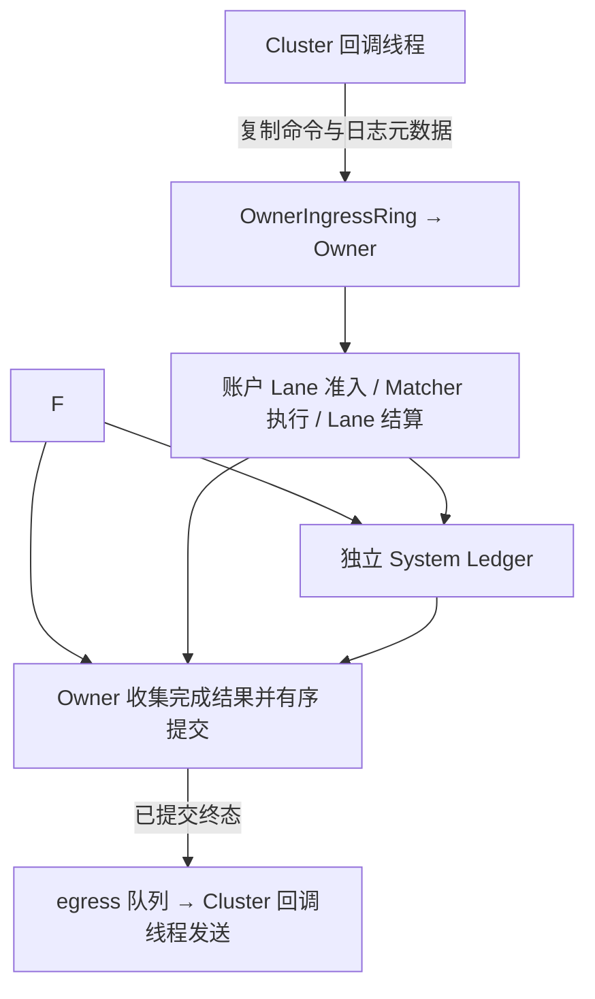

系统采用流水线执行架构。普通下单可提前把带准入门闩的输入交给 Matcher，但账户准入成功后才能撮合。队列提交成功或内部 `MATCHING_PENDING` 都不是客户端交易终态。

`LaneTopology.accountLaneId(userId)` 决定账户归属，`matcherShardId(symbolId)` 决定订单簿归属；两者不混用。快照只保存固定分片数、账户 Lane 数和路由种子，恢复不能按新配置重新分配账户；三项窗口/队列容量只由当前部署决定。

## 下单

入口为 `TradingCoreRuntime.apply`，由 `MatchingCommandAdmission`、`CoreMatchingFlow`、`OrderedCommitCoordinator` 串起。下图按逻辑依赖排序；PIPELINED 的派发可能重叠执行。

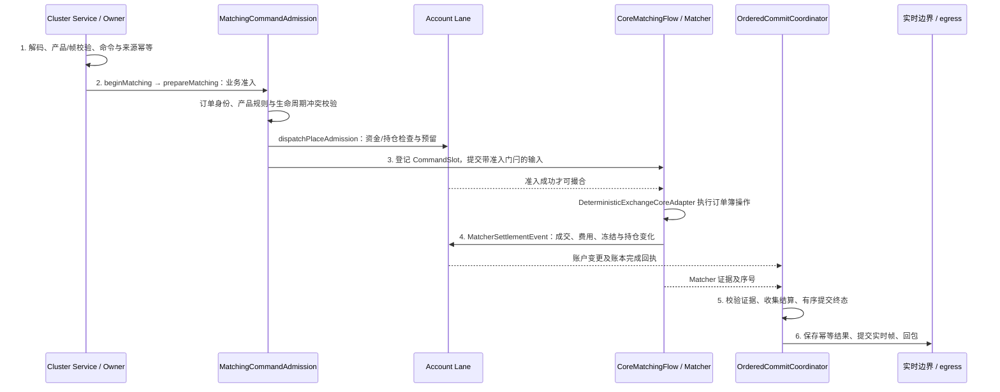

| 步骤 | 关键类 / 方法 | 阅读重点 |
| --- | --- | --- |
| 1 | `AeronTradingClusterService.onSessionMessage` → `CoreMessageFlyweightDecoder` → `TradingOwnerLoop.enqueue` → `TradingCoreOwner` → `TradingCoreRuntime.apply` | 帧租约、sessionId、指纹、来源序号、重复命令；非法帧进入 Owner 前丢弃 |
| 2 | [`MatchingCommandAdmission.beginMatching / prepareMatching`](surprising-aeron-service/src/main/java/com/surprising/aeron/service/order/MatchingCommandAdmission.java) | 命令身份、生命周期冲突、在途槽位与拒绝结果 |
| 2 | [`CoreOrderDecisionResolver`](surprising-aeron-service/src/main/java/com/surprising/aeron/service/order/admission/CoreOrderDecisionResolver.java)、[`RuntimeOrderAdmission`](surprising-aeron-service/src/main/java/com/surprising/aeron/service/order/admission/RuntimeOrderAdmission.java)、`PlaceAdmissionEvent` | 币对/订单规则、价格保护、费率、余额、杠杆/保证金、平仓容量、客户端订单号与预留；`RuntimeOrderStateTransitions` 创建订单/冻结 |
| 3 | [`CoreMatchingFlow.submitMatching`](surprising-aeron-service/src/main/java/com/surprising/aeron/service/order/CoreMatchingFlow.java)、`CommandSlot`、`PendingMatchingRing` | 固定路由、准入门闩、池化对象生命周期；`MatchingPipelineProgress` 推进可继续命令 |
| 3 | [`MatcherCommandPipeline`](surprising-aeron-service/src/main/java/com/surprising/aeron/service/matcher/pipeline/MatcherCommandPipeline.java)、[`DeterministicExchangeCoreAdapter`](surprising-aeron-service/src/main/java/com/surprising/aeron/service/matcher/DeterministicExchangeCoreAdapter.java) | 订单簿操作、撮合结果与分片证据 |
| 4 | [`MatcherSettlementDispatcher`](surprising-aeron-service/src/main/java/com/surprising/aeron/service/settlement/MatcherSettlementDispatcher.java)、`MatcherSettlementEvent`、`RuntimeSpotMatchProcessor` / `RuntimeDerivativeMatchProcessor` | 同一事实直接交给对应账户所有者；现货扣增、衍生品持仓/盈亏、手续费和释放预留 |
| 5 | [`OrderedCommitCoordinator`](surprising-aeron-service/src/main/java/com/surprising/aeron/service/order/commit/OrderedCommitCoordinator.java)、`CommitPublication` | 证据连续性、结算完成、有序终态和水位；不重复执行账户资金计算 |
| 6 | `CommandResultLedger`、`TradingRealtimeBoundary`、`ClusterServiceEgress` | 幂等终态、实时 outbox；回调线程发送响应 |

准入/匹配规则拒绝转换成业务结果；需要回滚时只回滚该命令拥有的状态。无法核对的撮合/账户故障进入失败与恢复路径，不能伪装成普通拒单。响应背压由 egress 保留内容；仍被 Matcher、Lane 或响应使用的对象不能提前回收。

步骤 4 的类较多，继续按“准备事件 → 整理事实 → 分发账户 → 账户收尾 → 财务核对 → Owner 收集”阅读，
见 [service README 的结算步骤与交接图](surprising-aeron-service/README.md#下单步骤-4撮合事实账户与账本)。
事件可由 Lane 消费、发布方已交出事件、账户及财务完成，是不同条件；文档分别对应
`readyForLane()`、`ready()` 和 `complete()`，避免把 Matcher 结果可见误认为可以回包或复用事件。

## 其他业务流程

各流程共用下单的输入、幂等、有序提交和回包边界，下面展开特有步骤。

### 撤单、改单与批量订单

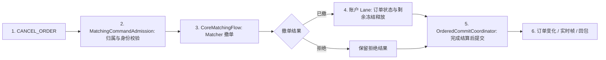

- **撤单**：`MatchingCommandAdmission.validatePendingCancel` → `CoreMatchingFlow` → `DeterministicExchangeCoreAdapter` → `MatcherSettlementEvent`。以撮合确认的剩余量释放预留，不能收到请求就先解冻；重复命令走幂等结果。
- **改单**：`REPLACE_ORDER` / `AMEND_ORDER` → `dispatchReplacementAdmission` → `ReplacementAdmissionEvent` → Matcher → 账户结算 → 有序提交。新旧身份、价格/数量和预留差异在同一边界处理，不拆成两个无关联命令。
- **批量**：[`OrderBatchExecutor.beginOrderBatchMatching`](surprising-aeron-service/src/main/java/com/surprising/aeron/service/order/OrderBatchExecutor.java) → `OrderBatchPending` / `OrderBatchItem` → 批量准入或逐项执行 → Matcher 分块 → Lane 结算 → 批次终态。批次保留 Core 序号和项游标，不能用单项回包代替整批完成。
- **Cancel-all-after**：`TriggerOrderCommands.executeUpdateCancelAllAfter` → `RuntimeCancelAllAfterStateTransitions` / `CancelAllAfterIndex` 保存控制状态；实际撤单仍经复制命令和上述流程。`onTimerEvent` 当前只检查 Owner 故障，不驱动交易状态。

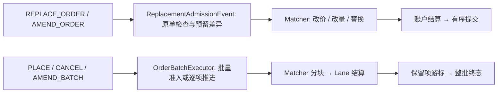

### 触发单、止盈止损与 OCO

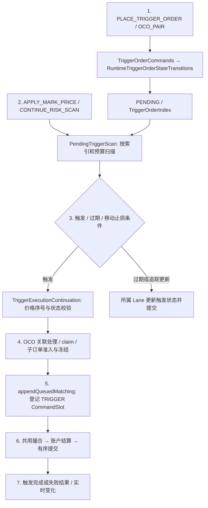

入口在 [`TriggerOrderCommands`](surprising-aeron-service/src/main/java/com/surprising/aeron/service/trigger/command/TriggerOrderCommands.java)：`executePlaceTriggerOrder` / `executePlaceTriggerOcoPair`、`initializeTriggerScan`、`PendingTriggerScan`、`beginTriggerExecution` / `TriggerExecutionContinuation`；状态变更在 [`RuntimeTriggerOrderStateTransitions`](surprising-aeron-service/src/main/java/com/surprising/aeron/service/order/state/RuntimeTriggerOrderStateTransitions.java)。

条件记录和子订单是不同生命周期。触发时重新校验准入与冻结，不能把条件成立当成子订单成交。子订单经 `MatchingCommandAdmission.appendQueuedMatching` 接回撮合、结算和终态提交。追踪价格、OCO、触发序号、重试与失效均保留在既有状态模型中。

### 标记价与风控扫描

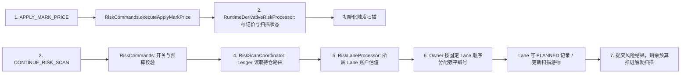

源码：[`RiskCommands`](surprising-aeron-service/src/main/java/com/surprising/aeron/service/risk/command/RiskCommands.java) → [`RuntimeDerivativeRiskProcessor`](surprising-aeron-service/src/main/java/com/surprising/aeron/service/risk/RuntimeDerivativeRiskProcessor.java) → [`RiskScanCoordinator.poll`](surprising-aeron-service/src/main/java/com/surprising/aeron/service/risk/RiskScanCoordinator.java) → [`RiskLaneProcessor`](surprising-aeron-service/src/main/java/com/surprising/aeron/service/risk/RiskLaneProcessor.java)。扫描按预算/游标继续，记录价格和用户修订，避免旧估值当成当前风险；强平编号不依赖线程完成顺序。扫描产生计划，执行由后续强平命令完成；续扫为止盈止损保留推进预算。

### 强平、保险基金与 ADL

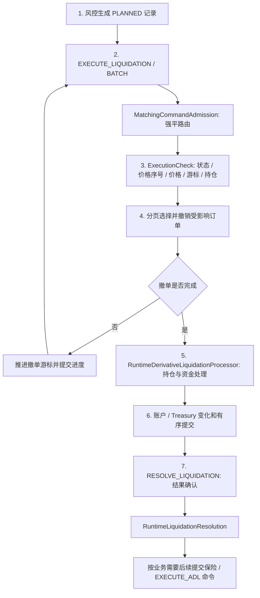

执行入口为 `MatchingCommandAdmission` / `CoreMatchingFlow`；跨分片撤单经 `CrossShardCancellationCoordinator` 保持既有顺序。账户入口为 [`LiquidationCommands`](surprising-aeron-service/src/main/java/com/surprising/aeron/service/liquidation/command/LiquidationCommands.java) → [`RuntimeDerivativeLiquidationProcessor`](surprising-aeron-service/src/main/java/com/surprising/aeron/service/liquidation/RuntimeDerivativeLiquidationProcessor.java)；确认经 `executeResolveLiquidation` → [`RuntimeLiquidationResolution`](surprising-aeron-service/src/main/java/com/surprising/aeron/service/liquidation/RuntimeLiquidationResolution.java)。

保险变更经 `InsuranceFundCommands` / `RuntimeInsuranceFundStateTransitions`；ADL 经 [`AdlCommands`](surprising-aeron-service/src/main/java/com/surprising/aeron/service/adl/command/AdlCommands.java) / [`RuntimeAdlExecution`](surprising-aeron-service/src/main/java/com/surprising/aeron/service/adl/RuntimeAdlExecution.java)。它们是独立复制命令，不是每次强平无条件自动执行的步骤。过期标记价、游标冲突和已结束计划按既有规则拒绝或跳过，不能重复扣减持仓。

强平记录的 `COMPLETED` 表示本笔已确认亏空归零，部分 ADL 后盈利对手可保留持仓。`clearing PnL` 是已实现结算的现金对手项，不表示合约净头寸。

按业务边界找源码：`service.risk` 负责估值和生成计划，`service.liquidation` 负责执行与结果确认，`service.adl` 负责自动减仓。它们共用 `service.risk.LiquidationRuntime` 这份强平记录，并继续通过原有账户 Lane 和 System Ledger 写入权威状态；分包不复制记录或新建处理阶段。各包的 `package-info.java` 按本文步骤列出类和方法，在 IDE 中也能顺着读。

### 资金费、交割与期权到期

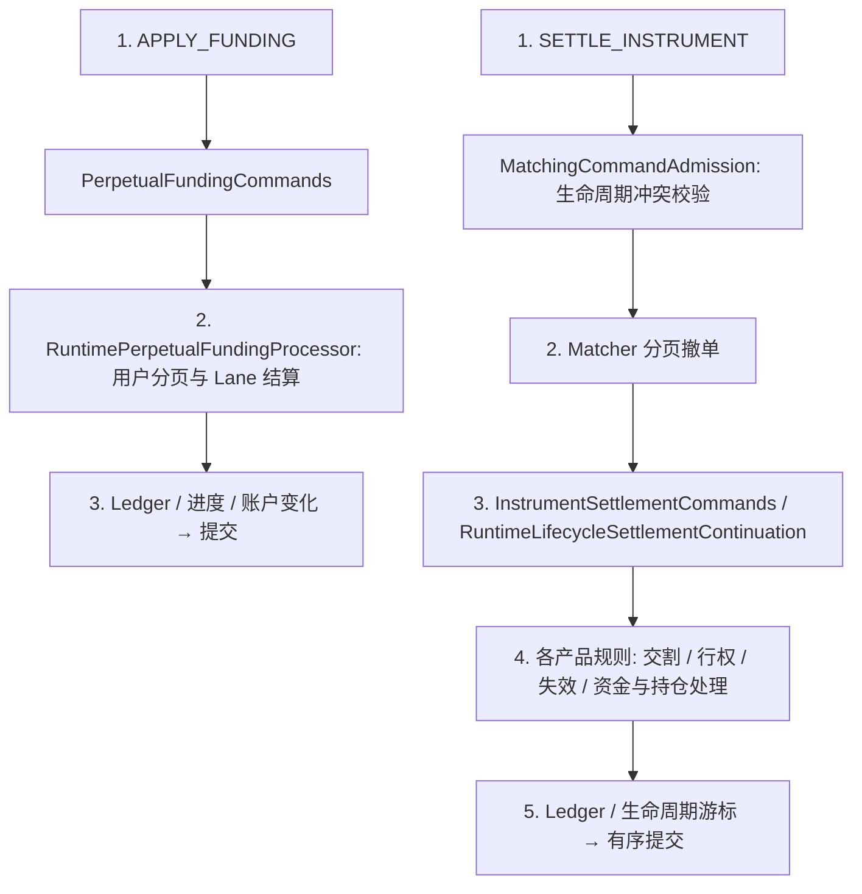

资金费看 [`PerpetualFundingCommands`](surprising-aeron-service/src/main/java/com/surprising/aeron/service/funding/command/PerpetualFundingCommands.java) 与 `RuntimePerpetualFundingProcessor`；交割和期权看 [`InstrumentSettlementCommands`](surprising-aeron-service/src/main/java/com/surprising/aeron/service/settlement/command/InstrumentSettlementCommands.java)、`RuntimeLifecycleSettlement`、`RuntimeLifecycleSettlementContinuation` 与各产品规则。命令保留分页游标，撤单阶段完成后才能推进持仓结算；分页提交不等于整个合约已结算。

### 余额、划转与账户设置

`ADJUST_BALANCE` / `TRANSFER_OUT` / `TRANSFER_IN` / `COMPLETE_TRANSFER` → [`DirectCommandDispatcher`](surprising-aeron-service/src/main/java/com/surprising/aeron/service/core/command/DirectCommandDispatcher.java) → `BalanceTransferCommands` → `RuntimeAccountStateTransitions` / `TransferRuntime` → 所属 Lane 与 System Ledger → 终态提交。不同产品账户通过显式划转连接，保留转出、转入、完成的幂等与恢复状态。

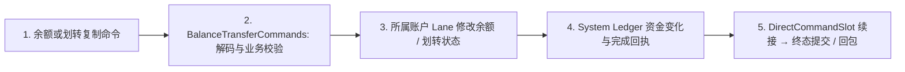

杠杆、仓位模式、逐仓保证金、费率、币对维护分别走 `LeverageCommands`、`PositionCommands`、`FeePolicyCommands`、`InstrumentConfigurationCommands`。`DirectCommandSlot` 保留控制命令的异步续接，账户与账本工作完成后 Owner 才发布终态。

## 实时、查询与完成边界

`TradingCoreOwner` 在命令边界通过 `TradingRealtimeBoundary.beginCapture / commit` 组织输出；`RealtimeStateCapture` 捕获业务变化，`RealtimeOutbox` 保存待发送帧。Follower 仍执行确定性变化，外部发送遵守角色/任期边界；不能让线程完成先后改变各副本的推送分组。

实时通道未配置时不创建发送/接收线程。`AeronRealtimeSender` 对失败发送记录 dropped/failures，实时视图依赖快照与重建能力补齐；这与保留待发终态响应的命令 egress 是不同的交付边界。

账户与订单簿查询经 `service.query` 边界读取所属状态，不能跨越未完成的撮合/控制依赖。`service.replay` 负责已提交回放与导出视图；恢复/导出物化不放入 Matcher 或账户热路径。

## 快照与恢复

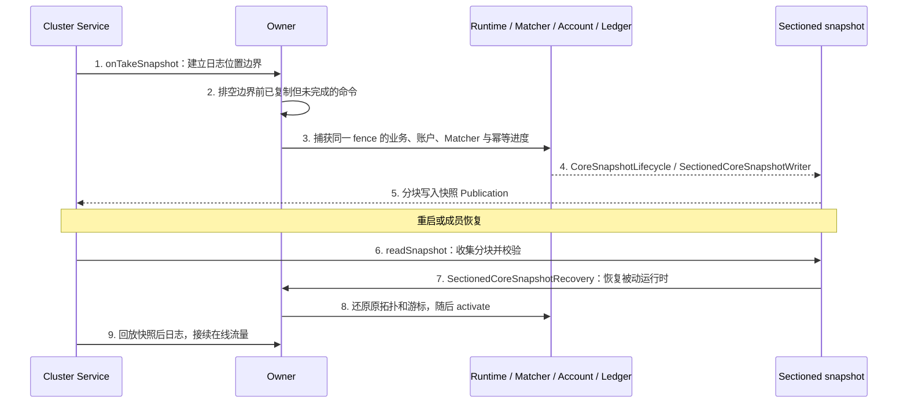

入口：`AeronTradingClusterService.onTakeSnapshot / readSnapshot` → `TradingOwnerLoop.captureSnapshotSections / start` → [`CoreSnapshotLifecycle`](surprising-aeron-service/src/main/java/com/surprising/aeron/service/snapshot/CoreSnapshotLifecycle.java)、`SectionedCoreSnapshotWriter`、`SectionedCoreSnapshotRecovery`、`SectionedCoreSnapshotValidation`；业务编码在 `service.snapshot.state`，Matcher 编码在 `service.matcher.MatcherSnapshotCodec`。

一起恢复业务状态、账户 Lane、订单簿/Matcher 序号、资金/Treasury、命令指纹/终态、来源序号、路由拓扑、风险/触发/资金费/生命周期游标及终态保留信息，不能只恢复订单簿或余额。

正常关闭由 Spring 关闭事件或 Aeron termination hook 唤醒 barrier，先关闭 Service Container，再关闭 Driver/Archive/Consensus；Service 终止回调停止 Owner，运行时释放 Matcher、Lane 和 Ledger。致命 Aeron 错误可能直接终止进程，由监督程序从已提交日志/快照恢复；WARN 不按致命故障处理。

## 包结构与整理规则

路径相对于 `surprising-aeron-service/src/main/java/com/surprising/aeron/`。
完整目录树和分层职责见 [service 包结构](surprising-aeron-service/README.md#包结构入口配置启动与业务服务)。

| 阅读顺序 | 包 | 关键类 |
| --- | --- | --- |
| 启动 1：配置 | `config` | `CoreConfiguration`、`ClusterTopology`、`LaneTopology`、`TradingCpuAffinity` |
| 启动 2：资源生命周期 | `bootstrap`、`bootstrap.account`、`bootstrap.matcher` | `SurprisingCoreApplication`、`AeronCoreLifecycle`、Owner / Lane / Matcher 线程 |
| 交易 1：输入与 Owner | `controller`、`support.ingress`、`bootstrap`、`service.core` | `AeronTradingClusterService`、`OwnerIngressRing`、`TradingOwnerLoop`、`TradingCoreOwner`、`TradingCoreRuntime` |
| 交易 2：业务准入 | `service.order`、`service.order.admission` | `MatchingCommandAdmission`、`CoreOrderDecisionResolver`、`RuntimeOrderAdmission` |
| 交易 3：撮合交接 | `service.order`、`service.matcher.pipeline`、`service.matcher` | `CoreMatchingFlow`、`MatchingPipelineProgress`、`MatcherCommandPipeline`、`DeterministicExchangeCoreAdapter` |
| 交易 4：账户与账本结算 | `service.settlement`、`service.account`、`service.treasury`、`bootstrap.account` | `MatcherSettlementEvent`、产品结算处理器、`AccountLaneState`、`SystemLedgerLane` |
| 交易 5：有序提交 | `service.order.commit`、`service.result` | `OrderedCommitCoordinator`、`CommitPublication`、`CommandResultLedger` |
| 交易 6：输出 | `support.egress`、`service.realtime`、`service.realtime.state` | `ClusterServiceEgress`、`TradingRealtimeBoundary`、`RealtimeStateCapture` |
| 特有业务 | `service.risk.command` / `service.liquidation.command` / `service.trigger.command` / `service.funding.command` / `service.settlement.command` 等 | 各业务 `*Commands`；复用既有执行边界 |
| 风控：估值与计划 | `service.risk` | `RuntimeDerivativeRiskProcessor` → `RiskScanCoordinator` → `RiskLaneProcessor`；共用的风险与强平记录仍在此包 |
| 强平：执行与结果确认 | `service.liquidation` | `RuntimeDerivativeLiquidationProcessor.ExecutionCheck` → 撤单完成 → `ExecutionWork` / `BatchFinancialWork`；后续命令进入 `RuntimeLiquidationResolution` |
| ADL：自动减仓 | `service.adl` | `RuntimeAdlExecution.AdlWork`：源账户校验 → 目标账户减仓 → 源强平补亏 → 账本完成 |
| 产品差异 | `service.product.spot` / `service.product.derivative` / `service.product.option` | 六产品独立规则实例及对应资金计算 |
| 公共状态与恢复 | `model`、`service.core.index`、`service.core.identity`、`service.snapshot`、`service.retention`、`service.replay` | 模型、索引、协议、恢复和查询不强制步骤编号 |

当前目录以入口、配置、启动和业务服务分层；原 state / orchestration 的业务实现归入对应 `service` 分类。
Lombok 替代直接访问器与纯赋值构造器，包含业务校验与状态转换的方法显式保留。
Owner 的日志元数据封装在 `model.OwnerLogContext`，启动层通过明确的生命周期方法访问 Owner；
资金费和到期结算共用的账户分页逻辑放入 `service.account.UserIndexPage`。
`CoreConfiguration` 仅注册一个配置 Bean，完整启动入口显式扫描 `com.surprising.aeron`。

准入、撮合推进与批量类共享同一组包内槽位和生命周期操作，因此保留在一个交易编排包，避免为步骤目录扩大访问权限。`CommandSlot`、`PendingMatchingRing`、`ClusterCommandWindow` 是公共在途设施；`DirectCommandSlot` 还承载风控/触发控制，不能只归下单某一步。

1. **顺序标在流程和入口职责上，包名表达业务，类名表达职责。** 不使用会随链路变化失真的 `Step1PlaceOrder` / `trade.pack1`；由本文、包说明和类注释对应阅读顺序。
2. 新业务先补入口、校验、状态变化、结果与异常；跨线程说明交接数据、状态所有者和完成条件，再放入对应包。
3. 共用状态、协议、索引和快照不复制到多个流程里；不为凑齐步骤创建透传类。
4. 改流程时同步图、源码导航和包说明；步骤编号不成为硬编码业务状态。

## 验证范围

本轮包含 Lombok 简化、包迁移、启动扫描和配置 Bean 去重；保持业务协议、资金公式、快照字段、线程策略与队列算法，不据此声称性能提升。验证覆盖 Service 测试、迁移的基准及生成代码、受影响外部调用方；已有资金与恢复测试检查原行为。

```bash
# 仓库根目录，HotSpot JDK 27
mvn -pl surprising-aeron-core/surprising-aeron-service -am clean test
mvn -pl surprising-aeron-core/surprising-aeron-benchmarks -am test
git diff --check
```

包迁移通过语法树检查业务实现；Owner 跨层访问、共享账户分页和启动装配的明确差异另行核对。`MatcherPipelineGroupTest` 的空队列检查需等待传输槽位退休：命令结果先于传输完成游标发布，不能收到结果后立即断言队列为空。该测试保留空队列断言，并增加有界排水等待及提交深度检查。

编译测试不能代替 API 做市联调、长稳、故障切换或 JMH/JFR 性能验收；每次交付单独报告实际运行范围。

### 本轮验证记录（2026-10-21）

环境：当前 `master`，Amazon Corretto HotSpot JDK 27，Maven 3.9.16，macOS；构建前及运行中磁盘可用空间均超过 240 GiB。

| 检查 | 实际结果 |
| --- | --- |
| Service 与依赖 `clean test` | Service 共 1557 项；首轮 1 项队列退休断言失败，0 errors，2 skipped；修正后 Maven 复测 `MatcherPipelineGroupTest` 5/5 通过。合并两轮报告为 1555 passed、2 skipped；没有声称第二次完整重跑全量 |
| 队列退休断言独立重复验证 | 使用同一修正后测试方法，在独立临时输出目录编译并执行 1000 次，1000/1000 通过 |
| 迁移涉及的基准回归 | `AccountLaneCommitBenchmarkTest`、`ClusteredBatchTradingBenchmarkTest`、`CorePerpetualEndToEndBenchmarkTest`、`LinearPerpetualBenchmarkSupportTest`、`RealtimeWorkloadTest`、`ExecutionModeComparisonTest` 共 173/173 通过；仅作为回归检查，不作为性能验收 |
| 实时服务调用方 | `MarketApplicationContextTest` 20/20 通过，覆盖六产品线及不会启动 Core 的装配边界 |
| 网关 Aeron 调用方 | 独立编译 `CoreTestCompletion`、`MaintenanceIntegrationTest`、`SharedCommandTransportIntegrationTest`；JUnit Platform 6.0.3 配合 `-Dgateway.shared-driver.it=true`，六产品线真实单成员 Core 集成 6/6 通过，逐产品启动并停止 |
| 生成与打包 | Service、Tools、Benchmarks JAR 含新包且无旧 `pipeline` / `commit` 包类；JMH `-l` 正常列出迁移后的两个基准类入口 |
| 生产源码与文档 | 34 个相关生产 Java 文件除命名空间/注释外无字段或方法体变化；37 个 README 源码链接存在；本次差异范围的 `git diff --check` 通过 |

跨模块构建的实际命令如下。该命令中 Service、Tools、Benchmarks、Realtime 等模块成功，整体退出码为 **1**：最后的 Gateway `testCompile` 被工作区其他 C2C 改动阻塞，`C2cOrdersPostgresTest` 等仍用旧构造参数调用 `C2cAds` / `C2cOrders`。独立网关验证不代表整个 Gateway 测试目录已编译通过。

```bash
aeronReviewTests='MatcherPipelineGroupTest,AccountLaneCommitBenchmarkTest,ClusteredBatchTradingBenchmarkTest,CorePerpetualEndToEndBenchmarkTest,LinearPerpetualBenchmarkSupportTest,RealtimeWorkloadTest,ExecutionModeComparisonTest,MarketApplicationContextTest,SharedCommandTransportIntegrationTest,MaintenanceIntegrationTest'
mvn -B \
  -pl surprising-aeron-core/surprising-aeron-benchmarks,surprising-gateway,surprising-realtime/surprising-realtime-provider \
  -am -Dtest="$aeronReviewTests" -Dsurefire.failIfNoSpecifiedTests=false package

java -jar surprising-aeron-core/surprising-aeron-benchmarks/target/product-core-benchmarks.jar -l
```

Service 的 2 项条件跳过分别是 Linux CPU 亲和性测试（当前为 macOS）及要求 `surprising.aeron.matching-phase-log-interval=1` 的日志模式测试。网关维护数据库集成未运行：没有 `MAINTENANCE_TEST_JDBC_URL`。本轮未运行 HTTP/API 做市端到端、正式 JMH/JFR、长稳或三成员故障切换，因此不提供新的容量、延迟或性能提升结论。

清理状态：验证摘要已归档本节；本轮独立 Core 均已停止，隔离验证目录、辅助脚本、临时日志及确认属于本轮的 Surefire 报告已清理。保留构建 JAR/classes 供运行和复核，没有启动 wallet，也没有遗留本轮 JFR、堆转储或常驻集群。

### 风险业务包整理验证（2026-10-21）

本轮在已有启动及交易包结构上，分离 `service.risk`、`service.liquidation`、`service.adl` 的业务职责，
同步 13 个 Java 文件的包名或引用，并更新 7 个包说明。共享模型、字段、方法体、访问权限、
协议、快照和资金算法保持一致；没有新增业务类、线程、队列或提交阶段。
Service README 的早期优化记录折叠保留，当前导航与历史迁移进度分开阅读。

环境：`master`，Amazon Corretto HotSpot JDK 27，Maven 3.9.16，macOS；构建前及运行中磁盘可用空间至少 239 GiB。

```bash
mvn -B -pl surprising-aeron-core/surprising-aeron-service -am clean test
mvn -B -pl surprising-aeron-core/surprising-aeron-tools,surprising-aeron-core/surprising-aeron-benchmarks \
  -am -DskipTests package
```

| 本轮检查 | 实际结果 |
| --- | --- |
| Service 完整测试 | 1557 项，1555 passed、0 failures、0 errors、2 skipped；完整命令退出码 0 |
| 同轮依赖测试 | Product 15、Protocol 250、Client 66、Instrument 14，均为 0 failures、0 errors、0 skipped |
| 源码等价 | 13 个迁移或引用文件（8 个生产、5 个测试）经 Java AST 比较，除命名空间和注释外代码 token 相同；7 个包说明没有增加类型或成员 |
| 下游编译与打包 | Tools、Benchmarks 及依赖共 15 个 Reactor 模块成功，命令退出码 0；此命令使用 `-DskipTests`，只计编译和打包 |
| JAR 与导航 | Service、Tools、Benchmarks 三个运行 JAR 均含三个类的新包路径，旧包类及其内部类为 0；两份 README 的 113 个本地链接有效，差异空白检查通过 |

两项跳过分别为 macOS 上的 Linux 原生 CPU 绑定，以及要求配置
`surprising.aeron.matching-phase-log-interval` 的日志模式用例。
完整 Service 测试包含六产品线、FUSED/PIPELINED 管线、强平/保险/ADL 资金、幂等和快照恢复回归。
本次为包归属整理，未改变资金计算或运行策略；未另行运行 HTTP/API 做市端到端、长稳、
三成员故障切换或正式 JMH/JFR，不提供新的性能结论。

清理状态：测试 JVM 已退出，未启动独立常驻集群或 wallet；本轮临时构建日志和已归档摘要的
Surefire 报告已清理。保留 classes/JAR 及活动注释审计所需的紧凑校验数据，没有生成 JFR 或堆转储。

### 结算步骤导航细化验证（2026-10-21）

在上述业务包结构上，将下单步骤 4 细分为事件准备、事实整理、账户投递、账户收尾、财务完成与
Owner 收集，在 service README、结算包说明和 7 个类的中文注释中对应到方法。
同时区分账户可消费结果、Matcher 发布结束和事件完成，说明无成交及 FUSED 内联账本分支。

本次仅文档和注释：8 个 Java 文件与提交前经 AST 比较，非注释 token 完全一致；
全模块 444 个 Java 文件解析正常。两份 README 的 16 张 Mermaid 图通过解析，
134 个本地链接及锚点有效，精确改动范围的 `git diff --check` 通过。
按文档改动的验证要求，本次未重跑 Maven、集群、API 联调或性能测试；此前包迁移的运行验证见上节。
