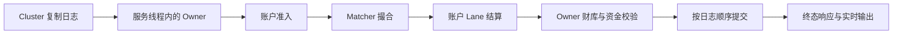

# Aeron 交易核心

本目录包含 protocol、client、service、tools 和 benchmarks 五个 Maven 模块。现货、U 本位永续、币本位永续、U 本位交割、币本位交割和期权分别运行独立 Cluster、账户与订单簿。

Core 消费复制日志中的命令，完成业务校验、撮合、账户结算、幂等和恢复。HTTP、数据库接入、做市、价格生产与生命周期调度由外围服务负责。

## 模块入口

| 模块 | 职责 |
| --- | --- |
| [protocol](surprising-aeron-protocol/README.md) | 命令、响应、查询及实时帧协议 |
| [client](surprising-aeron-client/README.md) | Cluster 连接、请求身份、响应关联和实时传输 |
| [service](surprising-aeron-service/README.md) | 节点资源、业务运行时、撮合、账户与恢复 |
| [tools](surprising-aeron-tools) | 集群探针、诊断与离线回放 |
| [benchmarks](surprising-aeron-benchmarks/README.md) | 局部基准和真实 Cluster 验证工具 |

## 启动

使用 HotSpot JDK 27。构建命令：

```bash
mvn -pl surprising-aeron-core/surprising-aeron-service -am -DskipTests package
```

首次启动需明确产品线、成员与目录；例如本地现货单成员：

```bash
java --add-opens=java.base/jdk.internal.misc=ALL-UNNAMED \
  --add-exports=java.base/jdk.internal.misc=ALL-UNNAMED \
  --add-opens=java.base/jdk.internal.ref=ALL-UNNAMED \
  --add-exports=java.base/jdk.internal.ref=ALL-UNNAMED \
  --add-opens=java.base/java.util.zip=ALL-UNNAMED \
  -jar surprising-aeron-core/surprising-aeron-service/target/surprising-aeron-service.jar \
  --surprising.aeron.product-line=SPOT \
  --surprising.aeron.node-id=0 \
  --surprising.aeron.hostnames=localhost \
  --surprising.aeron.data-dir=data/aeron-local
```

启动链路为 `SurprisingCoreApplication` → `CoreConfiguration` → `AeronCoreLifecycle` → `AeronTradingClusterService.onStart` → `TradingCoreOwner.start`。首次启动通过命令注册标的、余额和价格；重启从快照及后续日志恢复，不从数据库重建交易权威状态。

配置来源见 [application.yml](surprising-aeron-service/src/main/resources/application.yml)：

| 配置类 | 内容 |
| --- | --- |
| `CoreConfiguration` | 产品线、成员、路由拓扑和 CPU 绑定 |
| `CoreRuntimeConfiguration` | 在途窗口、执行预算、快照限制和资金索引目录 |
| `CoreTransportConfiguration` | Driver、Archive、Consensus 和 Service |
| `RealtimeConfiguration` | 可选实时输出及读取请求通道 |

配置在启动边界绑定；已有账户按快照保存的拓扑恢复。不同产品线使用独立数据目录，不通过删除节点数据代替恢复。

## 交易与状态归属



| 执行者 | 权威状态与完成条件 |
| --- | --- |
| Cluster 服务线程中的 Owner | 命令生命周期、来源水位、近期结果、终态身份、Treasury 和资金身份索引；按日志顺序完成终态 |
| Matcher 分片 | 订单簿和原生证据；PIPELINED 模式由 `core-matcher-<id>` 执行 |
| Account Lane | 按用户路由的余额、冻结、订单、预留、持仓与风险；PIPELINED 模式由 `core-account-lane-<id>` 执行 |
| 可选实时发送/接收线程 | 传输已提交帧与读取请求，不修改交易权威状态 |

FUSED 在服务线程执行 Matcher 与账户计算；PIPELINED 保留真实的 Matcher/账户交接。两种模式的财库记账和控制资金验证都由 Owner 同步执行。资金守恒、整数溢出、冻结释放、幂等、所有权和回滚前值由各自业务边界负责。

账户与盘口查询通过所属线程；财库、OI 与维护页在 Owner 上读取。对外查询使用协议响应，不暴露工作线程和测试状态访问器。

## 快照与恢复

Owner 完成前缀命令后建立快照屏障，冻结业务状态、费率和待划转，等待各 Matcher 在提交栅栏捕获原生模块，再完整审计并同步编码。释放等待屏障不取消正在执行的 Matcher 捕获；捕获结束前拒绝新交易和新快照。

`SectionedCoreSnapshotRecovery` 负责增量接收、CRC、字节预算与恢复校验。业务状态、账户 Lane、订单簿、Treasury、命令结果、来源水位、身份、拓扑和业务游标必须来自同一冻结点。只接受当前格式；旧样本用于验证明确拒绝。

## 验证与维护

按改动选择相关功能用例：

```bash
mvn -pl surprising-aeron-core/surprising-aeron-service -am test \
  -Dtest=<相关测试类> -Dsurefire.failIfNoSpecifiedTests=false
```

类或接口删除使用干净构建，性能工作遵循根 [性能规范](../AGENTS-performance.md)。本轮记录见 [service 验证记录](surprising-aeron-service/validation/cleanup-20261028.md)。过时轮次报告、旧线程设计说明和失效脚本已从当前目录移除，历史变更可从 Git 查看。
