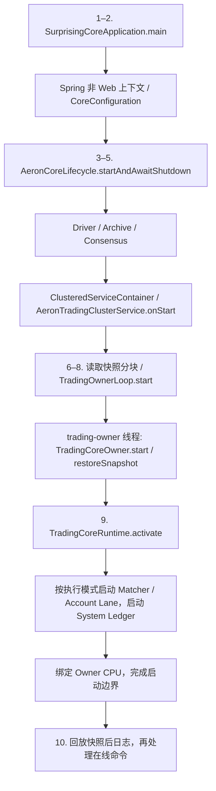
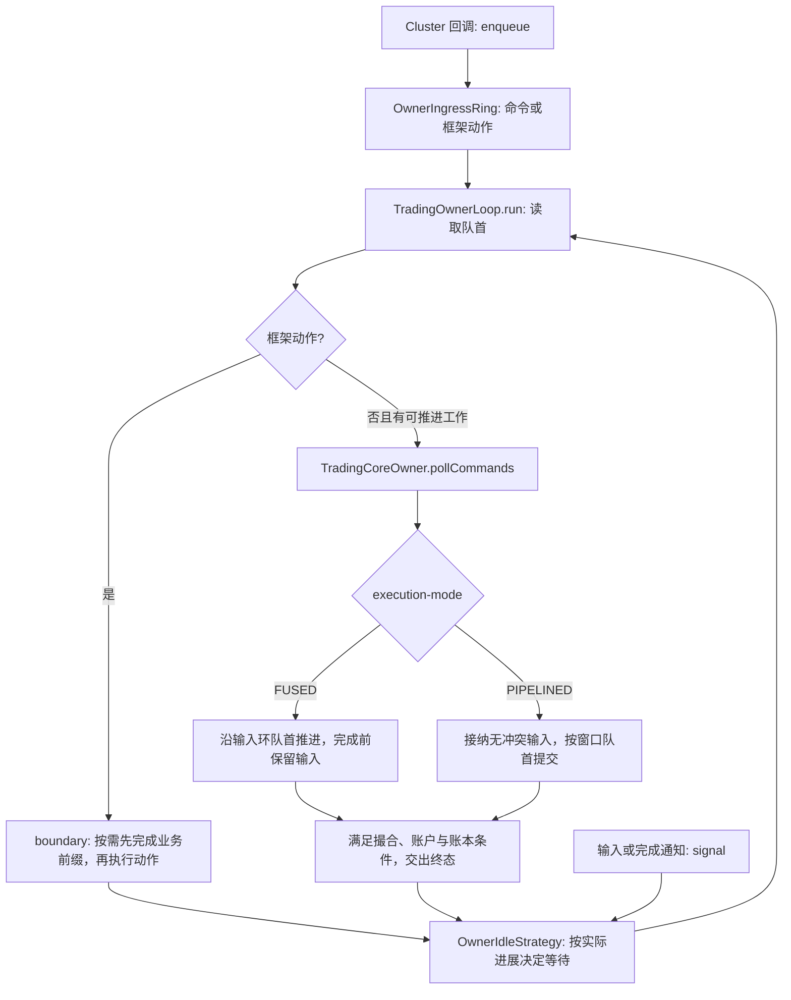
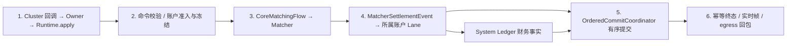
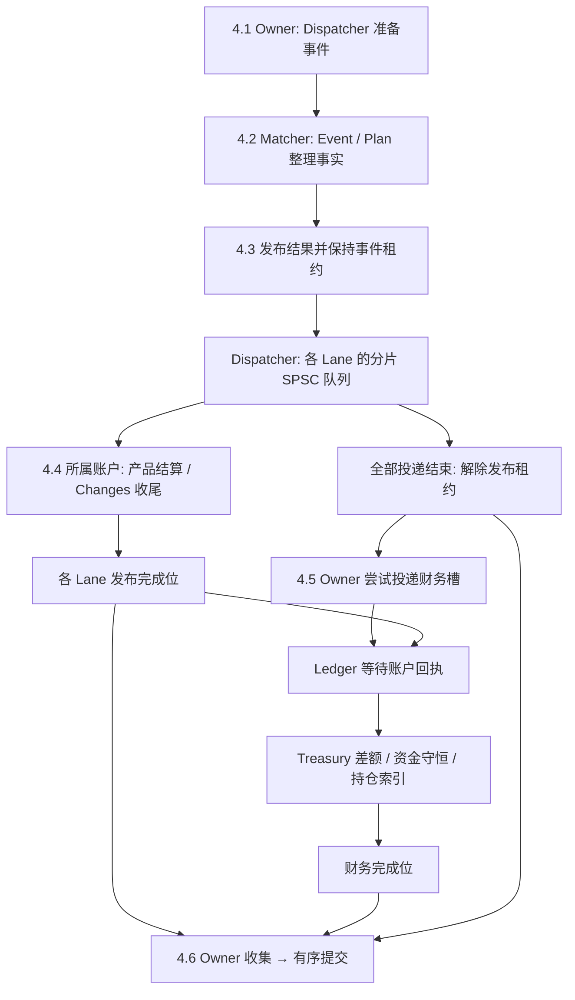
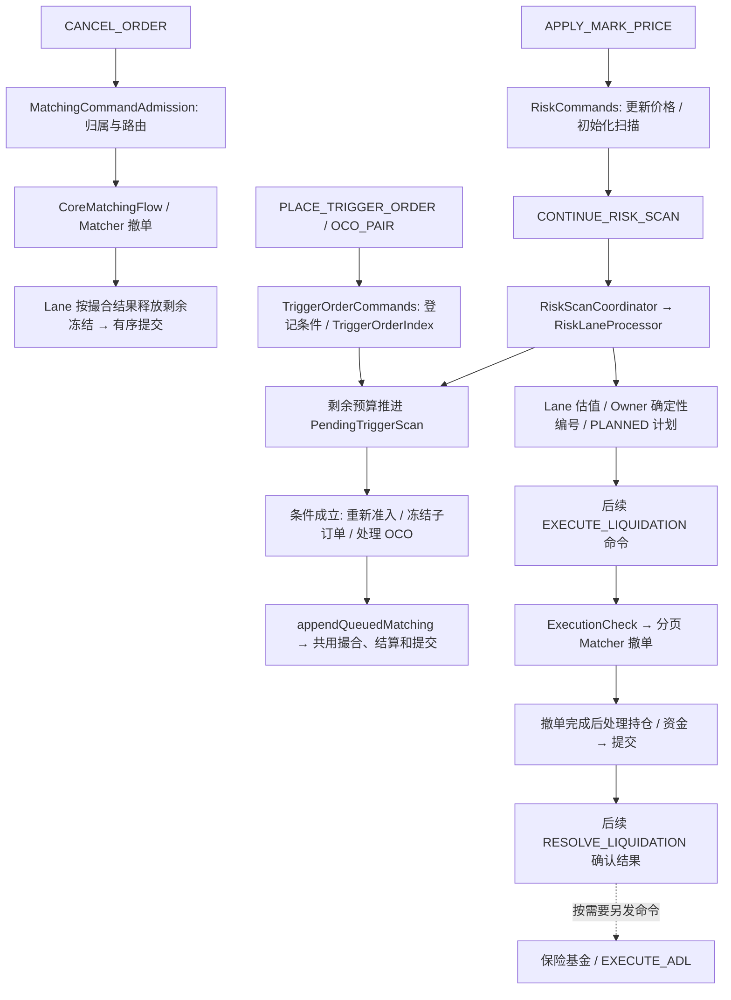
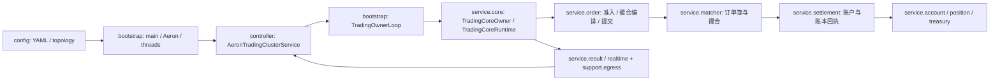

# aeron-service 代码导航

本模块是交易 Core 的执行服务。每个节点只服务一条产品线，处理 Cluster 已复制的命令；
HTTP接入、价格生产、生命周期调度和外部查询投影由其他服务承担。六条产品线的账户、订单簿和风险事实分别隔离。

`TradingCoreState`、`CoreUserState` 和 `CoreTreasuryState` 是快照、恢复及核对边界的完整冷状态。
在线修改由账户Lane和系统账本执行，Owner按原命令顺序推进。恢复索引由 `RuntimeStateProjector` 创建并绑定，
Owner借用同一组 `RuntimeFactIndexes`；固定路由只保存一份，恢复后空队列容量取当前部署配置。
算法及触发单保留权威终态和查询进度，近期普通订单墓碑保存身份与客户号，资金命令指纹长期保留。

产品线、永久币对ID、topic及共享纯公式来自
[`surprising-instrument-api`](../../surprising-instrument-api/README.md)。订单准入、成交、账户和持仓转换留在本模块；
永续与交割分别使用现有产品规则，线性、反向和期权的资金公式及生命周期约束各自保留。
Lombok只处理直接样板，校验、复制和状态转换显式实现，可变交易对象不用 `@Data`。

当前Core schema为 **12**，注册命令V7、交易状态快照v42、分段快照v29、Matcher快照v10、终态保留v4。
注册命令和不可变标的配置共用 `CoreInstrumentRiskLimits` 金融参数值，现货不创建风险配置，
也不在命令或快照中保存保证金、杠杆、持仓限额、OI或虚拟风险档。衍生品保留真实限额和档位，
维持保证金直接取实际风险档费率，删除标的级副本；资产单位、费用、价格保护和交易开关保留。
命令从27字段减为21字段，标的不可变配置同样从27字段减为21字段，衍生品风险值含6个字段，后续继续核对不同衍生品的实际字段消费。

算法命令v3区分创建意图和生命周期增量，更新只携带变化、预期版本及可选新增子单。
触发创建v5从命令头、Cluster时间和标的配置初始化归属、时间、状态及执行费率；
延时全撤命令v4用原业务时间加倒计时计算截止时间，持久化状态保留实际截止时间。
查询、实时事件和数据库模型保留各自消费的完整业务字段。按用户确认，旧命令与快照格式不再读取。

清理及逐字段证据见[命令与持久化数据审计](validation/command-data-audit-20261023.json)，
当前累计52项已解决，A11查询一致性仍为候选，其他产品条件字段及业务约束审查继续进行。
历史字段、索引和运行时清理过程也保存在审计及[早期验证记录](validation/simplify-20261022.json)，不以无引用扫描代替业务用途判断。

本轮使用HotSpot JDK27、Maven3.9.16执行：

```bash
mvn -pl surprising-aeron-core/surprising-aeron-service,surprising-aeron-core/surprising-aeron-benchmarks,surprising-aeron-core/surprising-aeron-tools,surprising-gateway,surprising-realtime/surprising-realtime-provider \
    -am -DskipTests clean test-compile
mvn -pl surprising-gateway -am -DskipTests test-compile
```

17个相关模块及依赖干净编译通过，随后网关整理再次编译通过，均包含测试源码编译。
29项静态检查通过，164处注册构造的非风险参数逐项对照未变。未执行测试、服务、交易、做市、数据库、前端交互、日志/快照恢复或性能采样，
因此没有宣称这些运行路径已验证通过。

先读本文的启动和业务步骤，再进入对应源码。更完整的模块架构、配置表、启动命令、
各业务时序和快照恢复见 [Aeron 总 README](../README.md)。下面的编号表示阅读顺序，
不表示增加线程、队列或提交阶段；同一公共类可能被多条业务复用。

| 要看什么 | 图与源码导航 |
| --- | --- |
| 代码放在哪一层 | [目录树与分层职责](#包结构入口配置启动与业务服务) |
| 模块之间怎样连接 | [系统架构](../README.md#模块与系统架构) |
| 配置从哪里来、线程怎样启动 | [本文启动流程](#启动配置加载恢复与线程启动)、[完整配置表与启动命令](../README.md#配置入口) |
| 下单经过哪些类 | [下单六步](#下单按六步顺着源码读)、[步骤 4 的账户与账本交接](#下单步骤-4撮合事实账户与账本) |
| 撤单、改单、批量订单 | [独立流程图](../README.md#撤单改单与批量订单) |
| 触发单、止盈止损、OCO | [独立流程图](../README.md#触发单止盈止损与-oco) |
| 标记价与风控 | [独立流程图](../README.md#标记价与风控扫描) |
| 强平、保险基金、ADL | [独立流程图](../README.md#强平保险基金与-adl) |
| 资金费、交割、期权到期 | [独立流程图](../README.md#资金费交割与期权到期) |
| 快照与日志如何恢复 | [恢复时序](../README.md#快照与恢复) |

## 启动：配置加载、恢复与线程启动



| 阅读步骤 | 类和入口 | 实际职责 |
| --- | --- | --- |
| 1–2 配置 | [`SurprisingCoreApplication`](src/main/java/com/surprising/aeron/bootstrap/SurprisingCoreApplication.java)、[`CoreConfiguration`](src/main/java/com/surprising/aeron/config/CoreConfiguration.java) | 加载 Spring 配置，绑定 `surprising.aeron`，创建集群拓扑、交易拓扑和 CPU 配置；不创建初始业务余额 |
| 3–5 Aeron 资源 | [`AeronCoreLifecycle`](src/main/java/com/surprising/aeron/bootstrap/AeronCoreLifecycle.java) | 启动 Driver、Archive、Consensus 和 Service Container，等待关闭并逆序释放资源 |
| 6–8 恢复与 Owner | [`AeronTradingClusterService`](src/main/java/com/surprising/aeron/controller/AeronTradingClusterService.java)、[`TradingOwnerLoop`](src/main/java/com/surprising/aeron/bootstrap/TradingOwnerLoop.java)、[`TradingCoreOwner`](src/main/java/com/surprising/aeron/service/core/TradingCoreOwner.java) | 回调线程读取快照分块；在 Owner 线程创建或恢复交易运行时 |
| 9 工作资源 | [`TradingCoreRuntime`](src/main/java/com/surprising/aeron/service/core/TradingCoreRuntime.java)、[`TradingAccountRuntime`](src/main/java/com/surprising/aeron/service/core/TradingAccountRuntime.java) | 激活恢复后的拓扑与状态；启动工作资源后才收窄 Owner 的 CPU mask |
| 10 回放 | `AeronTradingClusterService.onSessionMessage` → `TradingOwnerLoop.enqueue` | 把已复制日志及其时间、位置交给 Owner；回放与在线命令沿用同一交易规则 |

`CoreConfiguration` 统一装配拓扑、CPU、执行、网络和实时配置 Bean。
Matcher 数量、账户 Lane 数量、路由种子与队列容量的默认值见 [application.yml](src/main/resources/application.yml)，
可通过外部 YAML、环境变量、JVM `-D` 或 Spring 命令行参数覆盖；节点启动还必须指定产品线。
例如账户 Lane 数可通过 `SURPRISING_AERON_ACCOUNTLANES=4` 或 `--surprising.aeron.account-lanes=4` 覆盖。
`laneTopology` Bean → `TradingOwnerLoop` → `TradingCoreOwner` → `TradingCoreRuntime` → Matcher 与账户状态，
整条启动路径共用同一份拓扑，`LaneTopology` 本身不读取外部配置。
非 Spring 的工具和基准通过 `CoreConfiguration.standaloneLaneTopology()` 使用同一套绑定字段，
读取系统属性与环境变量，不隐式加载节点 YAML。执行模式、等待方式、在途容量和快照预算统一由
[`CoreRuntimeConfiguration`](src/main/java/com/surprising/aeron/config/CoreRuntimeConfiguration.java) 绑定、校验后注入；
非 Spring 工具使用它的 `standalone()` 显式绑定相同键。Spring 启动和恢复共用已绑定实例，运行时不再自行重新读取这些值。
`CoreTransportConfiguration` 绑定 Driver/Service、会话与通道；`RealtimeConfiguration` 绑定 `surprising.realtime`。
原 `AERON_*` 环境名只由 `application.yml` 显式映射，正常配置优先级不改变。
Matcher/Ledger 等待、原生 batching、Lane 初始容量、资金索引目录和快照部署上限也沿同一构造/恢复配置传递。
节点恢复只解码被动状态，`TradingOwnerLoop` 在交接 Owner 后首次携带 affinity 激活；工具的 `decode` 保留即用激活职责。
币对、余额和标记价通过业务命令进入日志，重启从快照与日志恢复，不从数据库自动补载。

| 线程 / 模式 | 负责的状态或工作 |
| --- | --- |
| Cluster Service agent | 会话、解码、快照 Publication 和真正的网络回包；不直接修改账户 |
| `trading-owner-<memberId>` | 按日志顺序推进命令、依赖、完成条件和提交水位 |
| FUSED，默认 | Owner 内联执行 Matcher 和账户工作，不创建独立 Matcher / Account Lane 线程 |
| PIPELINED | `core-matcher-<id>` 持有分片订单簿；`core-account-lane-<id>` 按用户持有账户、订单和持仓 |
| `core-system-ledger-lane`，两种模式均有 | Treasury、系统资金和持久化资金索引；其完成回执参与业务完成条件 |
| 可选实时 sender / receiver | 配置实时通道后启动；发送已提交帧或把控制请求交给 Owner |

### Owner：输入、等待与退出怎样衔接

启动后，先顺着 `TradingOwnerLoop.run` 看线程循环，再进入
`TradingCoreOwner.pollCommands` 看业务推进。两者分别管理线程和命令生命周期，
账户状态仍归所属 Lane；不要把它们看成两份交易状态。

[`AccountLaneLifecycle`](src/main/java/com/surprising/aeron/bootstrap/account/AccountLaneLifecycle.java)
拥有账户工作线程数组、创建失败回滚、关闭、交接轮次和首次故障。`TradingAccountRuntime`
保留账户准入、结算、变化收集和快照事实，不创建或逐条关闭工作线程；无第二份账户镜像。
`TradingCoreRuntime.pendingMatching()` 与 `matcherPipeline()` 借用既有组件时先检查 Owner，
资源数组和交接标记不再是公开可替换字段。测试故障注入集中在测试源集，生产不增加注入接口。
关闭会逐项尝试停止所有资源并保留首异常与 suppressed；只有确认 Matcher/Account/Ledger 已退出，才清理仍可能被它们借用的命令槽和索引。



| 阅读顺序 | 类与方法 | 数据、完成条件和异常 |
| --- | --- | --- |
| 1 交入命令 | [`TradingOwnerLoop.enqueue`](src/main/java/com/surprising/aeron/bootstrap/TradingOwnerLoop.java) → `OwnerIngressRing` | 交接请求租约、会话 ID、原业务时间、日志位置和指纹；入队成功只表示 Owner 可以接手 |
| 2 选择工作 | `TradingOwnerLoop.run / ownerWorkAvailable` | 动作在 Owner 线程执行；普通业务经 Core Owner 门禁推进。窗口非空和在途数量不能单独证明有进展 |
| 3 推进与提交 | [`TradingCoreOwner.progressCommands / pollControl / pollCommandCommitBatch`](src/main/java/com/surprising/aeron/service/core/TradingCoreOwner.java) | FUSED 保留输入环队首，PIPELINED 将独立输入租约交给窗口；终态必须等待实际业务完成条件，再交实时边界和 egress |
| 4 等待与唤醒 | [`OwnerIdleStrategy.idle / signal`](src/main/java/com/surprising/aeron/bootstrap/OwnerIdleStrategy.java) | 默认自旋，可选逐步退避；休眠前登记通知再复查工作。通知只是重查提示，原队列和完成位仍是事实来源 |
| 5 快照与角色边界 | `TradingOwnerLoop.boundary` → `TradingCoreOwner.finishCommands` | 先完成动作之前的命令；快照再固定日志位置及时间，角色切换再更新角色与响应 epoch。等待方通过 Future 收结果或异常 |
| 6 停止与释放 | `TradingOwnerLoop.terminate / run` → `TradingCoreOwner.terminate` | 正常退出先完成前缀；Owner 最终关闭运行时、工作资源，再释放借用输入并恢复 CPU 绑定。外层确认线程已退出后才清理余留输入 |

以下执行参数在启动时统一绑定；默认值见 `application.yml`，可由外部 YAML、环境变量、JVM 属性或命令行覆盖：

| 属性 | 读取时机与含义 |
| --- | --- |
| `surprising.aeron.owner-input-batch-size` | 每轮输入预算默认 64，范围 1–256 |
| `surprising.aeron.owner-wait-strategy` | 默认 `BUSY_SPIN`，也可选 `ADAPTIVE`；由 Spring Binder 转换枚举 |
| `surprising.aeron.owner-role-change-timeout-seconds` | 角色切换动作预算默认 600 秒，范围 30–1800 秒 |
| `surprising.aeron.snapshot-timeout-seconds` | 快照及内部完成前缀的预算默认 300 秒，必须为正 |
| `surprising.aeron.execution-mode` | `FUSED` 或 `PIPELINED`，在 Owner 与运行时激活之间保持一致 |
| `surprising.aeron.max-pending-matching` | 在途撮合上限默认 4096，与 Matcher 窗口取较小值 |
| `surprising.aeron.lane-completion-spins` | 同步 Lane 完成等待的自旋预算默认 1024，不允许负值 |
| `surprising.aeron.settlement-wait-strategy / settlement-spin-limit` | Lane 空闲策略与 BLOCKING 自旋预算，在建立工作线程前校验 |
| `surprising.aeron.standalone-snapshot-timeout-seconds` | 独立快照等待预算默认 300 秒，必须为正 |
| `surprising.aeron.owner-command-window / decoder-cache-slots` | 固定响应窗口与复用解码容量，启动前校验，不在类初始化时固定 |
| `surprising.aeron.matcher-pipeline-wait-strategy / system-ledger-wait-strategy` | Matcher 与账本真实等待策略；不存在 `matcher-wait-strategy` 配置 |
| `surprising.aeron.matcher-group-size / matcher-group-nanos` | 原生同步 Matcher batching，默认 256 / 10000 ns |
| `surprising.aeron.lane-initial-entities / funds-index-directory` | 每 Lane 实体表初始容量与资金索引根目录，在分配/开库前固定 |
| `surprising.aeron.snapshot.max-bytes` | 部署预算默认 1 GiB，在编解码边界使用；协议硬界限仍为数组允许上限 |

外层普通动作的等待预算默认 30 秒；输入入队等待和动作完成等待分别计时，
内部完成前缀还使用快照预算，不能把它们理解成一个统一的端到端超时。
动作执行失败会同时通知等待方并终止 Owner；业务拒单继续走原业务结果。

测试导航：`OwnerLogContextTest` 检查日志元数据交接，`OwnerIdleStrategyTest` 检查唤醒竞态，
`TradingRuntimeOwnershipTest` 检查错误线程关闭，`CoreActiveLaneIngressTest` 检查六产品线实际账户入口。
[`TradingOwnerTestSupport`](src/test/java/com/surprising/aeron/service/core/TradingOwnerTestSupport.java)
在测试调用线程直接推进 Core Owner；涉及独立 Owner 线程的边界应读实际 `TradingOwnerLoop` 测试。

## 下单：按六步顺着源码读



| 步骤 | 关键类，按阅读顺序排列 | 交接与完成条件 |
| --- | --- | --- |
| 1 输入 | `AeronTradingClusterService` → `TradingOwnerLoop` → `TradingCoreOwner` → `TradingCoreRuntime.apply` | 交接命令、指纹、会话和日志元数据；检查协议、产品线和幂等 |
| 2 准入 | [`MatchingCommandAdmission`](src/main/java/com/surprising/aeron/service/order/MatchingCommandAdmission.java) → [`CoreOrderDecisionResolver`](src/main/java/com/surprising/aeron/service/order/admission/CoreOrderDecisionResolver.java) → `PlaceAdmissionEvent` / [`RuntimeOrderAdmission`](src/main/java/com/surprising/aeron/service/order/admission/RuntimeOrderAdmission.java) | 检查订单规则、资金、保证金、平仓容量及生命周期冲突；所属账户完成订单和预留变更 |
| 3 撮合 | [`CoreMatchingFlow`](src/main/java/com/surprising/aeron/service/order/CoreMatchingFlow.java) → `MatcherCommandPipeline` → `DeterministicExchangeCoreAdapter` | 固定分片并交接命令；PIPELINED 可提前提交带门闩的输入，账户准入成功后才能撮合 |
| 4 结算 | [`MatcherSettlementDispatcher`](src/main/java/com/surprising/aeron/service/settlement/MatcherSettlementDispatcher.java) / `MatcherSettlementEvent` → `RuntimeSpotMatchProcessor` / `RuntimeDerivativeMatchProcessor` | Matcher 事实直接交给所属账户，按产品计算余额、冻结、费用与持仓变化；财务事实交给 Ledger |
| 5 提交 | [`OrderedCommitCoordinator`](src/main/java/com/surprising/aeron/service/order/commit/OrderedCommitCoordinator.java) → `CommitPublication` | 核验证据、收集账户与账本完成，按命令顺序提交；不在此重复计算资金 |
| 6 输出 | `CommandResultLedger`、`TradingRealtimeBoundary`、`ClusterServiceEgress` | 保存可幂等重试的终态，输出实时变化，并由 Cluster 回调线程发送响应 |

内部 `MATCHING_PENDING`、队列入队成功和 Matcher 执行完成均不能单独作为客户端交易终态。
业务拒单保留拒绝结果；需要回滚时只回滚该命令拥有的变化；无法核对的执行故障由故障与恢复边界处理。

### 下单步骤 2–3：准入与撮合怎样交接

先顺着下面的方法读主流程，再进入账户或 Matcher 的实现。PIPELINED 下这些工作可以重叠，
表中顺序表示依赖关系；“派发准入”不等于资金预留已经成功。

| 阅读步骤 | 类与方法 | 输入、交接与结束条件 |
| --- | --- | --- |
| 2.1 决定现在做还是延后 | [`MatchingCommandAdmission.beginMatching / deferMatching`](src/main/java/com/surprising/aeron/service/order/MatchingCommandAdmission.java) | 有尚未结束的批次且不允许独立准入时，保存原序号、解码输入、来源与日志时间，之后再做业务准入 |
| 2.2 检查并派发准入 | `MatchingCommandAdmission.prepareMatching` → `dispatchPlaceAdmission` / `dispatchReplacementAdmission` | 检查身份、归属、产品规则和生命周期冲突；账户工作由所属 Lane 执行。已知业务错误按当前命令边界拒绝或回滚，不能跨其他在途账户命令回滚 |
| 2.3 登记在途命令 | `prepareMatching` → `CoreMatchingFlow.putPendingMatching` | 把解码输入及准入事件放入 `CommandSlot`，固定分片及原业务时间；释放 Owner 事实作用域和账户访问权，再交出撮合输入 |
| 3.1 交给 Matcher | [`CoreMatchingFlow.submitMatching / submitMatchingInCommandScope`](src/main/java/com/surprising/aeron/service/order/CoreMatchingFlow.java) | 按分片提交顺序派发；普通 PLACE 可先把带准入门闩的任务交出，账户准入成功后 Matcher 才能执行 |
| 3.2 推进异步工作 | [`MatchingPipelineProgress.progressPlaceBatchAdmissions / submitDeferredMatchingAfterBatch`](src/main/java/com/surprising/aeron/service/order/MatchingPipelineProgress.java) | Owner 消费就绪提示并重试可推进项；准入事件和命令槽仍保存事实，就绪位只用于调度 |
| 3.3 收据与提交头释放 | `CoreMatchingFlow.collectPlaceAdmissionIfReady` → `MatchingPipelineProgress.submissionCompleted` | Owner 收据收齐与 Matcher 消费是两个条件，均满足后才归还准入事件；释放分片提交头只允许后继继续，不表示当前订单已到终态 |

### 下单步骤 4：撮合事实、账户与账本

`service.settlement` 中的类按下面顺序阅读。这里细分的是原有结算职责，
普通下单、改单、撤单和触发子订单继续共用同一套事件与完成条件。

| 阅读步骤 | 类与方法 | 本步做什么、由谁做 |
| --- | --- | --- |
| 4.1 准备交接 | [`MatcherSettlementDispatcher.prepareDirectAdmission / prepareDirect / prepareDirectReplacement / prepareDirectCancellation`](src/main/java/com/surprising/aeron/service/settlement/MatcherSettlementDispatcher.java) | Owner 借用事件槽，保存命令身份、币对与资产编号、初始路由和准入输入 |
| 4.2 整理事实 | [`MatcherSettlementEvent.publishDirectNativeResult / publishDirectNativeBatchItem / publishDirectNativeReplacement`](src/main/java/com/surprising/aeron/service/settlement/MatcherSettlementEvent.java) → [`MatcherSettlementPlan`](src/main/java/com/surprising/aeron/service/settlement/MatcherSettlementPlan.java) | Matcher 校验序号与命令证据，整理成交、已接受的前置撤单和实际参与 Lane；不读取其他线程的账户表 |
| 4.3 发布给账户 | `MatcherSettlementEvent.notifyDirectPublication` → `MatcherSettlementDispatcher.publishMatcherOwned` | PIPELINED 由 Matcher 直接写各 Lane 的分片 SPSC 队列；FUSED 在当前线程内联执行 |
| 4.4 应用账户变化 | `MatcherSettlementEvent.execute / applyPlan` → [`RuntimeSpotMatchProcessor.applyLane`](src/main/java/com/surprising/aeron/service/settlement/RuntimeSpotMatchProcessor.java) 或 [`RuntimeDerivativeMatchProcessor.applyLane`](src/main/java/com/surprising/aeron/service/settlement/RuntimeDerivativeMatchProcessor.java) | 各账户所有者只写自己的订单、预留、余额与持仓；衍生品成交计算由 [`RuntimeDerivativeFillCalculator`](src/main/java/com/surprising/aeron/service/settlement/RuntimeDerivativeFillCalculator.java) 承担 |
| 4.4 收尾与回执 | [`MatcherSettlementChanges.prepareLaneTerminal`](src/main/java/com/surprising/aeron/service/settlement/MatcherSettlementChanges.java) → `MatcherSettlementEvent.publishCompletion` | 所属 Lane 整理用户修订、终态身份、持仓及余额资金增量，然后发布自己的完成位 |
| 4.5 财务完成 | `MatcherSettlementEvent.submitTreasurySettlement` → `TreasurySettlement` / [`SystemLedgerLane`](src/main/java/com/surprising/aeron/service/treasury/SystemLedgerLane.java) | Owner 尝试投递财务槽；账本等账户回执到齐后应用 Treasury 差额、校验资金守恒并更新持仓索引 |
| 4.6 交回提交 | [`TradingAccountRuntime.collectMatcherSettlement`](src/main/java/com/surprising/aeron/service/core/TradingAccountRuntime.java) → `OrderedCommitCoordinator` | Owner 等发布、账户和已登记的财务工作完成后，收集变更与终态身份，再按命令顺序提交；事件归还对象池前还须交出变更缓冲 |



图展开 PIPELINED 中需要账本处理的成交。财务槽可以在账户尚未完成时先入队；
队列满则 Owner 保留原槽重试。无成交时可在账户完成后就地核对资金增量；
FUSED 还可在账本队列为空且事实就绪时，通过 `SystemLedgerLane.tryApplyInline`
交接账本所有权并内联应用，不要求每个命令都发生一次账本线程切换。

三个条件分别看：`readyForLane()` 只要求结果已经发布；`ready()` 还要求 Matcher 已结束发布过程；
`complete()` 再检查所有实际路由 Lane，以及已登记的财务槽是否完成。
因此，Lane 可以在其他 Lane 尚未入队时开始工作，Owner 此时仍不能回收事件。
准入拒绝的普通下单沿已登记路由交出无成交回执，不执行正常成交资金计算；
前置撤单已经成功、随后新单被拒绝时，成功的撤单仍须结算，不能视为整条命令没有变化。

### 下单步骤 5：证据、财务完成与终态

从 [`OrderedCommitCoordinator.commitReadyMatchingHead / commitReadyMatching`](src/main/java/com/surprising/aeron/service/order/commit/OrderedCommitCoordinator.java)
进入。它们只尝试推进已就绪队首；`awaitFirst` 只多探测一次，不阻塞 Owner 等待工作线程。

| 阅读步骤 | 方法 | 必须看清的边界 |
| --- | --- | --- |
| 5.1 提前派发资金 | `advanceMatchingProgress` → `dispatchReadyMatcherFinancialSettlements` | 按独立账本 FIFO 把已有资金事实提前交 Ledger；邮箱满就保留原游标重试。顺序批次还能产生后续子项时，不提前释放该命令的资金游标 |
| 5.2 检查队首能否推进 | `matchingCommitReady` → `financialHeadReady` | 收普通下单准入，再核对当前事件、批次账户工作及财务条件；返回真表示可以尝试提交，后续控制工作仍可能需要挂起 |
| 5.3 核对撮合证据 | `completeMatching` → `validateMatchingEvidence` | Core 序号与命令 UUID 必须匹配，结果所属逻辑分片的 Matcher 序号必须严格递增；当前代码不要求序号恰好加一 |
| 5.4 收集账户变化 | `completeDispatchedMatcherSettlement` / `finishAppliedMatching` | 普通交易收集已执行的结算事实及 Lane 完成位；强平和到期控制还会接续各自既有账户业务。所有必要回执未齐则保留原槽，下轮继续 |
| 5.5 发布并退休 | `finishTerminalMatching` → `storeTerminalResponse` | 完成发布和资金守恒核对，保存幂等终态及响应租约，再回收结算事件、移除待项并结束事实作用域；随后才恢复后继批次 |

[`CommitPublication`](src/main/java/com/surprising/aeron/service/order/commit/CommitPublication.java)
负责发布批次、派生索引和独立发布序号。`abort` / `suspend` 只清发布标记，账户回滚由原业务入口负责。
拒单也可能已占用 Matcher 证据序号；`completeRejectedMatching` 等生产者结束并核对进度后才回收槽，
防止较晚回执写入下一代命令。无法协调的 Matcher 前缀或账户故障进入恢复边界，不能当作普通无变化拒单。

余额、划转、风控、资金费、触发单等直接控制命令使用公共
[`DirectCommandSlot`](src/main/java/com/surprising/aeron/service/order/DirectCommandSlot.java)，
不占订单簿完成队列；它保存一个命令的账户、账本或回滚续步，由 `poll` 推进至运行时收尾。
这个槽被多条业务共用，因此保留在交易编排包，不归入下单某一步。

## 撤单、触发单、风控与强平

这些业务共用上面的输入、账户所有权、提交和回包边界。流程图中的箭头表示业务依赖，
并不表示所有步骤都在一次命令内自动完成。



| 业务 | 入口与后续关键类 | 阅读时需要区分 |
| --- | --- | --- |
| 撤单 | `MatchingCommandAdmission.validatePendingCancel` → `CoreMatchingFlow` → `MatcherSettlementEvent` | 所属 Lane 依据 Matcher 结果更新订单、释放冻结，不能收到请求就先解冻 |
| 改单 / 批量 | `ReplacementAdmissionEvent`；`OrderBatchExecutor` / `OrderBatchPending` | 改单处理新旧预留差异；批量保留项游标和整批终态 |
| 触发 / 止盈止损 / OCO | [`TriggerOrderCommands`](src/main/java/com/surprising/aeron/service/trigger/command/TriggerOrderCommands.java) → `PendingTriggerScan` → `TriggerExecutionContinuation` → `MatchingCommandAdmission.appendQueuedMatching` | 条件记录与子订单是不同生命周期；条件成立后仍须重新准入、冻结和撮合 |
| 风控 | [`RiskCommands`](src/main/java/com/surprising/aeron/service/risk/command/RiskCommands.java) → `RuntimeDerivativeRiskProcessor` → `RiskScanCoordinator` → `RiskLaneProcessor` | 按价格序号、修订和预算续扫；扫描生成强平计划，不直接等于强平执行 |
| 强平 | `MatchingCommandAdmission` / `CoreMatchingFlow` → `ExecutionCheck` / `CrossShardCancellationCoordinator` → [`LiquidationCommands`](src/main/java/com/surprising/aeron/service/liquidation/command/LiquidationCommands.java) → `RuntimeDerivativeLiquidationProcessor` | 先校验状态、价格和游标，分批撤单；撤单未完成时只提交进度，后续命令继续 |
| 强平确认 / 保险 / ADL | `RuntimeLiquidationResolution`；`InsuranceFundCommands`；`AdlCommands` / `RuntimeAdlExecution` | 各有独立复制命令和幂等边界，并非每次强平都无条件执行 |
| 资金费 / 交割 / 行权 | `PerpetualFundingCommands` / `RuntimePerpetualFundingProcessor`；`InstrumentSettlementCommands` / `RuntimeLifecycleSettlementContinuation` | 分页资金费与到期结算各保留游标；到期结算先完成撤单，再推进持仓和账本 |
| 余额 / 划转 | `DirectCommandDispatcher` → `BalanceTransferCommands` → `RuntimeAccountStateTransitions` / `TransferRuntime` | 所属账户与 Ledger 完成后由 `DirectCommandSlot` 续接提交，保留跨产品划转幂等 |

快照入口为 `AeronTradingClusterService.onTakeSnapshot` → `TradingOwnerLoop.captureSnapshotSections`
→ `CoreSnapshotLifecycle`。先排空快照边界前的命令，再捕获同一 fence 的账户、Matcher、账本、
幂等和业务游标；恢复时一起还原，不能只加载订单簿或余额。完整时序见 [快照与恢复](../README.md#快照与恢复)。

[`LaneTopology`](src/main/java/com/surprising/aeron/config/LaneTopology.java) 保存分片数、账户路由种子和队列容量，
恢复时使用快照中的这些参数。兼容性由 `SectionedCoreSnapshotCodec`、`MatcherSnapshotCodec` 等快照编解码器的格式版本检查；
修改路由算法或这些参数的含义时，须同步评估快照版本和恢复约束。

终态订单身份从已提交 Lane 回执经 `TerminalStateRetention.accept / acceptBatch` 写入墓碑，
`completeSequence` 在本序号接收完成后裁剪保留窗口；资金命令指纹仍由 `FundsIndexWork` 交给 Ledger 管理。
候选表按现有快照格式读写并参与订单编号占用检查，不提供独立的导出确认后清理入口。

## 包结构：入口、配置、启动与业务服务

源码根包为 `com.surprising.aeron`。按 MVC 的职责划分，`controller` 接收 Aeron 协议回调，
`service` 执行业务，`model` 表达状态和数据；响应与实时事件就是本服务的输出。
节点使用非 Web Spring 上下文，HTTP Controller 仍由网关和业务接入服务提供。

```text
com.surprising.aeron
├── controller             Aeron 消息、会话、角色及快照回调入口
├── config                 YAML 绑定、Cluster/Lane 拓扑、执行模式、CPU 配置
├── bootstrap              进程入口、Aeron 资源、Owner 启停与等待
│   ├── account            账户工作线程、账户邮箱消费与所有权交接
│   └── matcher            Matcher 线程身份
├── service
│   ├── core               Owner 命令编排、运行时、共享变更与业务索引
│   ├── order              订单准入、撮合编排、批量命令与有序提交
│   │   ├── admission      下单与改单的账户准入及回执
│   │   ├── command        已解码撮合指令与准入契约
│   │   ├── state          订单、预约、条件单状态转换
│   │   └── commit         核对结算完成条件并提交
│   ├── matcher            订单簿适配、撮合结果与快照；pipeline 放分片执行交接
│   ├── account / position 用户、余额、划转、持仓和平仓容量
│   ├── risk / liquidation 风险扫描与强平执行、亏空确认
│   ├── trigger / adl      触发单命令与自动减仓
│   ├── settlement         成交结算、交割与期权到期
│   ├── funding / treasury 资金费与系统账本
│   ├── product            六产品线各自的交易规则与资金计算
│   ├── instrument / fee / insurance / market
│   └── query / realtime / result / retention / snapshot / replay
├── model                  状态值、导出状态及 Owner 日志元数据
├── support                数学、primitive 集合、队列、协议输入/响应交接、指标
└── exception              业务状态拒绝与撮合分歧异常
```



| 找代码时的起点 | 类与职责 |
| --- | --- |
| [controller](src/main/java/com/surprising/aeron/controller/AeronTradingClusterService.java) | `AeronTradingClusterService` 负责协议回调；借用输入交给 Owner，真正的网络响应仍在 Cluster 线程发送 |
| [config](src/main/java/com/surprising/aeron/config/CoreConfiguration.java) | `CoreConfiguration` 绑定配置；`ClusterTopology`、`LaneTopology`、`TradingExecutionMode` 描述启动参数 |
| [bootstrap](src/main/java/com/surprising/aeron/bootstrap/SurprisingCoreApplication.java) | `SurprisingCoreApplication` → `AeronCoreLifecycle`；`TradingOwnerLoop` 管理 Owner 线程、动作边界和退出；`AccountLaneLifecycle` 拥有账户工作资源与所有权交接 |
| [service.core](src/main/java/com/surprising/aeron/service/core/TradingCoreOwner.java) | `TradingCoreOwner` 编排复制命令；`TradingCoreRuntime` 连接各业务；`TradingAccountRuntime` 保存并处理唯一账户业务状态 |
| [service.order](src/main/java/com/surprising/aeron/service/order/MatchingCommandAdmission.java) | `MatchingCommandAdmission` → `CoreMatchingFlow` → `OrderedCommitCoordinator`，依次完成准入、撮合交接及终态提交 |
| [service.matcher](src/main/java/com/surprising/aeron/service/matcher/DeterministicExchangeCoreAdapter.java) | `DeterministicExchangeCoreAdapter` 操作订单簿；`pipeline` 保留分片串行执行、完成回执与关闭协议 |
| [service.settlement](src/main/java/com/surprising/aeron/service/settlement/MatcherSettlementDispatcher.java) | Matcher 事实交给所属账户；资金、费用和持仓应用后收集账户与系统账本完成回执 |
| [service.account](src/main/java/com/surprising/aeron/service/account/AccountLaneState.java) / [service.treasury](src/main/java/com/surprising/aeron/service/treasury/SystemLedgerLane.java) | 账户 Lane 持有用户状态；Ledger 持有系统资金及财务索引；资金费和到期结算共用 `UserIndexPage` 游标选页 |
| [model](src/main/java/com/surprising/aeron/model/TradingCoreState.java) / [support](src/main/java/com/surprising/aeron/support/concurrent/LaneSequenceQueue.java) | 导出值与通用设施；在线可变状态留在相应业务服务中 |

各业务的 `command` 包保存对应业务命令入口；不会把 `OrderRuntime`、`AccountLaneState` 等可变对象
自动注册成 Spring 单例。它们继续由每个产品线的 Owner 创建，并由所属线程持有。
持久化使用现有 Aeron 日志、快照和 Ledger 索引，包整理沿用原有存储边界。
线程消费循环与其邮箱、所有权交接协议放在一起，避免只把 `Thread.start()` 拆成透传类。

顺着下单阅读：`controller` → `bootstrap.TradingOwnerLoop` → `service.core` →
`service.order.admission` → `service.matcher` → `service.settlement` →
`service.account` / `service.treasury` → `service.order.commit` → `service.result` / `support.egress`。
失败继续由原有业务回滚、异常响应或致命故障恢复边界处理。

风控、强平和 ADL 按独立命令分包，类注释和包注释中的编号只对应各自流程：

| 业务 / 步骤 | 按顺序阅读的源码 | 本步完成的含义 |
| --- | --- | --- |
| 风控 1–3：价格与预算 | `service.risk.command.RiskCommands.executeApplyMarkPrice` / `executeContinueRiskScan` | 写入价格及扫描进度，校验续扫开关和预算 |
| 风控 4–7：估值与计划 | `service.risk.RiskScanCoordinator.poll` → `RiskLaneProcessor` | 所属 Lane 估值，Owner 确定性分配编号，再由 Lane 写入 `PLANNED` 记录并提交 |
| 强平 2–4：输入、校验与撤单 | `service.order.MatchingCommandAdmission` → [`RuntimeDerivativeLiquidationProcessor.ExecutionCheck`](src/main/java/com/surprising/aeron/service/liquidation/RuntimeDerivativeLiquidationProcessor.java) → `service.order.CoreMatchingFlow` | 步骤 1 为风控计划；此处核对价格、状态及游标，Matcher 完成分页撤单后才能推进账户执行 |
| 强平 5–6：账户与账本 | 同类的 `ExecutionWork` / `BatchFinancialWork` → `service.order.commit.OrderedCommitCoordinator` | 所属 Lane 更新持仓与余额，Ledger 应用财务差额，两边完成才提交 |
| 强平 7：后续确认命令 | `service.liquidation.command.LiquidationCommands.executeResolveLiquidation` → [`RuntimeLiquidationResolution.ResolutionWork`](src/main/java/com/surprising/aeron/service/liquidation/RuntimeLiquidationResolution.java) | 捕获索赔、账本分配并补亏、源 Lane 更新记录；执行提交与亏空解决分别确认 |
| ADL 1–4：后续减仓命令 | `service.adl.command.AdlCommands` → [`RuntimeAdlExecution.AdlWork`](src/main/java/com/surprising/aeron/service/adl/RuntimeAdlExecution.java) | 源强平校验 → 目标账户减仓 → 源记录补亏 → Ledger 完成；同 Lane 时复用已有账户回调 |

`service.risk.LiquidationRuntime` 被扫描、强平、保险和 ADL 共用，保留为一份记录；
`service.treasury` 继续拥有系统资金，`service.account` 继续拥有用户状态。
包迁移保留权威状态、队列和线程；Owner 对启动层开放快照、角色切换和完成通知接口，仍须在 Owner 线程调用。
各业务包的 `package-info.java` 提供同样的有序类导航，避免为 IDE 排序把编号写进类名。

`service.order` 内的准入、撮合推进和批量命令共享包内槽位及生命周期操作，
机械拆包会扩大访问权限；`CommandSlot`、`PendingMatchingRing`、`DirectCommandSlot` 等也被多条业务共用。
新增职责仍先放入对应业务包，不为凑步骤增加透传类，不把步骤编号写进业务状态或协议。

跨包协作方法属于 Core 内部接口，调用方继续遵守 Owner、Account Lane 和 Ledger 的线程所有权，
以及查询屏障、命令槽和响应缓冲的租约。账户表保持封装，逐实体读写和快照导出分别提供入口；
包迁移不新增账户镜像、线程、队列、提交阶段或快照字段。`CoreQueryService` 原名为
`OrderBookQueryService`，改名用于体现已有的多类内部查询职责。

历史包整理的验证命令、模块结果、条件跳过项及清理记录见
[验证记录](../../docs/validation/aeron-service-packages-20261021.json)。
交易包及启动包后续迁移的记录见 [Aeron 总 README 的验证记录](../README.md#本轮验证记录2026-10-21)。
这些是对应改动时的验证证据；此前风险业务包整理结果见
[风险业务包整理验证](../README.md#风险业务包整理验证2026-10-21)。
本轮 Lombok 与分层重构结果见 [验证记录](../../docs/validation/aeron-service-mvc-20261022.json)。

<details>
<summary>历史优化与验证记录（展开查看，日期以各节为准）</summary>

以下保留各次修改当时的实现与验收范围。当前启动、线程和包结构以本文前半部分及
[Aeron 总 README](../README.md) 为准；例如下文早期“账本尚未启用”的描述属于当时的迁移进度。

# 保证金写入简化（2026-10-18）

`DerivativeAccountCommandProcessor.adjustAccountPositionMargin` 按“校验逐仓持仓与余额 →
计算新的可用、冻结、仓位保证金与版本 → 写入余额、持仓及用户版本”顺序执行。
全仓降低杠杆的保证金重定价也先完成算术校验再写入。
两处直接调用现有 `TradingAccountRuntime.replaceBalance(userId, assetId, available, locked)`，
删除构造后立即拆开的临时 `BalanceRuntime`；余额权威单元、所属 Lane 和回滚捕获仍由该入口负责。

五条衍生产品线逐仓增减与四条期货线杠杆重定价均有实际 Account Lane、资金及快照核对。
局部 JMH 保证金操作测到约 40 B/次分配减少，不能推断整链路吞吐或零分配。
已测范围、环境缺口与采样边界见 [八项简化验证](../../docs/validation/order-simplification-20261018.md)。

# 核心提交日志回放

`CommittedTradeReplay` 由独立导出进程持有核心状态，只应用 Archive 已提交的命令；不会向在线 Cluster 发送交易命令。订单和成交沿用实时捕获，资金费通过 `PerpetualFundingCommands` 的回放观察接口交出实际支付结果，形成不可变的 `CommittedFundingPage`。该对象的生命周期仅为当前完整命令，下一次 apply 清空；没有第二份资金账本或长期支付缓存。

资金费页保留产品线、日志位置、核心时间、实际命令费率、完成游标及支付明细。重复或被拒绝的命令不产生支付页。在线异步 Account Lane 路径不安装观察接口、不读取数据库，资金计算、快照格式和核心权威状态不变。查询投影在 realtime 模块持久化，SQL 成功后才能推进导出 checkpoint。

HotSpot JDK 27 下 `CommittedFundingReplayTest` 覆盖 U 本位及币本位永续的实际多空支付、分页、快照恢复和重复命令；原有 funding processor、异步 funding、订单成交回放及权利金/资金费回归一并执行。此改动供独立回放使用，不要求重启在线核心。


## Matcher 结果与账户结算交接

`publishedPositionCount()` 只读取 Owner 已提交的持仓记录计数，不再扫描 Lane 权威表或申请账户读取栅栏。
所属 Lane 在既有 `LaneCommitDelta.preparePositionRetirement` 中记录当前表大小；Owner 收集控制、批量准入、
成交终态回执时，以每 Lane 上一次计数的差值更新总数。每个回执保存自己的命令边界，Lane 后续命令
不能改变较早回执的计数；回收时清空标记。初始化及命令回滚也通过相同交接更新。
计数沿用持仓记录数语义，包含权威表保留的零仓位记录，不代表未平仓量。
这只增加固定长度的 Owner 计数元数据，没有持仓对象副本；按 ID 查找等其他迁移仍需继续。
功能范围见 [验证清单](../../docs/validation/published-position-count-20261015.json)。

用户、订单及 clientOrderId 内部查询由 `CoreQueryService.AccountQuery` 将已选定的
`AccountLaneState` 传入 `RuntimeStateQueryService`。投影中的用户、余额、预留、持仓、杠杆与订单读取
均使用显式 Lane 参数，校验该 Lane 属于当前运行时且由当前线程持有；不再通过查询门面反查 worker。
排序、临时余额副本、DTO 和状态哈希仍只在查询边界构建。Owner 只使用既有路由并消费已编码结果，
保留终态订单没有活跃路由时仍由各 Lane 原位查询，不引入全局订单镜像。
风险及其他控制路径的显式参数迁移仍未完成。
功能范围见 [验证清单](../../docs/validation/explicit-account-query-lane-20261015.json)。

账户分区按 `LaneTopology` 隔离，由对应的 `SettlementLaneWorker` 多线程消费。主线采用实验目录已修复的实现：Owner 定序并准备命令，Matcher 产生确定性撮合结果，`MatcherSettlementDispatcher.publishMatcherOwned` 通过每个 Lane 的分片 SPSC 队列直接发布成交及撤单结果，所属 Lane 串行应用账户结算；完成回执到达后，Owner 按提交顺序发布终态响应。

Matcher 在 `MatcherSettlementEvent.notifyDirectPublication()` 中校验结果并完成 Lane 投递，再发布就绪位。池化事件必须等实际消费者完成后才能复用。工作线程异常传给 Owner，避免命令在消费者退出后继续等待。全局控制命令沿用该实现已有的 Lane 所有权交接边界。

单笔及批量撤单的 Owner 入口只通过现有 `ActiveOrderIndex` 校验归属并准备路由，不读取 Lane 正在增删的 `orders` 普通 HashMap。`cancelIdentityAndPreparationNeverReadLaneOrderTables` 确定性禁止这类读取；跨用户仍拒绝，缺失订单仍返回 `ORDER_NOT_FOUND`，实际取消和释放冻结由所属 Lane 完成。编码层符号缓存、DirectBuffer 读取及实验目录已有低分配改动一并保留。

HotSpot JDK 27 的干净构建及 167 项撮合、资金、并发顺序、撤单、协议和实时投影契约回归通过；其中六产品线的单笔和批量撤单均有覆盖。本轮未执行 Aeron Cluster 快照或恢复场景，也未启动 wallet。吞吐和限频记录见主 README 的本次采用说明；本轮未据此宣称全链路零堆分配。


### 2026-10-11 Lane 活动上下文与停车唤醒

`DeterministicExchangeCoreAdapter` 的命令时间戳/scope 和 primitive 用户注册表分别归每个 Matcher 分片线程，不再以一个共享字段替代 ThreadLocal。`TradingAccountRuntime.currentLaneCommandScope()` 根据实际工作线程取得所属 Lane，Owner 使用独立的控制 scope；无关查询线程不能借 Owner 的活动 scope 获得写权限。Scope 进入、完成和回收不新增业务镜像。 这是当时移除 ThreadLocal 后的实现，仍有线程身份比较和 worker 线性遍历成本，不能视为 Lane 上下文开销已根除；2026-10-15 的显式 Lane 参数改造继续消除实际业务路径上的反查。

`SettlementLaneWorker` 先公布停车标记，再复查准入邮箱、控制队列、直接 Matcher 事件和所有权交接；生产者在停车标记为 true 时才 unpark，忙时不逐任务调用。仍保留 100µs 定时兜底和关闭唤醒。226项回归及50项边界/微基准测试执行全部通过（含Owner/Lane并发隔离）。固定256窗口的最新真实单节点观测408,903.948业务项/s、资金差/未完成0；CPU限频使容量证据无效，不宣称50万或完整Owner迁移完成。JMH提交边界约1472B/次，整链路仍有对象分配。

Owner仍有部分权威业务读取及Treasury写入，因此 pending reservation 监视器暂留；只删锁不能保证共享状态正确。外部账户查询继续使用启用 realtime 后的 Redis/Valkey 投影。完整记录见 `../../docs/validation/lane-owned-scopes-wakeup-20261011.json`；本轮没有快照、恢复或wallet场景。

### 普通下单的平仓容量检查

`PlaceAdmissionEvent.execute` 在所属 Account Lane 内校验持仓与存量订单，普通平仓超过可用容量时选取最新冲突的 reduce-only 订单，仅保留不可变撤单 ID。Lane 完成冻结准入后，Matcher 把这些 ID 与 Owner 从路由索引确定的自成交撤单合并、去重并按订单 ID 执行，随后撮合新订单；Owner 不等待准入，也不在这条准备路径读取 Lane 持仓或订单表。

资金准入被拒绝时不执行前置撤单。撤单成功后新订单被 post-only 拒绝，结果明确标记已接受的撤单前缀，并按完成收据中的最终授权校验、释放冻结；不会当作没有状态变化的拒单。收据必须在发布 Matcher 消费标记前转入池化结算事件，回收后不再读取准入事件字段。保留现有同账户命令 fence 与 Lane FIFO，不新增全局账户镜像或 Owner 合并阶段。

触发单、批次最终响应/元数据及 Treasury 写入尚未全部迁移。局部性能采集计划见 `../../../performance-artifacts/lane-parallel-20261010T144735Z/lane-close-validation-plan.json`；结果按时间追加到根目录 `PERFORMANCE_VALIDATION.md`。本轮仍排除快照、恢复和 wallet 场景。

### Matcher 财务回执的线程交接

`MatcherSettlementEvent` 保留一个可复用的财务槽。Owner 将其投递给 `SystemLedgerLane`；队列满则保留该槽重试，即使账户已完成也不允许收集。账本的 readiness 只 acquire 读取各账户完成位，不修改 Owner 的完成缓存，不调用账户结算。Maker 和 Taker 由各自 Account Lane 独立推进。

两侧完成后，账本在原 `TreasuryRuntime` 上应用手续费等原语 delta，将账户和财库的资金变化放入槽内缓冲并校验守恒。发布财务完成前捕获通知目标，此后不再访问事件；Owner acquire 完成后交换原语缓冲，再收集路由及终态结果。重复收集、非空目标、提前回收均受校验；非空目标拒绝不会消费回执。

新增财务槽承担跨线程所有权和回收边界，既不复制账户状态，也不新增全局资金镜像。该路径已用跨 Lane 实际手续费和满队列/复用用例独立验证，但 `TradingAccountRuntime` 尚未启用生产 `SystemLedgerLane`。剩余资金费、保险、强平和提交/查询路径完成迁移后才可启用；当前仍不可宣称 Owner 已退出资金写入。记录见 `../../docs/validation/matcher-ledger-receipt-20261011.json`。


### 2026-10-11 普通改单准入由所属 Lane 判断

`MatchingCommandAdmission` 用现有活动订单索引确定订单归属，捕获不可变币对、标记价与费率输入，然后把普通 AMEND/REPLACE 投递给所属 `SettlementLaneWorker`。`ReplacementAdmissionEvent.execute` 在 Lane 中读取原订单、账户、冻结、持仓和杠杆，计算改单所需冻结及平仓冲突；Owner 收集完成结果后才提交 Matcher。这是只读准入判断，实际撤旧单、冻结新单和版本校验仍由 Lane 结算完成，不新增账户镜像。

完成通知复用按 Matcher 分片的原子就绪位图，不搬运业务状态。命令槽保留解析结果直到终态；未完成不能归还池，完成发布后的通知只使用提前捕获的运行时及分片号。普通改单这条准备路径不再由 Owner 读取 Lane 账户表，批量改单、触发及生产账本迁移仍未完成；现有命令依赖与提交顺序保留。验证记录按时间追加到根 `PERFORMANCE_VALIDATION.md`，本轮排除快照、恢复和 wallet。


### 批量改单账户准入（2026-10-11）

`OrderBatchExecutor` 按批次原顺序派发当前 AMEND 项，复用 `ReplacementAdmissionEvent` 的所属 Lane 校验：原订单、余额、冻结、客户标识、持仓和关闭冲突只在 Lane 读取。现货沿用原冻结资金与可用资金的撮合前检查；Owner 根据既有路由索引检查归属和跨 Lane 新订单 ID 冲突，收集完成结果后提交 Matcher，保留事件直到该项结算结束。AMEND/CANCEL 不再创建或重复更新无用途的 Owner 批次准入索引，PLACE 保留既有路径。

`OpenInterestIndex.pendingOpenInterestSteps` 消费 Owner 已接管的不可变 Lane 持仓变更和既有风险索引，计算尚未提交批次的持仓总量；不查询正在写入的 Lane 表，不新增账户 Map，保留双向持仓、跨 Lane maker、持仓关闭和溢出处理。新增 scratch 只供 Owner 计算并在 finally 清除引用。

319次相关测试执行和实际节点资金核对通过。整链路仍约1172B/业务项，不能称为零分配；生产账本、最终批次响应/元数据和触发/强平/保险/ADL的 Owner 边界仍未全部切开。完整证据见 [批量改单验证](../../docs/validation/batch-amend-lane-admission-20261011.json)，本轮不测试快照/恢复/wallet。


### 顺序批量下单准入迁移（2026-10-12）

`OrderBatchExecutor.beginBatchReservation` 只准备不可变市场配置并派发当前批次项；`BatchPlaceReservation` 在所属 Account Lane 中检查客户订单号、余额、持仓、风险限额与平仓冲突并冻结资金。Owner 等既有控制完成通知后消费不可变准入回执、登记待结算路由并提交 Matcher，不读取账户表。任务保存在已有批次槽中复用，未完成不得清空输入或再次派发。

删除无权威业务职责的 `BatchAdmissionOrderIndex`。Lane 使用自己的准入索引；批次前一项完成后，后一项读取实际资金和持仓，保留成交所得再下单及部分成功语义。订单 ID 重复与命令用户归属仍用已有 Owner 路由索引校验，不做 Lane 间账户查询。

HotSpot JDK 27 的12个必要用例通过，覆盖禁止 Owner 读取账户表、部分成功和资金回退、成交所得再下单、永续累计风险与撤改单回归。按用户要求未执行压测、JMH/JFR、快照/恢复或wallet；生产账本与触发/风险等剩余 Owner 边界尚未全部迁移。证据见 [批量下单验证](../../docs/validation/batch-place-lane-admission-20261012.json)。


### 触发子订单准入与撮合回执（2026-10-12）

`TriggerExecutionContinuation` 把不可变指令和资金费/结算只读进度标志交给所属Lane。客户订单号与持仓身份、余额、风险准入、资金冻结以及Lane待结算标记在Lane执行；Owner在既有ControlLaneDispatcher完成后登记路由。删除会在Lane线程修改Owner索引的旧方法，删除Owner按订单ID回读Lane预留的旧收集入口。

`QueuedTriggerMatching`、`CommandSlot.triggerAdmissionOrder` 与 `DirectMatcherSettlementPreparation.prepareTrigger` 沿用同一不可变准入值，直到命令槽回收；不新增订单Map或深拷贝。子订单编号冲突使用已有活动路由、本命令变更回执及终态身份索引，覆盖其他Lane的占用ID。关闭持仓的触发取消使用已收集的持仓变更值。

HotSpot JDK27的18个必要测试执行通过：六产品线直接/扫描触发，禁止Owner账户表读取、OCO、撮合与准入拒绝/回退、终态ID冲突及批量/命令槽回归。精选方法走无快照分支；未执行快照、恢复、压测、JMH/JFR或wallet。生产SystemLedgerLane、保险/强平/ADL/资金费等剩余资金边界仍需迁移。详见 [触发回执验证](../../docs/validation/trigger-child-lane-receipt-20261012.json)。


### 账本完成回执与批次已有流水（2026-10-12）

`RuntimeFundsAccumulator.transferTo` 保留空目标原语数组交换；目标已有前一项流水时，先检查所有同键金额溢出，再合并完成回执并清空源。失败保留目标与源，`MatcherSettlementEvent` 此时不标记已消费；拒绝无接收目标，防止财务流水被静默回收。实际业务资金仍由原Treasury单写者应用，资金流水不是第二份账户状态。

12个必要用例通过，含跨Lane实际手续费、已有批次前缀、溢出可重试、空缓冲交换、复用与Mailbox顺序。不做压测/JMH/JFR或快照/恢复/wallet；尚未启用完整生产账本链路，不宣称Owner已退出全部资金写入。证据见 [账本流水验证](../../docs/validation/ledger-batch-funds-receipt-20261012.json)。


### 账本投递与响应退休分离（2026-10-13）

生产 `SystemLedgerLane` 已由 `TradingCoreRuntime.activate` 自动启动。原先 `financialHeadReady` 只在响应队首投递财务事实，导致后续独立命令即使完成账户结算，也要等 Owner 退休前一条响应才能进入账本。

现在 `PendingMatchingRing.ledgerDispatchHead` 只表示尚未投递的日志前缀，复用原有槽位和 `nextSlots`，由 Owner 单线程维护。`OrderedCommitCoordinator.advanceMatchingProgress` 先推进 Matcher/Lane，再连续投递已派发的独立命令与流水下单批次；`TradingAccountRuntime.dispatchMatcherFinancialSettlement` 只负责非阻塞投递，原 `pollMatcherFinancialSettlement` 继续用于队首完成检查。Ledger 单写者按 FIFO 等账户完成位、应用原 Treasury 并验证资金守恒；Owner 只消费既有回执，响应和槽位回收仍等原终态条件。

控制命令、顺序批次和尚未就绪的前缀不能被跳过。Mailbox 满时不推进游标、不重建或回收事实；已有 Owner 本地工作判定保留有界重试，避免没有新 Matcher 通知时停止推进。没有新增线程、业务镜像、队列或全窗口重复扫描，等待配置及在途上限不变。

现货/U本位永续的独立单笔和流水批次已验证：暂停 Ledger、完成账户任务，停止 Owner 轮询后放行 Ledger，两条命令能在第一条响应退休前结算；随后响应顺序、手续费、资金、订单与持仓正确。72 个必要用例通过，另 3 个旧用例误含快照恢复已记录并排除。本轮未压测/JMH/JFR或启动 wallet，性能改善仍待实测。证据见 [账本流水验证](../../docs/validation/ledger-pipeline-20261013.json)。


### 命令槽位复用与连续 Ledger（2026-10-13）

普通下单与改单的权威 `OrderRuntime` 由 Account Lane 创建。已终态且脱离 Lane 表的订单进入
该 Lane 的有界回收缓存；必须等 `CoreMatchingFlow` 发布对应 Owner 退休序号后才能重新初始化。
开放订单继续持有自身对象。订单变更在 Lane 完成时写入 `RuntimeOrderChangeBuffer` 的复用副本，
副本与物理数组一起交接；长于单项结算的批量响应、链式改单身份和成交记录由批次自己的槽位持有。
这两种存活期不能混用，也不建立全局订单镜像。

`DeterministicExchangeCoreAdapter` 的直达入口使用 exchange-core `placeInto/cancelInto`。
每条在途命令、每个批量项以及改单的撤单结果分别持有 native 结果槽；在 SharedPool 回收原生成交链
前复制 primitive 字段，响应与结算消费者完成后复用。冷边界的独立值入口仍保留不可变语义。

入口 `CoreMessageFlyweightDecoder.decodeBorrowed` 复用有界消息/Header/payload 槽，Owner 与响应出口
通过固定槽的读者计数交接。Egress 必须在发布 Output 前保留 Header，并在编码、丢弃旧 epoch 或清理
Output 时释放；Owner 退休后仍有出口读者时，Decoder 不得复用该槽。槽忙或帧大于 16 KiB 时使用独占
消息存储，缓存 payload 总上限 8 MiB。公开独立消息构造与 `decode` 保留独立值；需要在租约外保存 Header
时调用 `immutableValue()`。单笔及批量意图随命令窗口复用；UTF-8 编码直接写已有 ByteBuffer，字段、长度、
布尔校验及 wire version 不变。`CoreMessageHeader`、`PlaceOrderCommand`、`PlaceOrderBatchCommand` 改为带同名
访问器的类，反射调用方不能再假定它们是 Java record。

Ledger 投递只受日志前缀、实际资金屏障和 mailbox 容量约束，不再要求已就绪事实占据响应队首。
顺序批量的逐项财务事件可以先入队，但在最后一项或业务关闭前保留资金游标；控制命令仍保留
commit/rollback 屏障。Ledger 取到就绪任务即释放队列容量，再执行原 Treasury 上的资金写入。
全部资金合并、守恒校验和资金临时缓冲清理均留在 Ledger 线程，生产路径不会把资金明细传回 Owner。
Owner 只观察完成并推进路由、日志顺序、投影发布与响应退休。未激活账本的独立测试执行使用原同步
Treasury，生产线程启动后非空财务 delta 不能由 Owner 应用。

验证范围与局部分配结果见 [槽位与 Ledger 验证](../../docs/validation/hot-command-slots-ledger-20261013.json)。
局部 JMH 不代表整链路 `bytes/business op` 或真实 Aeron 吞吐；本轮不执行单节点压测、快照恢复或 wallet。


### 变长输入与持仓、响应槽复用（2026-10-14）

普通命令从 `CoreMessageFlyweightDecoder` 进入时，按载荷长度寻找未租用的槽；缓存最多512项、单项16KiB，超长或全忙输入沿用独立所有权。`RuntimePositionChangeBuffer` 把持仓 after-image 复制到自身物理槽，随变更缓冲一起交接，消费者清空后才复用。变更用户/订单ID直接暴露当前命令范围内的只读primitive视图；挂起命令保留其原始集合，恢复时重新绑定视图。

`CommandSlot.LaneResultTarget` 在Lane编码一条或两条订单结果。终态 `CoreResponse` 与独立的响应Header由已租用的 `CoreMessage` 持有；`TradingCoreOwner` 直接使用该响应Header交接响应，`ClusterServiceEgress` 保留租约直至Aeron编码消费，随后归还响应和8192个出口槽。异步消费者必须持有Header租约，不能保留已释放槽的引用。正常公开构造的消息和响应继续拥有独立值。

必要验证覆盖六产品线入口、资金守恒、挂起集合恢复、延迟响应和超过出口容量的循环。持仓索引事实、部分控制与实时输出、背压缓冲仍有分配；Owner业务迁移及完整Core百字节目标尚未验收。范围和一次误选旧快照用例的失败记录见 [功能验证](../../docs/validation/leased-response-position-slots-20261014.json)。


### 下单价格与费率决策归属（2026-10-14）

`TradingCoreRuntime.dispatchPlaceAdmission` 通过 `CoreOrderDecisionResolver.prepare` 捕获不可变instrument、mark和 `FeePolicyBook` 版本，绑定命令路由。`PlaceAdmissionEvent.execute` 在账户Lane计算价格保护、撮合/预留价格与费率，再做冻结准入；Matcher收到准入完成后才读取这些结果。Owner提前构造结算事件只读已固定的路由身份，该身份不会由Lane重写。`BatchPlaceReservation` 同样把顺序批量项的决策放在Lane。改单、整批下单、触发和预检继续在既有Lane执行，费率输入统一改为配置版本，消除逐单 `CoreFeeRate` 对象。

`FeePolicyCommands` 复用既有控制任务把配置更新交给Lane 0，Owner消费完成通知并发布命令修订。`FeePolicyBook` 是唯一不可变策略配置，优先级在更新时排序；Lane按命令时间选择有效策略，已捕获版本不随后续更新改变。没有逐命令复制策略，也没有新增可变策略镜像或线程。Owner侧的OI、ADL数量、转账与市场/风险控制仍在后续范围，不能据此认定Owner迁移完成。验证见 [下单价格及费率边界](../../docs/validation/lane-price-fee-decisions-20261014.json)。


### 划转生命周期与内部查询归属（2026-10-14）

`AccountTransferOut` 把指令交给来源账户Lane，由Lane检查完整划转身份、扣减可用资金并保存 `TransferRuntime`。`AccountTransferCompletion` 在同一Lane移除身份。完整指令仅保存在 `LaneColdState.pendingTransfers`；Owner保留有界的 `transferId → userId` 路由、容量和公平分页游标，收到完成通知后更新路由，不做扣款或完整幂等比较。相同转出可在容量满时重试，已完成身份的再次完成不改变修订。

`PENDING_TRANSFER_QUERY` 是内部划转对账/重试查询：Owner选取至多256个路由ID，`CoreQueryService` 复用既有多Lane查询完成位，各Lane原位读取该页身份，最后完成的Lane编码响应。它不申请Owner账户访问权，也不持有长期业务镜像。查询分页只遍历本页ID，避免对131072条尾集合求size。冷初始化与序列化仍使用原划转协议结构，本轮按要求未执行快照/恢复场景。必要验证、入口边界首次失败及修复见 [划转Lane验证](../../docs/validation/lane-transfer-lifecycle-20261014.json)。


### 持仓索引输入与条目生命周期（2026-10-14）

Lane结算通过已有 `RuntimePositionChangeBuffer` 交接冻结after-image，不再为每次持仓变更创建 `RuntimePositionIndexValue`。`RuntimeFactIndexes` 消费其中的原语字段，`AdlPositionIndex` 保有自己的 `IndexedPosition` 单元；它不会保存随后被清空复用的命令槽对象。用户成员变化和OI增量先读取旧字段，再更新索引单元，保留数量、方向、关闭重开、资产变化和删除语义。批内未提交OI同样直接读冻结字段。

按遇到的已注册asset/symbol保留空成员存储与零总量单元，关闭重开不会反复分配它们；零总量不进入公开OI查询，重建时清空缓存。没有新增权威账户表或业务镜像。不过这些业务索引的写入线程仍是Owner，后续迁移尚未完成，不能据此称Owner已纯化。必要功能验证见 [持仓索引生命周期](../../docs/validation/position-index-owned-cells-20261014.json)。


### Lane短期索引删除复用（2026-10-15）

`AccountLaneState.pendingReservationSequences` 与每用户 `clientOrderIndex` 改用既有 Agrona `Long2LongHashMap`。准入写入序号与客户别名，结算或回滚删除；删除时原位整理哈希链，已达到活跃容量的数组继续复用。两表仍由账户Lane独占，正序号和订单ID使用0表示缺失，客户端键0的既有内部语义保留；没有Owner业务镜像或逐命令索引副本。冷序列化出口只做原类型转换。

`LaneEntityMembershipTest` 覆盖唯一ID周转、保留在途项及实际客户端别名回滚，资金计数和六产品线入口的必要验证见 [Lane primitive索引验证](../../docs/validation/lane-primitive-index-churn-20261015.json)。本次只解决对应表的删除分配，预约对象、余额lambda、业务聚合与完整Core分配仍需继续处理。


### Lane余额及杠杆热查询（2026-10-15）

`TradingAccountRuntime.replaceBalance` 在已有Lane命令作用域内直接调用 `replaceBalanceInLane`，保留余额前像和after-image，不创建路由lambda；作用域与用户路由必须匹配。`RuntimeOrderAdmission.effectiveLeverage` 使用现有primitive参数查询，查询键由各Lane自己的 `LeverageLookup` 复用并在查询后清除引用，不再逐单创建 `CoreLeverageKey`。不存在新增共享scratch或余额镜像。

并发Lane配置查询、跨Lane写入拒绝、余额回滚、六产品线成交与Ledger的必要验证见 [余额与杠杆路径](../../docs/validation/lane-balance-leverage-direct-20261015.json)。这只减少对应临时对象，完整Core百字节分配和Owner业务索引迁移仍未完成。


### 预约与订单槽共用生命周期（2026-10-15）

普通Lane准入通过 `OrderRuntime.prepareReservation` 初始化一个resident `ReservationRuntime`。它与权威订单共用现有Owner退休序号、返还队列及有界复用缓存；旧命令尚未退休时不能重新初始化。订单的响应副本及独立值副本不保存该引用，预约没有Owner副本或独立回收线程。再次准入覆盖身份与原语计数，只允许重置带内部orderSlot标记的权威对象；公开值副本不能作为复用目标。

`OrderSlotReuseTest` 验证延迟退休、重复准备、身份重置和独立值稳定；六产品线成交、资金计数、批量改单及Ledger回归见 [预约槽生命周期验证](../../docs/validation/reservation-order-slot-lifetime-20261015.json)。普通值复制不等于Cluster快照场景，本轮未对Cluster快照/恢复做验证。完整Core分配及长稳仍需后续验证。


### 内部自动撤单与先前成交（2026-10-15）

`CommandSlot.AdmissionMatchingContinuation` 处理的是下单前“若自己的旧单仍在簿上则撤销”的内部意图。Matcher可能已成交并移除旧单，而所属账户Lane尚未消费该成交；此时原生 `MATCHING_UNKNOWN_ORDER_ID` 代表不再需要撤销，继续提交新单，不追加撤单事实或再次解冻。只有真实撤销成功才记录 `recordDirectPreCancellation`；其他原生失败保留失败处理，公开撤单不存在订单仍拒绝。

`CoreSelfTradePrefixTest` 用受控Maker Lane延迟覆盖六产品线的零、部分及全部成交，并检查资金/持仓及Owner未接管账户。稀有 `surprising.MatcherPrefixFailure` JFR事件记录原生前缀失败码和身份，成功交易路径不创建该事件。必要验证见 [条件自动撤单验证](../../docs/validation/conditional-self-trade-prefix-20261015.json)。


### 成交财务槽保留已用容量（2026-10-15）

`MatcherSettlementEvent` 在所属命令退休并归还后继续保留已创建的 `RuntimeTreasuryDelta` 槽。下单最初只路由到一个账户Lane，Matcher发现其他成交方后扩展路由；参与Lane数缩小时不再重建数组或对象，增大时只补充新槽。Owner准备输入、Matcher发布事实之前清除槽内流水，账户Lane写入各自槽，原SystemLedgerLane在账户完成后按当前 `requiredLaneMask` 归并，数组容量不决定本次业务范围。没有新增账本、账户镜像、线程或回收阶段。

必要验证覆盖槽位扩容和收缩、无成交、未参与槽位排除、独立账户线程和Ledger费用结算、六产品线连续交易及未完成事件禁止回收，见 [财务槽容量验证](../../docs/validation/treasury-slot-capacity-20261015.json)。这只消除该分配源；完整Core百字节目标和Owner业务迁移仍需继续完成。按要求未验证Cluster快照/恢复或启动wallet，分配诊断结果仅保存在本地。


### Lane活跃订单与预约成员集合（2026-10-15）

`AccountLaneState.activeOrderIdsByUser` 与 `reservationIdsByUser` 使用已有Agrona primitive集合。订单准入增加成员，终态/回滚原位删除并整理探测链，达到活跃容量后不因唯一ID周转反复重建数组；集合仍归所属账户Lane，用户删除时移除容器。预约成员的增删集中在该Lane的 `addReservationId` / `removeReservationId`，清除旧通用容器辅助方法。Lane内部扫描复用迭代器并读primitive值；风险游标仍选择最小后继，平仓冲突仍显式按业务顺序排序，外部预约ID查询仍返回独立集合。

必要验证覆盖大ID周转时保留在途项、容器释放、独立查询值、终态及回滚恢复，并覆盖六产品线、风险/ADL查询、平仓容量、预检和realtime输出。原来直接在Owner读写活跃账户的旧测试夹具改为Lane邮箱执行，保留原冻结/别名/回滚断言，生产所有权检查没有放宽。验证及已纠正的失败记录见 [Lane成员集合验证](../../docs/validation/lane-membership-backshift-20261015.json)。完整Owner职责、客户端身份/编解码等剩余分配和完整Core百字节目标仍未完成；本轮不验证Cluster快照/恢复或wallet，数值诊断只留本地。


### 准入交接账本事实与按需OI输入（2026-10-15）

Treasury仍由原SystemLedgerLane独占写入，`TreasuryRuntime.settlementStatus` 借出其已经发布的不可变 `SettlementStatus`。Owner准备普通下单、批量、改单、预检和触发子单时只传递该引用；`PlaceAdmissionEvent`、`CoreOrderDecisionResolver.Context` 和 `AdmissionIdentity` 不再由Owner提取或复制生命周期/资金费布尔值。账户Lane执行时读取捕获的事实，随后账本发布新进度或回滚也不会改变旧命令的输入。没有新状态镜像、队列、线程或逐单状态副本。

`CoreInstrument.usesOpenInterestForUserLimit` 明确限额对市场OI的依赖：现货、比例为0或下限已经达到固定上限时无需全局OI输入。对应准入跳过全局查表及批内持仓扫描；Lane仍执行固定下限、持仓上限、风险档位和有效比例限额检查。80个必要用例覆盖固定下限拒绝、有效比例读取、下单/改单/批量/预检、捕获事实延迟执行、六产品线触发与资金费分页，见 [准入输入所有权验证](../../docs/validation/admission-input-ownership-20261015.json)。首次误选含快照用例及查询夹具错误均保留记录，最终仅执行已审查的必要方法。

这一改动不代表Owner迁移完成：有效比例限额仍由Owner准备OI输入，OI/ADL/持仓用户索引与部分业务收据、市场/风险控制及输出编码仍待迁移；完整Core百字节与真实单节点验收尚未完成。


### 持仓业务索引由原SystemLedgerLane独占（2026-10-15）

`RuntimeFactIndexes` 的持仓用户、OI和ADL索引在Ledger激活后绑定该线程，Owner及Account Lane直接读写都会失败；停止Ledger后才允许冷路径物化和重建。正常成交在原 `MatcherSettlementEvent.TreasurySettlement` 中读取已有冻结持仓输出，应用索引后才发布完成。Owner的 `CommitPublication` 只继续维护订单等路由，跳过持仓业务索引。没有新增账户镜像、worker或逐持仓DTO。

`SystemLedgerCommand.ScopeClose` 与仅账户控制的验证边界复用最小primitive前像数组，保留到Owner提交或拒绝；仅持仓变化也会验证并发布，不能因为没有余额流水而漏掉。强平批次内部继续扫描风险时，在同一财务scope内发布索引输入并保留同一回滚前值，不排到尚未请求关闭的队首后面。`LedgerPositionPublicationTest` 覆盖两种控制scope的重复回滚、可变ADL条目原位修改及线程边界。

普通下单/改单复用原准入槽作为Ledger输入请求，账户worker依据 `accountReady` 消费；等待输入时仍能处理先前成交，并保留准入FIFO。顺序批量、触发和预检消费命令自有的OI primitive。有效比例限额复用原控制命令边界保证全局及批内前缀，固定限额保留普通并行窗口，Owner不阻塞等Lane。原Owner待提交OI扫描及其旧基准已删除。

资金费与生命周期在已有continuation内从Ledger选用户页；风险账户任务只携带本片预算加1的primitive用户ID页，不能再读取全局索引。内部Core的OI与维护分页由Ledger编码，风险/ADL由Ledger选路、Account Lane读取并编码；外部Redis投影路径未改动。风险查询仅在明确的查询入口冻结市场配置版本，交易热路径不做该复制。110个必要用例及已修正失败见 [Ledger索引所有权验证](../../docs/validation/ledger-position-index-ownership-20261015.json)。

这完成的是三项业务索引的所有权边界。Owner仍有业务收据遍历、部分控制编排和输出编码要继续迁移；完整Core百字节分配及真实单节点验收仍未完成。数值分配诊断只保留本地，本轮不做Cluster快照/恢复、wallet或真实单节点压测。


### 顺序批量订单、预约输出与提交元数据复用（2026-10-15）

`RuntimeOrderStateTransitions.placePrepared` 在活跃账户线程上使用该Lane已有订单池及订单自带的预约，沿用响应退休序号；冷初始化仍创建独立权威值。`ControlLaneDispatcher` 在发布完成标记前，把订单及预约输出冻结到物理缓冲自己的槽。新增 `RuntimeReservationChangeBuffer` 只承担这一跨线程输出生命周期，清空后保留容量，不形成第二份账户表。

`BatchPlaceReservation` 保留自己的准入输入槽，不能借用随后可能被Owner接管并清空的Lane输出。触发队列的子单输入也保持独立生命周期，目前仍需独立复制。`PendingReservationTracker` 仅登记已接管输出的身份，Owner不再额外做一次订单快照；直接写入已借出的变更值时，先冻结输入，再释放来源缓冲。

`LaneCommitEvent` 在实际Lane上原位填写权威订单的提交元数据，冻结事件输出后按缓冲交接，保留权威订单及其预约的池身份。若命令修改已有订单，先保存回滚前值，拒绝时恢复到同一权威对象；不能用冻结副本替换仍带预约和退休租约的对象。Owner不再为该事件逐订单创建元数据副本。

必要功能验证、缓冲生命周期缺陷的修正以及误选旧矩阵测试的失败记录见 [顺序订单槽验证](../../docs/validation/sequential-order-slot-reuse-20261015.json)。本模块没有完成全部Owner收据/控制/编码迁移，也不代表所有路径零分配或完整Core小于100 B/业务项；分配诊断留在本地，未做真实单节点压测。最终必要用例排除了Cluster快照/恢复及wallet；此前误选含快照方法的旧测试类不计入最终验收。


### 准入及路由索引周转、结果交接回调（2026-10-15）

`AccountLaneState.LaneAdmissionOrderIndex` 在最后订单离开时摘除币对汇总，最多复用256个已归零且不含身份的单元；仍存在的用户保留空索引表，删除用户后释放。若先删除用户再清订单，最后订单负责释放该表，不能提前丢掉有效汇总。原有内部表改用Agrona primitive表，直接支持symbolId 0并保留数组容量；外部币对ID、分组数量和回滚语义不变。

`ActiveOrderIndex` 仍仅保存Owner路由身份。用户和币对的最后订单离开后即移除身份键，空primitive成员表最多缓存64个、单表容量最多4096，过大的表直接释放；清空的路由对象最多缓存4096个。币对表改用开放寻址以保留数组容量，没有新账户镜像或永久历史用户桶。查询游标仍必须在下一次索引修改前消费。

`MatcherSettlementEvent.BatchStorage` 的元数据槽改用以-1表示缺失的primitive表，清空后保留容量，symbolId及槽号0均有效。`TradingAccountRuntime.reserveOrderInLane` 在已有Lane作用域直接执行原冻结步骤；`RuntimeIndexedChangeBuffer` 直接把冻结值和可选删除证明交给目标缓冲，再清空源，避免捕获型回调。Owner控制及终态收据的相关小循环沿用原顺序，不再逐次创建lambda；这尚未把所有收据业务搬离Owner。

必要用例覆盖数量替换和部分成交、跨分组复用、0及最大symbolId、用户移除顺序、缓存上限、独立输出租约、拒绝及回滚、六产品线双币对反复交错批量、风险查询、触发及Ledger，见 [索引周转功能验证](../../docs/validation/admission-routing-reuse-20261015.json)。局部索引生命周期基准与进程内交易流水线JMH/JFR分开记录，仅保留本地数值；不做真实单节点压测、Cluster快照/恢复或wallet。Owner剩余控制/输出及完整Core百字节目标继续保持未完成。


### 顺序批量的配置捕获与Matcher输入（2026-10-15）

`OrderBatchExecutor.prepareBatchDecision` 复用批次已有的币对列表和决策数组，同一批、同一币对只捕获一次只读配置与资产身份。资金、仓位、费用选择及依赖OI的准入仍由Account Lane和原SystemLedgerLane逐项执行，不能缓存批内变化的余额或OI。同步准备失败和Lane整批准入拒绝转顺序执行时，都先释放失败前缀的配置引用，再按新的执行前缀准备；批次退休后清空引用。

顺序PLACE通过原 `PlaceBatchIntentSource.captureAdmittedOrder` 在Lane直接填写批次自有的冻结输入槽。`BatchPlaceReservation` 只轮询原控制任务，Owner完成后绑定引用，不再把该输入复制到另一订单对象；它的下一项准备不会清空先前项的批次槽。资产选择在Lane执行，Owner只提供已解析的资产身份。这个配置捕获和输入租约不形成新的账户表、全局镜像、worker或队列。

`CommandSlot.PlaceMatchingContinuation` 复用现有撮合任务，Matcher通过 `DeterministicExchangeCoreAdapter.placeAdmittedDirect` 读取冻结输入，直接调用原生 `placeInto`，保留剩余数量、产品线滑点、订单类型和撮合证据。Owner的普通活跃顺序提交不再创建 `CoreMatchingOrder` 或本项提交lambda；前置撤单已在后续 D3 清理中移入同一复用任务。适配入口拒绝Lane活权威对象、错误用户、已释放槽及无剩余数量。原生事实发布前所有输入已经成为调用参数，continuation发布后不再读取这些可复用字段；输入值本身保留至批次退休。普通交易的冷/活跃执行均使用预构建 Direct 事实，旧裸同步接口已在 D3 删除。

必要验证见 [批量输入功能验证](../../docs/validation/sequential-matcher-input-20261015.json)，覆盖六产品线的双币对市价/限价、重复项拒绝和转顺序执行、配置版本、独立输入、改单、触发、Ledger和异常退出。异常退出夹具按生产方式推进Ledger，并在等待时保留已提供的撮合结果；关闭前后比较真实致命边界已观察的撮合序号，仍保留精确相等断言。按要求没有执行Cluster快照/恢复或wallet。

分配诊断分别记录单笔请求的每请求字节和20项批量的每项字节，不能把两种口径互代；两者都仍排除真实Aeron网络/Archive及realtime。JMH增加双币对交错场景并逐币对核对终态持仓，数值只留本地。Owner其他业务收据、部分控制及输出编码、客户端身份/用户修订等分配和完整Core百字节目标仍未完成。


### 单笔入口包装、生命周期判断及响应writer复用（2026-10-15）

入口包装已在 D4 收敛为唯一 `OwnerIngressRing`：Cluster 回调写固定槽，`TradingCoreOwner` 直接消费原队首，不再经过 `PendingClusterIngress` 或 `availableInput` 回收队列。槽位只在命令进入原交易窗口、或控制/边界任务完成后清空并发布消费进度；消息与响应租约各自保留到实际消费者完成。环满或字节预算耗尽时等待，未成功发布的输入不占用槽位。详见下方 D4 说明。

普通订单在 `MatchingCommandAdmission` 直接用用户及币对路由检查已有生命周期范围，不再逐请求创建 `LifecycleScope` 或stream；强平/交割需要保留的范围仍是独立值，用户隔离、整币对交割及退休后放行语义保留。`PendingReservationTracker` 的首个预约成员改用Agrona primitive表，清除后保留数组；多成员提升及其他在途序号不会被清空。`TradingRealtimeBoundary.beginCapture` 在确认实时捕获已启用且当前为Leader后才生成缺省追踪字符串。

单订单响应使用原 `ResponseArena.Slot` 持有的 `ByteBuffer`，每次编码重置position，沿用原存储及transport/ledger引用计数；另一个未释放的响应不能借到这个writer。协议新增接受已有ByteBuffer的写入入口，原byte[]及offset接口保持一致字节。两订单/批量等其他编码分配仍待处理。

116个必要用例及选择范围见 [单笔入口与响应功能验证](../../docs/validation/single-ingress-reuse-20261015.json)，覆盖满入口队列、等待中断、两轮真实Owner槽周转、协议边界、延迟出口、生命周期隔离以及六产品线成交、拒绝、触发、资金和实时事件。没有执行Cluster快照/恢复、wallet或真实单节点压测。分配数值只保留本地；完整Core百字节目标，以及Owner其他业务收据、控制及输出职责继续保持未完成。

本轮诊断入口曾误用旧shaded Jar中的协议类，新增编码方法缺失导致预热失败；已要求重新打包并锁定实际JAR指纹，失败轮次单独保留。该故障暴露的空闲故障传播也已修复：`SettlementLaneWorker` 先保留原始故障，再发布通知，报告回调异常不能盖掉原故障；`TradingAccountRuntime` 在完成探测时检查原故障引用并唤醒Owner。关闭时无论RuntimeException还是Error，都继续停止其余Account Lane和Ledger，最后再抛故障。补充用例覆盖Error身份、通知失败及所有线程退出，不将异常当作未完成请求持续等待。


### 指纹与提交访问的槽生命周期（2026-10-15）

`AeronTradingClusterService` 显式使用 `CommandFingerprint.Calculator.ofBorrowed`：计算器把SHA-256摘要写入当前decoder槽自己的32字节单元，header/payload在该租约内保持不变。原 `of` API仍返回独立不可变值。原 `CommandResultLedger.StoredResult` 池在提交时把借入摘要复制到该记录自有的常驻单元，输入退出不会修改保留结果；对外 `fingerprint()` 返回独立值，内部重复比对直接读记录摘要，不逐次物化。固定canonical字段、32字节编码及划转v1/v2等价规则未变。

`CoreMessage.matchingPendingResponse` 复用独立的待撮合元数据单元，覆盖普通、延后及批量入口；它与终态响应分开，不能在同一输入租约内改变序号。最后一个Header/出口读者退出后，指纹和两种响应单元一起清除。没有新增业务状态表、线程、队列或执行阶段。

`TradingAccountRuntime.visitChangedIndexes` 直接遍历已有primitive变更缓冲，保留direct、Lane号及订单/持仓/强平/算法单/触发单/定时器的原访问顺序；准备好的持仓索引和删除标记仍沿原字段传递。Ledger启用时，Owner继续跳过持仓业务索引。提交后的风险身份先于持仓身份清理，随后才清空缓冲。`LaneCommitDelta` 的用户交接和批量身份登记改用原位循环；`RuntimeFundsAccumulator` 跳过空流水迭代器，非空流水仍按原顺序核算。

130个必要用例及修正夹具见 [指纹和提交访问功能验证](../../docs/validation/commit-fingerprint-reuse-20261015.json)，包括独立canonical摘要向量、六产品线摘要与槽周转、结果记录淘汰、旧暴露值独立、冲突不变更状态、划转重复/淘汰/错误收款人、提交顺序及删除标记、Ledger和六产品线成交/拒绝/风险/触发/实时事件。主矩阵129例通过后，协议小范围收尾及新增固定向量由9例协议测试验证，重复项不计入130个独立用例。未执行Cluster快照/恢复或wallet。

本模块仍未达到完整Core百字节目标，也未完成Owner的全部业务/输出职责。客户端身份、用户修订、任意UTF8解码，以及Owner资金幂等索引的同步RocksDB读写仍待迁移；资金幂等不能因为减小Owner成本而缩短保留。数值诊断只留本地，不做真实单节点压测或提交数值压测记录。


### Lane 用户修订号与命令收据复用（2026-10-15）

`UserRuntime` 的公开构造值保持不可变的字段和值比较语义；Account Lane 首次写入时取得自身的权威对象，随后只原位更新修订号与持仓模式。普通准入先完成算术和资金校验，再冻结资金、登记订单并更新用户；`MatcherSettlementChanges` 仍按用户合并本次成交的修订增量，Lane 结束该结算时更新同一对象。账户调整、划转、模式、保证金和触发子单通过原账户入口更新，不再为每次修订创建新用户对象。Owner 不保存第二份用户状态。

原有 `LaneCommitDelta.users` 和回滚用户缓冲改用 `RuntimeUserChangeBuffer`：每个物理命令槽保留可复用的独立前值或后值，跨线程交接时不暴露 Lane 活对象。回滚前值同时保留原权威对象的身份，失败时在其 Lane 恢复修订号与模式；批量准入事件也保留自身独立的前值槽，不能只保存活用户引用。清空只释放该命令的租约，随后才允许重写槽位。这里增加的是已有命令缓冲的值存储，不新增账户镜像、队列、worker 或提交阶段。

实时增量 metadata 在消费收据时立即编码，编码字节不会引用用户槽；公开查询及冷序列化边界仍返回独立值。142 个必要用例的功能验证见 [用户修订与收据复用](../../docs/validation/user-revision-reuse-20261015.json)，覆盖六产品线、并行在途收据、回滚与模式、批量拒绝、划转和实时输出。未执行 Cluster 快照/恢复或 wallet。两个旧拒绝夹具先由 Owner 路由索引证明没有待划转，再按相同 canonical 规则计算业务哈希，保留原资金、状态和拒绝断言。

完整 Core 百字节目标和 Owner 迁移仍未完成：客户端身份及 UTF8/UUID 解码、业务收据与实时编码、资金幂等索引同步 I/O 以及生产 `stateHash()` 活跃 Lane 读取边界继续处理。当前阶段只在本地保存受影响路径的数值诊断，不做真实单节点压测，不提交数值压测记录。


### 客户端订单身份归属 Account Lane（2026-10-15）

`AccountLaneState.clientIdentities` 独占本 Lane 的客户端订单身份。`LaneClientIdentities` 使用 primitive 键到行号索引及用户、名称、引用计数列；最后一个订单或别名释放引用时清空名称，将行归还复用。容量只随实际同时存活的身份高水位增长，不缓存已经释放的名称。`RuntimeIdentityRegistry` 不再维护全局客户端身份 Map；Owner 只汇总 volatile 数量作诊断，不能访问活跃 Lane 的身份表。

客户端身份仍由 `(userId, clientOrderId)` 确定，原 UTF8 确定性数值键保持不变，数值键在所属 Lane 内使用；不同 Lane 可以持有相同数值键且互不影响，同一 Lane 内用户或名称不符仍报碰撞。冷构造、绑定和重绑定先把完整引用计数转入未发布的目标 Lane，全部成功后才清除原表；活跃运行时禁止重绑定。这里没有新增全局碰撞表、队列或执行阶段。

`CoreQueryService` 将客户端订单号原始输入送入现有账户查询任务，在用户所属 Lane 查身份和订单；预检同样在 Lane 查询客户端及持仓身份。重复准入回滚只撤销本次获取的引用，旧订单终态不能提前回收仍被新别名使用的身份。必要验证共 160 个唯一用例，最后移动预检持仓查找后补验其中 23 个，覆盖六产品线、并行 Lane、强制碰撞、回收周转、别名、查询、批量和资金/风险边界，见 [客户端身份验证](../../docs/validation/lane-client-identities-20261015.json)。

完整 Owner 迁移和完整 Core 百字节目标仍未完成；任意 UTF8/UUID 解码、剩余业务收据及输出编码、资金幂等索引同步 I/O、活跃 `stateHash()` 的 Lane 读取仍继续处理。当前只运行受影响路径的必要测试及本地分配诊断，不执行 Cluster 快照/恢复、wallet 或真实单节点压测，不提交数值压测记录。


### 活跃运行时的业务哈希读取边界（2026-10-15）

`TradingCoreRuntime.stateHash()` 经 `currentBusinessStateHash()` 在同一个现有冷读取屏障内物化交易状态，并读取手续费策略和各 Lane 的完整待划转字段，然后按原 canonical 规则计算哈希。查询结束或异常时，只归还本次取得的 Lane 所有权；外层已经持有的屏障不被内层查询释放。Owner 在普通活跃路径直接读取 Lane 待划转表仍被拒绝，没有放宽热路径的单写者检查。

14 个必要用例覆盖六产品线、跨 Lane 待划转、手续费、重复及完成、外层屏障和查询后 worker 写入；两个批量拒绝夹具重新使用生产 `stateHash()`，见 [活跃业务哈希验证](../../docs/validation/active-business-hash-20261015.json)。本次是冷查询正确性修复，不执行快照/恢复、wallet 或压测。Owner 其余迁移及完整 Core 分配目标继续处理。


### 成交用户修订回调由 Lane 常驻（2026-10-15）

`MatcherSettlementChanges.applyUserRevisions` 把当前命令合并后的 primitive 修订增量与对应 `LaneCommitDelta` 交给所属 `AccountLaneState`。Lane 构造一次原语 visitor，并按原规则校验用户、精确累加修订号、更新权威用户和独立收据；不再逐次创建捕获 Lane 及收据的 lambda。收据引用只在同步遍历期间借用，正常和异常返回均在 `finally` 清空；源增量仍只在成功后清空。没有新增线程、队列或账户镜像。

167 个必要用例通过，新增用例验证算术溢出不改写用户或失败收据，后续命令不会沿用失败收据；同时覆盖六产品线、独立输出、实际 worker、成交及资金/风险路径，见 [Lane 修订回调验证](../../docs/validation/lane-revision-visitor-20261015.json)。本次运行时分配复验受宿主降频影响，尚未验收其动态成本；不据此宣称零分配或完整 Core 达标。未执行快照/恢复、wallet 或真实节点压测，数值记录仅留本地。


### 资金幂等索引 I/O 归属 SystemLedgerLane（2026-10-15）

资金命令先检查现有内存结果，未命中时由 `DirectCommandSlot` 把完整命令 UUID 的保留身份查询送入既有 SystemLedgerLane 邮箱。Ledger 查询 RocksDB，Owner 只检查完成状态；重复或冲突仍先于 sourceSequence 校验处理。新命令沿原账户及资金流水执行，完成发布与资金守恒检查后，由同一 Ledger 写入幂等身份；只有写入完成才推进已应用计数和来源序号并返回终态。队列满时保留原请求，索引故障仍使 Core 失败，不伪装成业务拒绝。

`FundsCommandIndex` 继续保留全历史资金幂等和原磁盘格式，活跃读写绑定到 Ledger，Owner 直接 get/put 会失败。原单个 DirectCommandSlot 复用 I/O 请求，完成写入先发布结果再唤醒 Owner；没有增加线程、队列或账户镜像。冷构造、序列化及关闭边界保持原职责。

177 个唯一必要用例通过，最后 16 个重叠用例验证完成通知的收尾修改，见 [资金索引 Ledger 验证](../../docs/validation/funds-index-ledger-20261015.json)。覆盖六产品线、结果缓存淘汰后的重复与冲突、四类资金命令、邮箱满、数据库故障及连续请求复用。没有执行快照/恢复、wallet 或真实节点压测。完整 Owner 迁移、显式 Lane 参数、锁归因和完整 Core 分配目标继续处理，不据功能测试宣称性能达标。


### 准入与成交结算显式传递 Account Lane（2026-10-15）

`PlaceAdmissionEvent`、批量及替换准入把实际 worker 收到的 `AccountLaneState lane` 传入 `RuntimeOrderAdmission`。校验直接读取该 Lane 的订单、客户端订单号、用户、持仓和杠杆，保留原资金、模式、生命周期和风险检查。配置校验也使用显式 Lane 入口，不再为每次查状态调用 `currentLaneCommandScope()`。

`MatcherSettlementEvent` 把同一个 Lane 交给现货/衍生品的 plan 执行、逐笔及累计成交计算。余额前后值、订单/预留/持仓原位更新、用户修订合并、终态冻结释放及触发完成均使用传入的 Lane 与既有独立收据；不重新按线程寻找业务状态。取消/拒绝直接更新原权威对象与收据，去掉这条生产路径的中间取消结果对象。已无调用者的两种旧 List 版 Lane 执行入口删除。

Scope 进入和退出仍验证真实线程所有权与当前命令边界，但只检查传入的 Lane；另一个 Runtime 的 Lane 不能进入。客户端身份按已知用户路由，Lane 持仓身份查询直接使用该 Lane 的探针。没有新增 worker、队列、账户镜像或通用执行层。冷构造入口继续使用独立值；这不代表所有控制及查询已经迁移。

209 个唯一必要用例覆盖六产品线、成交/反向/自成交、精确修订、拒绝、批量、改单、触发、资金/风险、查询及输出。首轮两项失败分别为所有权提示断言和旧冷夹具未绑定的 symbolId，修正后 71 项相关复验通过；最后的触发完成与外来 Lane guard 再验 70 项，均为重叠用例，见 [显式 Lane 功能验证](../../docs/validation/explicit-lane-20261015.json)。未执行实际快照/恢复、wallet 或真实节点压测。

`currentLaneCommandScope()` 仍存在于尚未迁移的控制、风险、资金费和查询/冷门面；Owner 按 ID 扫表和持仓计数、客户端/服务端锁归因及剩余分配也继续处理。不能把本节理解为上下文成本全部消除、Owner 迁移完成或完整 Core 百字节目标达标。数值诊断仅保留本地。


### 终态客户端别名释放回调常驻 Lane（2026-10-15）

`MatcherSettlementChanges.prepareLaneTerminal` 按既有 primitive 缓冲下标处理订单和持仓，保持原顺序、拒单保留、冻结检查、终态退休及平仓触发取消规则。订单完成后，由 `AccountLaneState` 的常驻 visitor 释放原客户端身份引用，再由独立常驻 visitor 删除该订单的客户端映射。删除前确认映射仍指向当前订单，旧终态不能抹掉复用该客户端键的新订单映射。

visitor 仅在同步遍历期间借用身份注册表、用户、映射和订单 ID；正常或异常退出都在 `finally` 释放这些引用。原全局 Runtime 的单纯转发 helper 删除；没有新队列、worker、账户镜像或业务阶段。215 个必要用例通过，包括六产品线共享/多别名、零键、失败后的下次遍历、旧终态与新映射，以及成交、改单/批量/触发、资金/风险、查询和输出，见 [终态别名释放验证](../../docs/validation/terminal-client-release-20261015.json)。未执行实际快照/恢复、wallet 或真实节点压测。

数值诊断只留本地。最终代码的分配复验因宿主 swap-in 无效，动态成本尚未验收。字符串、UUID、未迁移的控制及查询路径、Owner 路由/计数、客户端和服务端锁工作仍继续处理，完整 Core 百字节目标未验收。

### Owner 日志元数据边界与测试适配（2026-10-15）

`OwnerLogContext` 不再实现 Aeron `Cluster`。`TradingOwnerLoop` 在服务线程复制初始角色、日志时间和位置，Owner 按既有输入 FIFO 更新这些值；`TradingCoreOwner` 和实时边界只接收所需元数据，Owner 的等待策略仍由自己持有。真实会话、发布器及定时器 API 留在 Cluster 服务边界。

受影响测试改为等待实际异步初始化，待撮合场景只完成准入，账户及身份断言经真实 Lane 查询；测试回调适配器同步更新元数据。没有放宽业务或线程归属校验。67 个必要用例通过，包含六产品线真实 Owner 的 Cluster API 访问隔离；基准模块及直接依赖编译通过。按要求未执行快照、恢复或压测，也不据此宣称全量测试或整体 Owner 迁移完成。见 [D1 功能验证](../../docs/validation/owner-log-metadata-tests-20261015.json)。

D1 补充审查：`ClusterServiceEgress.TransportSession` 仍实现 `ClientSession`，两个未使用的接口方法仍抛 `UnsupportedOperationException`，因此完整 D1 尚未关闭。补充六产品线实际 Owner/会话出口贯通后，79 个必要用例通过，涵盖背压顺序、角色切换、旧任期丢弃、会话关闭和响应租约。该贯通用例仅模拟发布器，不代表真实网络集群或压测验收；见 [D1 复验及未完成项](../../docs/validation/d1-review-rerun-20261015.json)。

### D1 完成：Owner 只传会话 ID（2026-10-15）

`OwnerLogContext` 与 `ClusterServiceEgress.TransportSession` 均不再实现 Aeron 接口；后者删除两处未实现方法和无调用的元数据转发，仅承担服务线程的具体响应出口。`OwnerIngressRing.Entry`、`ClusterCommandWindow`、响应 sink 和出口槽只传 `long sessionId`。真实 `ClientSession` 留在服务线程，响应消费时按 ID 查原会话表；无客户端日志使用 `NO_SESSION_ID=-1`，合法会话 ID 0 保留原语义。没有新增接口、线程、队列、账户镜像或逐命令对象。

已关闭/移除会话及旧任期的响应直接丢弃，同时归还响应与 Header 租约；原背压 FIFO、容量、关闭回调及有序提交规则保留。111 个必要用例通过（服务 109、受影响基准夹具功能用例 2），包括六产品线真实 Owner 线程隔离、关闭后丢弃、池复用、资金及控制流水线。未启动真实网络集群、执行快照恢复或压测。此前 D1 补充审查记录中的会话伪实现未完成项已关闭，见 [D1 完成验证](../../docs/validation/d1-complete-20261015.json)。其他 Owner 迁移及性能验收仍是独立未完成事项。


### D2 旧派发、兼容查询与响应回退清理（2026-10-15）

`MatcherSettlementDispatcher` 和 `TradingAccountRuntime` 的 Owner 直达派发入口已删除，改单也统一预留 Matcher 发布槽；Matcher 将成交事实交给各 Lane，Owner 不再补派发或修改事件 fence。`ClusterCommandWindow.complete()` 的扫描回调删除，普通订单由有序队首接收结果；控制回调只保存自身序号的响应，触发/OCO 子单继续独立提交。

`ActiveOrderIndex` 的 boxed `ids()` API 及无调用的旧平仓检查删除。`ImmutableLongArrayList` 保留实际命令、分页和协议 List 契约所需的 primitive 存储，删除无调用的兼容工厂。Lane 必须提供已捕获响应及长度，包括未变化订单、终态后镜像和明确的空结果，Owner 不再回查或重编码；每个命令槽仅增加本代响应项的捕获位，复用时清零。响应存储申请合为一处，大响应及池槽被传输/幂等结果保留时仍使用独立存储，防止丢失已提交命令的响应。

153 项必要功能用例通过（service 151 项、受影响基准夹具 2 项），覆盖六产品线成交资金守恒、跨 Lane IOC、改单/批量/触发、连续 Ledger 和槽位复用，见 [D2 功能验证](../../docs/validation/d2-complete-20261015.json)。未执行快照、恢复、wallet 或压测；未采集 JMH/JFR 性能数据。C1 引用计数并发审计、其他 D 项和整体 Owner 迁移不属于本次完成结论。


### D2 复审补齐（2026-10-15）

对 `53f778a40` 复审后，删除直达事件剩余的非 Matcher 发布模式开关，开始及结果/失败发布统一要求已预留的 Matcher 槽。单笔响应编码异常不再转换为空成功；单笔和批量都在编码完成后公开结果，异常归还槽并上抛、清除旧 payload/长度。`OrderBatchPending` 删除无池构造和 null 分支，测试使用真实响应池并明确转移租约。响应池两种 API 共用槽申请，裸数组的大响应/池满路径直接分配数组，不额外创建描述符；必要的独立存储继续保留。

3 个回归用例在修复前失败；最终 158 项必要用例通过，含真实四 Lane 保留票据延迟消费时的回收保护、响应编码失败及重编码后的租约释放，见 [D2 复审验证](../../docs/validation/d2-review-20261015.json)。未执行压测、快照、恢复或 wallet；C1 引用计数并发及其他 D 项独立待办。


### D3 撮合指令及结算入口收敛（2026-10-15）

普通下单、撤单、改单和触发单统一由 `DirectMatcherSettlementPreparation` 先准备事实槽，再由 `CoreMatchingFlow` 选择既有 `CommandSlot` 任务。PLACE 读取同一次 Lane 准入输出，顺序批量读取冻结订单收据，触发单读取已冻结子单；Owner 不再重新解析或回读账户构造 Matcher 输入。前置撤单直接在复用任务内按序执行，把成功前缀记入同一事实。

`DeterministicExchangeCoreAdapter` 已删除裸交易、Async、WithEvidence 及通用证据包装。Matcher 把原生结果写入既有 Direct 槽，Account Lane 执行业务，Ledger 完成资金事实，Owner 按序收取完成条件与发布响应。`OrderedCommitCoordinator` 的结果后补结算、旧撤单续步、批量结果数组及分区扫描已删除；`SettlementBatchInput` 和无调用的 Owner 订单重建方法一起移除。

强平/交割保留实际控制撤单：在原 Matcher worker 执行显式撤单，原生序号按实际分片校验，Owner 只绑定已完成控制结果。新增的槽内控制任务和前置撤单引用只承担线程交接，随槽退休清空；没有新增账户镜像、worker、队列或阶段。

195 项必要用例通过，覆盖六产品线成交、部分成交与拒单、批量共享 maker、改单/触发、跨分片强平撤单和 Ledger，见 [D3 功能验证](../../docs/validation/d3-complete-20261015.json)。最终验收不运行快照/恢复或 wallet；首轮误选旧快照夹具的失败另行保留。未执行压测、JMH/JFR，不给出分配或吞吐收益结论。


### D4 唯一输入环与 Owner 原位消费（2026-10-15）

`TradingOwnerLoop` 的生产者和 `TradingCoreOwner` 的消费者共用同一个 `OwnerIngressRing`。该类仅持有原 Agrona SPSC 交接、8192 个常驻输入槽和 64 MiB 字节预算；`PendingClusterIngress`、输入回收队列及 Owner 中继方法已经删除。前一条消息尚未离开队首时，生产者不能复用其记录；清空字段先于 SPSC 消费进度发布。

交易准入时原 `ClusterCommandWindow` 接管消息租约，然后释放输入槽。控制命令直接保留原环头，异步完成及响应交接后才前进。退出时先停止交易 workers 并清理已准入窗口，再归还环内未准入消息；服务输入发布失败也归还其 decoder 租约。角色和终止边界保留顺序，只等待动作前面的命令，不把自身或后续输入纳入等待条件。

唯一待处理预算为 8192 槽 / 64 MiB，去掉了原第二 FIFO 叠加的积压。原 `surprising.aeron.owner-input-batch-size` 配置保留为每轮直接交易准入上限（1–256、默认 64）；完成推进预算、超时及响应背压仍沿用原流程。`transportToOwner` 每条输入记录一次，`ingressToAdmission` / `ingressToControl` 使用同一入队时刻，已没有中继 FIFO 的单独计时起点。

85 项必要功能用例通过：服务端 83、基准夹具 2，覆盖满环/预算背压、两次完整绕回、中断、租约释放、边界前缀和六产品线命令，见 [D4 功能验证](../../docs/validation/d4-complete-20261015.json)。新增类只承担实际线程交接，没有新业务镜像、接口、worker 或额外 FIFO。未运行压测、JMH/JFR、快照/恢复或 wallet，不给出性能收益结论。


### D5 命令直接依赖既有运行时（2026-10-15）

`DirectCommandDispatcher` 将余额、配置、资金费、风险、强平、保险、ADL、持仓、杠杆、交割与触发命令交给原业务类；这 12 类命令现在直接持有同一个 `TradingCoreRuntime`。已删除 `CommandOwnerContext`、`CommandResultContext` 和七个业务 `CommandContext`，异步续步也直接绑定原运行时。账户变更仍由所属 Account Lane 执行，财务事实仍交给 SystemLedgerLane，有序提交和异常回滚沿用既有流程。

触发变更枚举 `Mutation` 及 OCO 取消页 `OcoCancellationPage` 由 `TriggerOrderCommands` 定义。交割分页直接返回既有 `LifecycleOrderChunk`，移除接口专用页及重复包装；风险续扫由接收调用的运行时绑定续步，去掉多余的 owner 参数。本次没有新增类、接口、容器或线程。

74 项必要功能用例通过，覆盖六产品线入口及非零手续费资金守恒、划转、资金费、触发/OCO/风险、强平/保险/ADL、到期结算和持仓控制，详见 [D5 功能验证](../../docs/validation/d5-complete-20261015.json)。未运行压测、JMH/JFR、快照/恢复或 wallet，未更新性能记录；其它审计项单独处理。


### D6 无调用终态观察链清理（2026-10-15）

`TerminalStateRetention` 已删除无调用的旧 `observe` / `observeAcknowledgedOrders` 及其专用观察、排序、候选更新方法，共 12 个方法，并移除排序缓冲。实际终态仍从 Lane 提交事实进入 `TerminalOrderSink`；去重标记、候选裁剪、资金幂等及编解码方法保持原实现，没有增加替代流程。

21 项必要功能回归通过，覆盖六产品线资金幂等与手续费资金守恒、跨 Lane IOC 和终态发布，见 [D6 功能验证](../../docs/validation/d6-complete-20261015.json)。本轮不执行快照/恢复、压测、JMH/JFR 或 wallet。审计文档 D2–D6 已标记完成；D6 原报告中的序号冗余和“仅测试使用”判断已按实际用途纠正。

### 交易链路精简与并发修复（2026-10-18，验收中）

币对ID解析修正：`DeterministicExchangeCoreAdapter.reserveSymbolId` 直接读取已有 `symbols` 注册表，未注册时仍通过 `registerSymbolId` 校验永久正整数ID及反向映射冲突。删除只覆盖1–1023的两个重复数组及四位数字解析捷径，`10000`、`10127`、正整数上界与小ID使用同一注册流程。恢复时仍重建原注册表；每个Matcher作用域的native注册集合继续控制订单簿首次注册，不新增状态、快照字段或执行阶段。

`TradingCommandCodec` 使用已有有界内容缓存复用币对文本，移除大ID每次重建String的分支；无生产调用的 `InstrumentIds.canonicalString` 小ID缓存一并删除，VarHandle数值解码保留。产品API15项、协议249项、客户端66项，以及FUSED/PIPELINED各113项服务回归全部通过；覆盖大ID注册与快照恢复、六产品线快照、现货资产、永续/交割/期权财务矩阵、资金幂等及提交恢复。完整结果和未测范围见 [币对缓存修复验证](../../docs/validation/symbol-id-cache-fix-20261018.json)。按用户要求，本次不执行压测、JMH或JFR，不宣称吞吐或P99改善。

`TradingCoreOwner` 在FUSED模式直接推进输入环队首，直到撮合、结算、确定性提交及回包交接完成；不创建 `ClusterCommandWindow` 或维护其依赖索引。解码在幂等/来源检查之后进入原准入异常处理，畸形载荷仍产生业务拒绝。`MatcherCommandPipeline.startInline` 不创建跨线程提交环或读请求队列，同步结果直接交给既有命令槽；只有控制调用需要保留一个本线程结果。PIPELINED保留Matcher、Account Lane与账本线程的原交接边界。

FUSED的权威订单和冻结槽沿用Lane池，并受已提交序号的退休栅栏约束。Matcher的原生币对注册集合改为所属执行作用域的primitive集合。Lane就绪提示按Lane/分片间隔存放，各Lane回执计数放在自身 `LaneCommitDelta` 中；队列及事件完成位仍是完成事实，提示位不替代业务栅栏。直达结算仅允许发布已就绪事实，移除不可达的未就绪等待分支。

`MatcherSettlementEvent` 直接访问自身批次存储，删除重复数组引用和首项元数据副本。财库delta只在实际有成交时分配容量，事实构造完成时统一清理一次；`MatcherSettlementPlan` 的去重scratch只在构建finally清理一次。`ClusterServiceEgress` 的异常会话关闭请求改为并发去重集合，Aeron逐项消费，避免清空时丢失Owner并发追加的请求。正常回包不为该集合分配节点，仍保留跨线程Header/响应租约。

快照格式升至27，头部125字节；删除递增探针字段，不持久化非业务测试状态，旧格式明确拒绝，不加入恢复兼容分支。资金、持仓、来源序号、命令幂等、Matcher及Lane配对检查保留。协议变动影响六产品线，需完成共享协议、交易/风控/资金与快照恢复、实时推送和Gateway回归后验收。

直达事件区分Lane可消费事实与Owner可退休条件：先释放Matcher提交路由，再发布事实并完成所有Lane投递，最后释放已有生产者生命周期标记；此后只能用提前捕获的runtime发出通知，不再访问可能已经被复用的事件。FUSED资金划转沿用就地执行时已登记的路由，控制续接不再重复登记或删除；PIPELINED仍由Owner在Lane回执后维护路由。

FUSED融合的是交易计算与账户Lane；两种模式都启动已有 `SystemLedgerLane`，资金幂等索引和财库仍使用该所有权/I/O边界。不能把“单一交易线程”解释为允许Owner同步访问持久化索引。已有控制续接负责等待账本结果，无需恢复FUSED命令窗口或Matcher队列。

FUSED比例OI准入通过既有事件等待Ledger发布输入，再在Owner执行所属账户检查；撮合不会在同线程等待尚未执行的准入。用户元数据和冻结记录统一从已提交Lane回执导出，避免融合模式再按变更集合重复发送。实时推送回归覆盖两模式×六产品，并校验单次元数据、冻结、订单、成交和执行记录。

`surprising-aeron-tools` 的 `OfflineReplayMain` 按输入顺序等待控制命令、撮合/账户/账本完成及查询结果。它直接使用Owner现有的有序完成收集入口和回调契约，不再自行拼装Matcher与Lane提交；正常和异常退出均关闭运行时。该入口及回调只扩大可见性，没有新增执行框架、状态镜像或提交阶段。

验收中的256项强平撤单暴露了冻结变更缓冲的边界错误：就地执行可累计超过8个原始删除项，但发布副本数组无需随之扩容。`RuntimeReservationChangeBuffer.clear` 现在只清理实际可用的副本，再通过原缓冲清理全部键和值；没有为纯删除创建副本。新增回归在修复前稳定越界，覆盖0/1/8/9/256/1024项及冻结/就地复用，强平业务夹具同时覆盖两种执行模式。改单准入使用has/raw字段读取可选修改，避免重复数值装箱。

### 交易线程固定 CPU（2026-10-18）

`TradingOwnerLoop.start` 先完成恢复并启动原有交易 worker，再绑定 Owner，避免 Linux 的线程亲和性继承把 Ledger 限制到 Owner 的单个 CPU。`TradingCpuAffinity` 使用 Java-Thread-Affinity 的原生 mask API，只有 Owner、Matcher 0、Account Lane 0/1 参与绑定，线程退出恢复原 mask。Driver、Archive、Ledger 等线程没有新增绑核设置。

配置文件 [application.yml](src/main/resources/application.yml) 的 `surprising.aeron.cpu-affinity.enabled` 默认 `false`，关闭时不校验 CPU 编号、不调用原生绑核 API。开启时在同一文件为四个角色配置 OS CPU 编号，例如：

```yaml
surprising:
  aeron:
    cpu-affinity:
      enabled: true
      owner-cpu: 2
      matcher-cpu: 4
      lane0-cpu: 6
      lane1-cpu: 8
```

编号必须按部署机替换，使用 `lscpu -e=CPU,CORE,SOCKET,ONLINE` 确认四个不同物理核，并核对容器/cgroup 的允许 CPU；默认编号 `-1` 表示尚未配置。`CoreConfiguration` 绑定文件内容，启动时把不可变配置传给 Owner、Matcher 和 Account Lane，没有自定义环境变量或 `-D` 参数读取。Linux 开启后要求一个 Matcher、两个 Account Lane、四个不同且在允许 mask 内的 CPU，绑定失败直接报错。PIPELINED 四个线程分别绑定；FUSED 只有 Owner 执行交易计算，因此只绑定 Owner，不额外创建 Matcher/Lane 线程。

**macOS 开启此开关仍跳过绑核并输出 `Trading CPU affinity skipped on macOS`，不校验 CPU 编号、不调用原生绑核 API。** 该功能不配置 `isolcpus` 或系统中断亲和性。

功能验证覆盖配置校验、macOS 跳过、Matcher/Lane 生命周期、六产品快照及资金幂等；FUSED/PIPELINED 各 98 项回归、0 失败，每轮 1 项 Linux 原生绑定用例在 macOS 上跳过，需在 Linux 验证实际 mask。验证记录见 [CPU 亲和性功能验证](../../docs/validation/core-cpu-affinity-20261018.json)。本次不执行压测、JMH、JFR，不据此承诺 P99 改善。

### 核心币对身份与条件单索引的 primitive 存储（2026-10-18）

数据库永久 `instrumentId` 是正 int；之前的文本来自线协议、查询及快照契约。`CoreInstrument.instrumentIdValue()` 现在在注册入口固定数值，原 `instrumentId()` 只复用已校验的规范文本。HTTP/WebSocket、协议和快照字段不改格式，不在逐笔路径重新生成文本。`TradingAccountRuntime` 的规范 instrument 注册表使用 `IntObjectHashMap`；`RuntimeIdentityRegistry` 使用 `IntIntHashMap` 把永久 ID 映射到原有稠密 `symbolId`，保留运行时 ID 0 的合法性和 -1 未命中语义。稠密数组不按数据库最大 ID 分配，支持大 ID。查询和恢复边界才导出文本键的有序视图。

`CoreMatchingOrder` 直接保存 int ID；普通和批量撮合从规范 instrument 取数值，并先检查 Matcher 所属执行作用域已有的 primitive 注册集合。首次注册仍维护原协议/快照字典，后续撮合不再逐笔查 String→Integer 并发字典。资金费、风险和到期结算在取得规范 instrument 后也直接使用数值身份。

`TriggerOrderIndex` 的币对、用户和订单主索引用 primitive hash map；订单 ID、价格和到期桶使用 fastutil 的 primitive AVL 集合/映射，取消 `TreeMap<Long,...>`、`TreeSet<Long>` 以及客户端 ID 映射中的 Long 值装箱。现有 Eclipse Collections 提供 primitive hash map，但此处还需要有序价格范围和分页续扫，因此使用标准库 `fastutil-core:8.5.18`，没有自建树、排序全表或新增索引副本。触发价格、到期时间仍可定位到范围；同一价格下按订单 ID 降序，持仓关联查询和到期输出保持原升序，OCO 撤单保持降序。分页对已删除价格桶续扫，并正确跨过 Long.MAX_VALUE 价格桶。

`AlgoOrderIndex` 的币对路由使用 int，用户/订单键和客户端映射使用 primitive hash map；组合筛选直接遍历较小索引并核对路由，不再临时构造交集树。`CancelAllAfterIndex` 的用户索引也去掉 Long 键装箱，未被遍历的状态字典改为 hash map。算法调度的 `(时间,订单ID)` 和撤单定时器的 `(时间,用户,scope)` 保留复合业务键的有序集合，scope 的文本语义及原有字典序不变。

这些均为原 Owner 持有的派生索引，只随已提交 Lane 回执增删；权威订单和账户状态仍由原 Lane 持有，快照恢复时重建索引。没有新增线程、事件阶段、逐命令状态副本或第二份权威字典。协议/恢复模型及组合业务键仍有对象和文本表示，本次不声称全链路零对象。按用户要求只执行功能回归，不运行压测、JMH 或 JFR，也不据此声称吞吐或 P99 改善。

功能验证：核心 FUSED/PIPELINED 各 232 项通过；补充的最新代码就绪提交、回放/资金核对、网关及实时路由共 55 项通过。首次宽回归发现的测试等待条件缺口、修正过程和未测范围均记录于 [核心原生索引验证](../../docs/validation/core-native-indices-20261018.json)。本轮未运行压测。

</details>
