# Aeron Core Service

This is the authoritative trading node for one product line. Startup, commands, queries, and recovery share `TradingCoreRuntime`. Paths below are relative to `src/main/java/com/surprising/aeron/`.

## Source map

| Step | Main classes / packages |
| --- | --- |
| Startup and shutdown | `config`, `bootstrap.AeronCoreLifecycle`, `SurprisingCoreApplication` |
| Cluster callback | `controller.AeronTradingClusterService` |
| Input scheduling | `service.core.TradingCoreOwner`, `TradingCoreRuntime`, `support.ingress.OwnerIngressRing` |
| Order admission | `service.order.MatchingCommandAdmission`, `CoreMatchingFlow`, `CommandSlot`, `OrderBatchExecutor` |
| Account ownership | `service.account.AccountLaneState`, `service.order.admission.RuntimeOrderAdmission` |
| Matching | `service.matcher.DeterministicExchangeCoreAdapter`, `service.matcher.pipeline` |
| Settlement | `service.settlement.MatcherSettlementEvent`, product-specific match processors |
| Treasury and funding | `service.treasury`, `service.funding`, `service.insurance` |
| Risk and resolution | `service.risk`, `service.liquidation`, `service.adl` |
| Triggers and algorithms | `service.trigger`, `service.core.index` |
| Delivery and exercise | `service.settlement.lifecycle` |
| Commit and retention | `service.order.commit`, `service.result`, `service.retention` |
| Queries and output | `service.query`, `service.realtime`, `support.egress` |
| Snapshots | `service.snapshot`, `service.snapshot.state` |

## Command lifecycle

```mermaid
flowchart LR
    Callback[AeronTradingClusterService] --> Owner[TradingCoreOwner]
    Owner --> Runtime[TradingCoreRuntime]
    Runtime --> Admission[MatchingCommandAdmission]
    Admission --> Flow[CoreMatchingFlow / CommandSlot]
    Flow --> Matcher[MatcherCommandPipeline]
    Matcher --> Lanes[SettlementLaneWorker / Account Lanes]
    Lanes --> Commit[OrderedCommitCoordinator]
    Commit --> Output[CommitPublication / terminal response]
```



The callback preserves original log time, position, and input leases. Owner checks identity, source progress, dependencies, and capacity. Lanes perform authoritative admission; Matcher publishes actual matching facts; Lanes settle affected users. Owner collects acknowledgements, applies Treasury work, validates funds, and publishes in order. A business rejection is not a runtime fault. A failed funds audit propagates and leaves the runtime fault visible.

Same-user assets and cross-margin state belong to one Account Lane. Matcher ownership is by instrument. Full cold state is materialized only at query, snapshot, or controlled recovery boundaries. `CommandSlot.OrderMatchingContinuation` is reused across place/cancel/replace operations and cannot be overwritten before matching completion and retirement.

## Commit details

`TradingAccountRuntime` dispatches changed users/orders and original log metadata. Lane receipts retain prepared slots and leases until Owner consumes them. Published position identities are deterministic. Lane progress and dispatch watermarks enforce commit order; progress arrays are not copies of account state. Cross-shard cancellation advances serially after each receipt and reuses its progress object.

## Idempotency and recovery

`CommandResultLedger` retains recent results. `FundsCommandIndex` retains durable funds identities and immutable fingerprints; Owner alone accesses it after activation. Funds identity checks precede source-sequence checks. Capacity exhaustion is a system fault. Snapshots preserve complete UUID/fingerprint identities and cluster-log replay restores later work.

`CoreSnapshotLifecycle` waits for real Lane and Matcher completion, freezes one consistent state, audits it, then encodes it. `SectionedCoreSnapshotRecovery` validates the envelope, sections, CRC, limits, product, topology, and business/funds hashes before activating candidate state.

## Configuration and verification

Defaults are in [application.yml](src/main/resources/application.yml). `CoreConfiguration` defines topology; `CoreRuntimeConfiguration` defines execution/snapshot budgets; `CoreTransportConfiguration` defines Aeron resources; `RealtimeConfiguration` defines optional output. Default topology is one Matcher and two Account Lanes; recovered routing comes from the snapshot.

```bash
mvn -pl surprising-aeron-core/surprising-aeron-service -am test
```

Keep test-only copying, observation, and fault injection out of production APIs. Verify actual rollback, funds, Lane ownership, leases, ordered completion, and current-format recovery. Shut down workers before releasing borrowed slots and input leases; retain the first exception and suppressed failures.

## Architecture reference

See the [project architecture and class-level trading flows](../../README.md). Historical validation notes describe their recorded versions, not guarantees for the current implementation.
