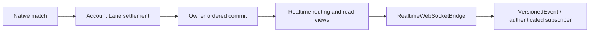

# Gateway WebSocket

WebSocket delivery shares Gateway's process and port 9094 at `/ws/v1`. It forwards Realtime/Core state, book/trade updates, prices, funding, and candles to clients connected to this node. It does not replay authoritative Core state from SQL history or add client fanout to the trading Owner hot path.

## Authentication and subscriptions

Send the session token in the first `authenticate` message, wait for `op=authenticated`, then request private channels. A browser that opens the socket with its HttpOnly session cookie may send `authenticate` without `token`; the handshake cookie is used. Never place tokens in URL query parameters. Session state comes from Valkey, so a revoked, expired or frozen session closes private connections on the next periodic check. Handshake identity headers or caller-provided user IDs are not proof of login.

```json
{"op":"authenticate","id":"a1","token":"<session-token>"}
```

```json
{"op":"subscribe","id":"c1","channel":"candles","symbol":"BTC-USDT","period":"1m"}
```

```json
{"op":"subscribe","id":"p1","channel":"positions","symbol":"BTC-USDT","productLine":"LINEAR_PERPETUAL"}
```

| Channel | Access | Input / semantics |
| --- | --- | --- |
| `candles` | Public | Symbol and period; complete candle updates |
| `index`, `mark` | Public | Symbol; product price events |
| `funding` | Public | Symbol; funding-rate events |
| `orders` | Authenticated | Optional symbol; Core ORDER frames |
| `triggerOrders` | Authenticated | Optional symbol; Core TRIGGER frames |
| `executionReports` | Authenticated | Optional symbol; Core EXECUTION frames |
| `positions` | Authenticated | Optional symbol; Core POSITION frames |
| `positionRisk` | Authenticated | Optional symbol; Core RISK frames |
| `accountRisk` | Authenticated | Wildcard user subscription to native risk objects |

Omitted private symbols subscribe to `*` for the authenticated user only. Product identity and user access remain isolated. C2C chat reuses this connection and its protected authorization path; see the C2C guide.

## State and version fences



Positions are published after accounting, not inferred from raw matching facts. `VersionedEvent(version, entityId, value)` and snapshot fences handle duplicates, out-of-order delivery, and reconnect. Trigger values retain PENDING/TRIGGERING entries and remove terminal entries. Establish a fresh user snapshot before relying on subsequent deltas after reconnect.

`positions` is account position state, not an independent live PnL calculator. Subscribe to `positionRisk` for authoritative mark, notional, unrealized PnL, maintenance margin, position margin, ratio, and status. `accountRisk` carries native risk objects to the wildcard user subscription; account aggregate risk is available through the existing HTTP API.

Native risk/order/position transport does not switch back to removed legacy Kafka events when realtime is disabled. Public price/funding/candle producers retain their configured product-specific Kafka fanout paths.

## Books, failures, and deployment

Validate snapshot/delta continuity and actual published depth. The corresponding Gateway book HTTP query reads the Realtime Valkey view and returns unavailable if missing/stale. Scale Gateway horizontally with per-node session/subscription state and explicit routing; do not share mutable WebSocket session objects across processes.

Source epoch changes, incomplete snapshots/commits, invalid/stale views, queue capacity, connection loss, and session revocation require explicit recovery or rejection. Preserve versions and product identity rather than merging events by local arrival time.

## Verification

```bash
mvn -pl surprising-gateway -am test
```

Live acceptance requires actual authenticated subscription, ready snapshot, Core execution/cancel/close, reservation release, reconnect/version handling, and user/product isolation. Compiling integration tests is not equivalent to running them.

## Architecture reference

See the [project architecture and class-level trading flows](../README.md). Historical validation notes describe their recorded versions, not guarantees for the current implementation.
