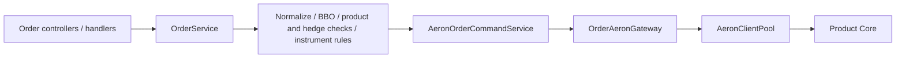

# Gateway and Unified Business Application

Gateway combines REST, WebSocket, authentication, administration, trading, account, and instrument services in one process and datasource. Core is a separate authoritative trading process. Default HTTP port is 9094; WebSocket path is `/ws/v1`.

| Package | Responsibility |
| --- | --- |
| `com.surprising.gateway.provider` | Identity, sessions, API routing, administration, approval, and audit |
| `com.surprising.trading` | Order/trigger/algo commands, validation, and query adapters |
| `com.surprising.account.provider` | Account commands, transfer workflows, and history queries |
| `com.surprising.instrument.provider` | Instrument catalog, configuration changes, and Core synchronization |
| `com.surprising.gateway.c2c` | C2C markets, escrow workflows, and protected settlement |

## Product containers and resources

Product registration is persisted and hot-loaded. Each business container isolates product connections, caches, consumers, and tasks. One command MediaDriver is shared by its account/order/trigger/maintenance pools; each pool retains its own source identity, mailbox, sessions, and budget. The container closes borrowed clients before the driver.

Startup probes reuse the real product container/pool. Only read-only not-yet-connected probes retry within the connection budget. Business response timeouts remain separate. Rejections, other failures, interruption, or shutdown stop probing. Failed containers release resources before later activation attempts.

## Order path



`OrderPlacementStateService.requireClosePosition` validates product, position mode, margin mode, and direction from consistent state before constructing reduce-only input. Core retains final reservation, margin, fee, and position authority. Batch requests finish local validation before submission. Explicit dry-run is separate from authoritative placement.

Normal orders, balances, positions, and trigger queries use Realtime views. Targeted order reads retrieve only the entity plus snapshot/watermark metadata. A missing active order can use the supported reliable terminal projection; an unavailable view does not trigger an arbitrary Core fallback. Command receipt/result queries are distinct from current-state queries.

## Service routes

| Route family | Target |
| --- | --- |
| Instrument, trading, trigger, account | Local business services |
| Trading order book | Local adapter over Realtime Valkey book views |
| Candles | Realtime, default 9095 |
| Index, FX, mark | Price, default 9082 |
| Risk, liquidation, funding, insurance, ADL | Lifecycle, default 9087 |
| Maker | Maker, default 9096 |
| Wallet | External configured wallet service; not started by default |

See controllers and route configuration for exact public/admin URLs and authorization. Internal service paths are not an alternative public authorization boundary.

## Security and administration

REST and WebSocket share trading authentication. Validate session/device state, MFA requirements, role/permission scopes, and product access. Open-platform API credentials use their own configured scopes, signature checks, and rate limits. Approval and audit requirements apply to protected administrative changes; a successful HTTP request must not bypass them.

Transfer orchestration retains persisted immutable intent and stable funds IDs. Unknown outcomes are reconciled with the original identity. C2C escrow uses actual Core balances, not a second SQL wallet. See [C2C](src/main/java/com/surprising/gateway/c2c/README.md).

Affiliate processing consumes committed fee facts. Identifiable team-relation errors are isolated and retried without discarding fees or blocking healthy teams. Identity conflicts and database failures still roll back. Confirmation progress cannot pass unresolved fee work; matured late fees use their original identities and occurrence times.

## Media and legal documents

Public media uses the dedicated `surprising-ex-public` R2 bucket, CDN `https://ex-cdn.tokdou.com`, and prefix `public/exchange/content/`. Private C2C/KYC attachments retain private access controls. Validate file type, signature, size, and references. Persist draft references transactionally; bounded cleanup removes only unreferenced expired uploads.

Real R2 credentials are an explicit external-configuration exception: `~/.config/surprising-ex/content-r2.env`, mode 0600. Inject `GATEWAY_CONTENT_R2_ACCESS_KEY_ID` and `GATEWAY_CONTENT_R2_SECRET_ACCESS_KEY` at runtime. Keep secrets out of committed YAML, examples, logs, and command arguments. See [deployment](../deployment/legal/README.md), [empty credential example](../deployment/content-r2.env.example), and [CORS policy](../deployment/content-r2.cors.json).

Legal revisions are immutable after publication. Registration/login/refresh confirm the actual current revision and reading language. New revisions require renewed acceptance; privacy acknowledgement does not grant unrelated optional permissions. Required unpublished documents return unavailable; published-but-unaccepted revisions require consent. Administrative approval requirements and user legal consent are different conditions.

## Build and verification

```bash
mvn -pl surprising-gateway -am test
```

Check authentication, product isolation, command outcome handling, stale-view behavior, approvals, audit, transfer reconciliation, WebSocket recovery, and affected UI contracts. Backend compilation alone does not establish browser/mobile interaction acceptance.

See [WebSocket contracts](README-websocket.md) and the root architecture for product-container and application boundaries.

## Architecture reference

See the [project architecture and class-level trading flows](../README.md). Historical validation notes describe their recorded versions, not guarantees for the current implementation.
