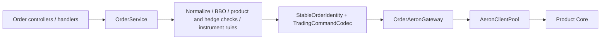

# Gateway and Unified Business Application

Gateway combines REST, WebSocket, authentication, administration, trading, account, and instrument services in one process and datasource. Core is a separate authoritative trading process. Default HTTP port is 9094; WebSocket path is `/ws/v1`.

| Package | Responsibility |
| --- | --- |
| `com.surprising.gateway.provider` | Identity, sessions, API routing, administration, approval, and audit |
| `com.surprising.trading` | Order/trigger/algo commands, validation, and query adapters |
| `com.surprising.account.provider` | Account commands, transfer workflows, and history queries |
| `com.surprising.instrument.provider` | Instrument catalog, configuration changes, and Core synchronization |
| `com.surprising.gateway.c2c` | C2C markets, escrow workflows, and protected settlement |

## Product containers and resources

Product registration is persisted and hot-loaded. Each business container isolates product connections, caches, consumers, and tasks. One command MediaDriver is shared by its account/order/trigger/maintenance pools; each pool retains its own source identity, mailbox, sessions, and budget. The container closes borrowed clients before the driver.

Startup probes reuse the real product container/pool. Only read-only not-yet-connected probes retry within the connection budget. Business response timeouts remain separate. Rejections, other failures, interruption, or shutdown stop probing. Failed containers release resources before later activation attempts.

## Order path



`OrderService.requireClosePosition` validates product, position mode, margin mode, and direction from consistent state before constructing reduce-only input. Core retains final reservation, margin, fee, and position authority. Batch requests finish local validation before submission. Explicit dry-run is separate from authoritative placement.

Normal orders, balances, positions, and trigger queries use Realtime views. Targeted order reads retrieve only the entity plus snapshot/watermark metadata. A missing active order can use the supported reliable terminal projection; an unavailable view does not trigger an arbitrary Core fallback. Command receipt/result queries are distinct from current-state queries.

## Service routes

| Route family | Target |
| --- | --- |
| Instrument, trading, trigger, account | Local business services |
| Trading order book | Local adapter over Realtime Valkey book views |
| Candles | Realtime, default 9095 |
| Index, FX, mark | Price, default 9082 |
| Risk, liquidation, funding, insurance, ADL | Lifecycle, default 9087 |
| Maker | Maker, default 9096 |
| Wallet | External configured wallet service; not started by default |

See controllers and route configuration for exact public/admin URLs and authorization. Internal service paths are not an alternative public authorization boundary.

## Security and administration

REST and WebSocket share trading authentication. Login issues one signed session token; its validity is the Valkey session (7-day sliding window, shorter for administrators) and the request path never reads Postgres. Validate session/device state, MFA requirements, role/permission scopes, and product access. Open-platform API credentials use their own configured scopes, signature checks, and rate limits. Approval and audit requirements apply to protected administrative changes; a successful HTTP request must not bypass them.

Transfer orchestration retains persisted immutable intent and stable funds IDs. Unknown outcomes are reconciled with the original identity. C2C escrow uses actual Core balances, not a second SQL wallet. See [C2C](src/main/java/com/surprising/gateway/c2c/README.md).

Affiliate processing consumes committed fee facts. Identifiable team-relation errors are isolated and retried without discarding fees or blocking healthy teams. Identity conflicts and database failures still roll back. Confirmation progress cannot pass unresolved fee work; matured late fees use their original identities and occurrence times.

## Media and legal documents

Public media uses the dedicated `surprising-ex-public` R2 bucket, CDN `https://ex-cdn.tokdou.com`, and prefix `public/exchange/content/`. Private C2C/KYC attachments retain private access controls. Validate file type, signature, size, and references. Persist draft references transactionally; bounded cleanup removes only unreferenced expired uploads.

Real R2 credentials are an explicit external-configuration exception: `~/.config/surprising-ex/content-r2.env`, mode 0600. Inject `GATEWAY_CONTENT_R2_ACCESS_KEY_ID` and `GATEWAY_CONTENT_R2_SECRET_ACCESS_KEY` at runtime. Keep secrets out of committed YAML, examples, logs, and command arguments. See [empty credential example](../deployment/content-r2.env.example) and [CORS policy](../deployment/content-r2.cors.json).

Legal revisions are immutable after publication. Registration/login confirm the actual current revision and reading language. New revisions require renewed acceptance; privacy acknowledgement does not grant unrelated optional permissions. Required unpublished documents return unavailable; published-but-unaccepted revisions require consent. Administrative approval requirements and user legal consent are different conditions.

## Build and verification

```bash
mvn -pl surprising-gateway -am test
```

Check authentication, product isolation, command outcome handling, stale-view behavior, approvals, audit, transfer reconciliation, WebSocket recovery, and affected UI contracts. Backend compilation alone does not establish browser/mobile interaction acceptance.

See [WebSocket contracts](README-websocket.md) and the root architecture for product-container and application boundaries.

## Architecture reference

See the [project architecture and class-level trading flows](../README.md). Historical validation notes describe their recorded versions, not guarantees for the current implementation.

## 鉴权与登录状态

- 浏览器/App 登录态只存 Valkey。JWT 仍保留；Web 仍使用 HttpOnly cookie 和 CSRF，App/API 可使用 Bearer，开放 API 可使用 HMAC API Key。普通身份校验不查询 PostgreSQL，也不从旧数据库会话恢复登录。
- 普通会话默认 7 天、管理员默认 8 小时滑动有效；同一会话至少间隔 10 分钟才续期。跨网关续期在 Valkey 内原子节流；已删除的会话不会被并发续期重新创建。登录业务事务提交后才创建会话。
- JVM 缓存默认新鲜 4 秒。Valkey 报错时，仅已缓存身份可在最后成功读取后最多 60 秒内继续使用，并短暂退避失败重试；未知身份、明确缺失的会话/用户不会回数据库兜底。失效通过 `auth:invalidate` 广播；广播漏收时靠短缓存到期收敛。Valkey 故障不是无限放行承诺。
- 活跃会话及设备资料来自 `auth:session:{id}`，全局/用户/到期索引分别为 `auth:sessions`、`auth:sessions:user:{uid}`、`auth:sessions:expiry`。列表按游标有界读取，每页最多 200 条；单用户最多 100 个活跃会话。后台会话列表只显示当前会话，`active=false` 返回空列表；过期/注销记录不当作可恢复会话保留。设备列表从这些活跃会话去重。
- 到期索引每秒最多清理 1000 项；存储故障会退避。创建会话时也有界清理该用户已失效的索引。注销、踢人和设备/IP 吊销会原子删除会话与索引并广播，不做全库扫描。
- Telegram 绑定不是 7 天网页会话。`auth:telegram:{subject}` 与仍有绑定用户的 `auth:user:{uid}` 均不设置自然到期时间；网关重启不会要求重新绑定。普通机器人消息/回调先校验 JVM→Valkey 身份和封禁状态，再进入业务处理；明确注册 `/start` 或通过验证的登录才允许进入持久绑定流程。解绑留撤销记录，不能靠 `/start` 自动复活。语言等业务设置仍可查数据库，但语言预热每用户每分钟最多一次，不作为身份回源。
- PostgreSQL 保留用户资料、角色权限、封禁、API Key 配置、Telegram 绑定以及真实业务设置。启动同步按每批 500 条读取持久配置，补齐 API Key、Telegram 绑定及其用户资料；撤销配置也会同步删除。它不读取、创建或恢复任何浏览器/App 会话；Valkey 数据丢失的网页/App 会话需重新登录。持久配置提交后的同步失败会显式报错并排队重试（每轮最多 100 项，故障时退避 5 秒），不靠普通身份请求回库；待重试队列在进程内，不是跨存储原子提交保证。
- `init.sql` 不再包含 `gateway_refresh_sessions` 或 `gateway_api_keys.last_used_at`。登录历史仍在 `gateway_login_logs`；注销/踢人等操作单独追加到 `gateway_session_operation_logs`，只含目标用户、操作、会话 ID 和时间，没有令牌或会话到期时间，也不混入登录成功统计。管理 API 的 `lastUsedAt` 响应字段保持为 `null`，不会触发请求时写库。
- 当前未上线，schema 直接以 `init.sql` 为准，不提供旧登录态兼容或升级脚本。修改初始化文件不等于已更改任何现有数据库；不要对已有数据自动执行删表/清库。

对应验证包括 `AuthStateTest`、`AuthStateStartupTest`、`LoginSessionRepositoryTest`、`TelegramIdentityStateTest`，以及 HTTP cookie/CSRF、API Key、WebSocket 和 Telegram 分发测试。`LoginSessionRepositoryTest` 启动并清理独立的临时 Valkey，不连接或清空现有实例。PostgreSQL 测试需要显式测试环境；部分旧测试会清空测试表，不能指向现有业务数据库。未进行完整生产登录、前端点击、性能基准或长稳验收。
