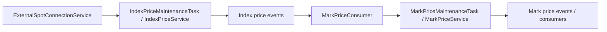

# Price Services

The API, consumer, and provider modules expose index prices, mark prices, FX, and option reference quotes. Price production is outside the Core trading owner. Every input and output remains product/instrument scoped.

## Source and class flow



Index computation validates source age, minimum valid sources, and outliers. External WS connections have their own idle/reconnect/refresh lifecycle. Mark computation uses the applicable index and market inputs, basis window, freshness rules, and clamp band. A stale real last trade must not acquire a new trade timestamp merely because a calculation runs again.

`ExchangeRateService` handles fiat/USDT bridges. `OptionQuoteService` provides reference quotes; these are not matching fills. Instrument snapshots and configuration versions govern calculation inputs.

## Configuration

Current defaults are in provider YAML and typed configuration. Notable settings include index poll interval, maximum source age, outlier threshold, minimum source count, WS reconnect budgets, coordination leases, mark publish interval, basis window, input age, and clamp ratio. A configured one-second period does not guarantee one-second output if a round itself takes longer.

Index/mark coordination prevents multiple instances from independently owning the same calculation lease. Kafka input concurrency and polling limits are resource settings, not business authority. Business settings persisted through administration are distinct from deployment settings.

## Operations and verification

Start Gateway first so instrument snapshots can load. Configure product-scoped Kafka, database, and external sources. Check freshness/sequence, source connection health, lease ownership, and rejected calculation inputs before interpreting missing output as a transport problem.

```bash
mvn -pl surprising-price/surprising-price-provider -am test
```

Use configuration and controllers under the provider source tree as the current API reference. Do not submit stale mark inputs to Core or silently use presentation decimals in financial execution.

## Architecture reference

See the [project architecture and class-level trading flows](../README.md). Historical validation notes describe their recorded versions, not guarantees for the current implementation.
