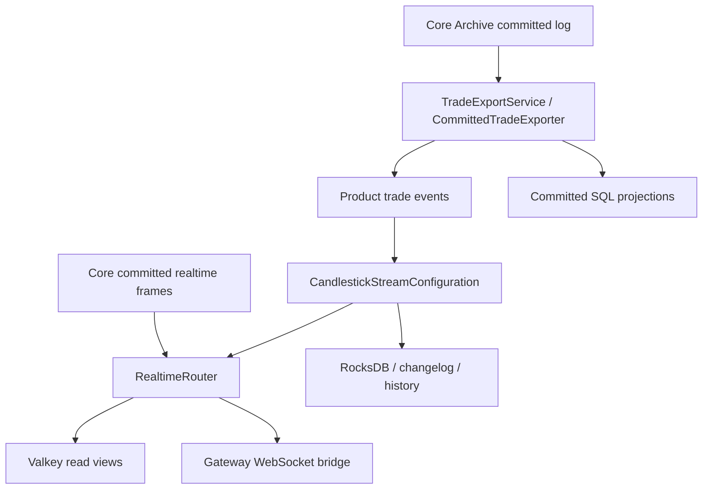

# Realtime, Committed Export, and Candles

The API and provider modules run committed trade export, candles, realtime routing, and query projections. Provider HTTP defaults to port 9095. Order-book HTTP is implemented in Gateway and reads Realtime's Valkey book view; there is no separate market-data provider.

## Data paths



Realtime frames are lossy and bounded. Validate complete commit/snapshot batches, source epochs, ordinals, and continuity before exposing views. Missing/stale/invalid views fail unavailable rather than reading unrelated SQL balances or falling back to Core.

The router performs Valkey/downstream transport work; Kafka Streams performs candle aggregation and nonblocking enqueue. Router queue overflow does not delete durable candle history. Shared JVM resources still share a failure domain.

## Reliable export and projections

Export reads committed Core state using Archive metadata and an independent checkpoint. Preserve checkpoint, product topic, transaction identity, and source watermarks across deployment. Exporter Core replay must collect actual matching completions, including batch results, before advancing.

Committed order, algorithm, trigger, trade, liquidation, funding, and portfolio projections are derived facts. Projection transactions and progress checks enforce source continuity. Recovery of a read model does not adjudicate online trading state. Targeted ordinary-order queries read the relevant Valkey entity and metadata; terminal history uses reliable committed projections where supported.

## Candles and units

`CandleUpdatedEvent` and `CandleStatus` are in realtime-api under `com.surprising.candlestick.api.model`. Complete 1m PARTIAL/CLOSED snapshots drive higher intervals. The active minute is replaced, then folded once across minute boundaries; deduplication prevents late CLOSED events from double counting. Historical corrections rebuild a bounded range without losing the current minute.

Linear-perpetual quantity conversion uses the instrument multiplier when producing base-asset public volume. Other products retain their contract-specific units. HTTP and WebSocket use the same complete OHLCV snapshot.

Each candle instance owns one product, Kafka Streams application ID, state directory, and database schema. Tables without a product column must not be shared across products. Topic creation follows current broker/deployment policy; changing defaults does not shrink existing partitions or delete history.

## Query behavior

Gateway book queries accept depths 1–100 but return at most 50 levels per side and report actual depth. Missing or older-than-five-second book views return 503. User queries retain source epoch, snapshot, freshness, invalid-state, and minimum-export-watermark checks.

## Startup and verification

Start Gateway and its shared application driver before enabling Router. Keep old database, Kafka application identity/changelog, exporter checkpoint, and Archive paths when migrating. `REALTIME_ENABLED=false` disables Router, not candle aggregation or candle HTTP.

`TRADE_EXPORT_ENABLED` enables reliable export. Export configuration must point to the same product Core member's cluster directory, Core Aeron directory, and Archive control channel, not the application MediaDriver directory. See provider configuration for checkpoint, cluster ID, and optional Kafka security settings.

```bash
mvn -pl surprising-realtime/surprising-realtime-provider -am test
```

Validate actual source gaps, restart, snapshots, stale reads, SQL transactions, deduplication, and product/user isolation. Compile-only evidence must not be reported as live delivery acceptance.

## Architecture reference

See the [project architecture and class-level trading flows](../README.md). Historical validation notes describe their recorded versions, not guarantees for the current implementation.
